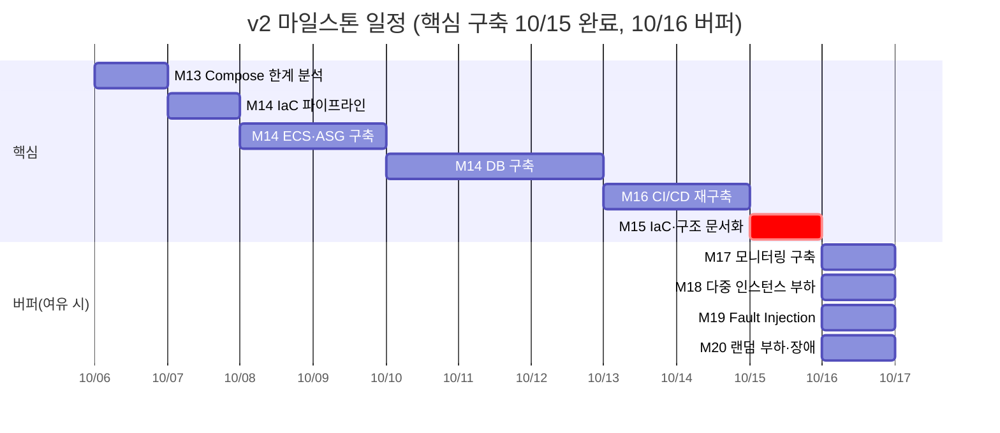

# 다먹자 v2 구현 계획 (2026-10-06 ~ 2026-10-16)

> **2026-10-08 변경**: v2 dev를 ECS 인스턴스 1대(nginx·FE·BE·Redis)+기존 dev DB로 만들고, ALB·2AZ·DB 이중화는 v2 prod에서 처음 구축하기로 함([구현 기록 I6](../implementation/v2%20구현%20기록.md)). 아래 날짜별 작업표는 이 결정 전 기준이라 다시 정리가 필요합니다.

> 작성일: 2026-10-06 · 수정: 2026-10-07(IaC 배포 파이프라인 선행, 버퍼 하루 사용) · 원본: [Claude Doc](https://claude.ai/code/artifact/5bea82b8-2e1e-4efb-b0d8-c2df455bde50)

## 요약

10/6(화)부터 10/16(금)까지 주말과 한글날을 포함한 11일 동안 v2 아키텍처(ECS EC2 + ASG + ALB, 자체구축 MySQL Multi-AZ + Read Replica, Redis, S3, ECS Native Blue/Green)를 dev에 IaC로 올리고, 그 위에서 M13~M16을 우선 달성합니다. 10/15까지 한계 분석, IaC 배포 파이프라인, ECS·ASG 구축, DB 구축, CI/CD 재구축, 문서화(M13~M16)를 끝내고, 10/16 버퍼에 밀린 작업이 없으면 모니터링 확장(M17)과 부하·장애 테스트(M18~M20)를 진행합니다.

- **기준 문서**: v2는 `docs/design/wiki/ktb4-cloud-wiki-v2.md`(15~24번), v1은 같은 폴더의 `ktb4-cloud-wiki-v1.md`, CI/CD는 `ktb4-cloud-wiki-ci.md`, `ktb4-cloud-wiki-cd.md`입니다.
- **원칙**: v2에 결론이 있으면 v2를, 없으면 v1 결론을 그대로 씁니다. 리전은 서울(ap-northeast-2), 새 리소스 이름은 dameokja입니다.
- **IaC 도구**: v2에 언급이 없어 v1에서 이미 쓰고 있는 CloudFormation(`infra/monitoring`, `infra/discord-alerts`)을 그대로 씁니다.
- **적용 순서**: v2 스택은 환경 파라미터로 만들어 dev에 먼저 적용합니다. prod 전환은 M20 결과를 보고 따로 정합니다.
- **배포 방식**: 모든 v2 스택은 로컬에서 직접 배포하지 않고 GitHub Actions 파이프라인으로만 적용합니다(PR → change set 미리보기 댓글, main 머지 → 적용). 근거는 `docs/implementation/v2 구현 기록.md` I3.

## 구현 기준: v2 결정과 v1에서 유지하는 것

컴퓨트, DB, 배포는 v2를 따르고 이미지, 태그, 컨테이너 설정, 모니터링 도구는 v1을 그대로 씁니다.

| 영역 | v2 결정 (구현 대상) | v1에서 그대로 유지 | 구현 메모 |
| --- | --- | --- | --- |
| 컴퓨트 | ECS EC2 launch type + ASG(Capacity Provider), AZ 2곳 이상, Task 1개 = nginx+FE+BE (18, 20번) | dev는 t 시리즈(t4g 유지 또는 t3), non-root 실행, prod restart 의도 | prod는 CPU 크레딧이 없는 m 시리즈 사용. 부하가 길어지면 크레딧 소진으로 성능이 떨어지는 t 시리즈는 prod 안정성에 맞지 않음. 크기는 M18 결과로 확정 |
| 진입점 | ALB 1대, Blue/Green 타겟 그룹 2개 (20, 23번) | nginx 설정(`/` → FE, `/api` → BE), HTTPS 리다이렉트 | TLS는 ALB(ACM)에서 종료하고 certbot 마운트는 빠집니다 |
| 오토스케일링 | Target Tracking 상시 + 저녁 Scheduled Scaling, min=평시 RPS N+1, max=Peak RPS 95 (20번) | - | ECS Service(태스크 수)와 Capacity Provider(인스턴스 수) 두 층을 모두 설정 |
| 애플리케이션 상태 | JWT + Refresh Token(Redis, RTR), 프로필 사진 S3 (17번) | - | BE 코드에 아직 Redis, S3, SSE가 없음(BE 저장소 확인). 인프라는 엔드포인트와 IAM만 제공 |
| 알림 | SSE + Push + Catch-up, Redis Pub/Sub 브로드캐스트 (21번) | - | ALB idle timeout을 SSE 연결에 맞게 늘립니다 |
| DB | 기존 MySQL(Primary)에 Standby(다른 AZ, 준동기)와 Read Replica 2대(AZ 2곳, 비동기)를 추가하는 이중화, RDS 이전과 데이터 이전은 없음, Orchestrator 1대(구현 중 CPU·메모리 사용률을 보고 필요하면 2대로 확장), VIP/DNS 리다이렉션 (19, 22번) | EC2 직접 구축, private subnet, EBS 영속 + 백업, SG 3306은 앱 SG만 | DNS는 Route 53 private hosted zone으로 둡니다 |
| Redis | 단일 인스턴스, 이중화 없음 (22번) | - | 형태는 v2에서 미정. ElastiCache cache.t4g.micro 단일 노드를 기본으로 잡음 |
| CI | GitHub Actions 유지, 기본 러너 (23번) | GHCR, Git SHA 태그 + digest 배포 | 변경 없음 |
| CD | GitHub Actions → ECS Native Blue/Green, 알람 연동 자동 롤백 (23번) | Discord 배포 알림 | SSH 배포(`deploy-v1.sh`)는 폐기. GitHub OIDC 역할로 AWS 접근 |
| 시크릿 | 범위 제외, 단 새 인스턴스 주입 방식은 23번에서 정리 필요 (15번) | GitHub Secrets, Discord 웹훅은 Secrets Manager | 런타임 env는 Task Definition `secrets`(SSM Parameter Store)로 주입 |
| 관측성 | CloudWatch로 ALB, ECS, DB, Redis, S3 전체 (18번) | CloudWatch Agent, 지표 필터 + Metric Math SLO 알람, Actuator Prometheus, Alarm → SNS → Lambda → Discord | v2는 모니터링 대상 범위(AWS 리소스 전체)만 정했고 세부 지표·알림·대시보드는 정하지 않음(15, 18번에서 22~24번으로 넘겼지만 22~24번에 내용 없음). 그래서 v1에서 구현한 CloudWatch 구성을 그대로 쓰고, ECS·ALB·DB·Redis로 넓히는 작업은 버퍼에서 진행. PLG는 쓰지 않음 |
| 범위 제외 | Dev 데이터 안정성, 시크릿 로테이션, AZ 전체 장애 시 DB, Redis 이중화 | v1 상태 유지 | k8s는 v3 범위 |

## 마일스톤 매핑

M13은 10/6, M14는 IaC 파이프라인·ECS·ASG 구축(10/7~10/9)과 DB 구축(10/10~10/12)으로 나누고, M16은 10/13~10/14, M15 문서화는 10/15에 마칩니다. 10/7에 IaC 배포 파이프라인을 먼저 만들기로 하면서(2026-10-07 결정) 이후 일정을 하루씩 밀고 버퍼를 하루 썼습니다. M17~M20은 우선순위가 낮아 버퍼(10/16)에 여유가 있을 때만 진행합니다. 모니터링은 v1 CloudWatch 구성이 이미 동작하고 있어 미뤄도 됩니다.

| 마일스톤 | 산출물 (CLOUD 저장소) | 완료 기준 |
| --- | --- | --- |
| M13 한계 분석 | `docs/design/v1 한계 분석.md`(실제 파일: [v1 Compose 한계 분석 및 ECS 전환 검토.md](v1%20Compose%20한계%20분석%20및%20ECS%20전환%20검토.md)) | v1 한계 8개마다 측정 근거(10/4 부하 테스트, 메모리 예산)와 해결하는 v2 섹션 연결 |
| M14 ECS·ASG 구축 | `infra/v2` network, ecs, service 스택, IaC 배포 워크플로(`infra-v2-cfn.yml`)와 OIDC 부트스트랩 스택 | 2AZ에서 Task 서비스, ASG 대체 동작, 오토스케일링 정책 적용 |
| M14 DB 구축 | `infra/v2` data 스택, Orchestrator 설정 | Standby·Replica 2대 복제 정상, 수동 failover 1회 성공, BE 읽기·쓰기 분리 동작. 무중단 마이그레이션(선택)은 v2 범위 밖이라 하지 않음 |
| M15 IaC·문서화 | `docs/design/v2 구축 기록.md`(실제 파일: [v2 구현 기록.md](../implementation/v2%20구현%20기록.md)), `docs/README.md` | 문서에 적힌 리소스와 실제 스택이 일치 |
| M16 CI/CD 재구축 | BE, FE `v2-cicd.yml`, GitHub OIDC 역할, 롤백용 CloudWatch 알람 | Blue/Green 배포 1회, 알람 기반 자동 롤백 1회 |
| M17 모니터링 구축 (버퍼 시) | `infra/monitoring` v2 템플릿 | v1 CloudWatch 구성을 ECS에 맞춰 옮기고 ALB, ECS, DB, Redis 지표를 한 대시보드로, 알람은 Discord로 수신 |
| M18 부하 테스트 (버퍼 시) | k6 v2 시나리오와 결과 문서 | 인스턴스당 RPS, Peak 95 RPS에서 SLO 충족 여부, 스케일 아웃 소요 시간 |
| M19 Fault Injection (버퍼 시) | 장애 시나리오 결과 문서, FIS 실험 템플릿 | 시나리오별 탐지, 복구 시간 |
| M20 랜덤 테스트 (버퍼 시) | 랜덤 부하·장애 결과 문서 | 무작위 장애 중 SLO(가용성 99.9%) 영향과 복구 시간 |

테스트 코드와 실행 스크립트는 기존 방식대로 로컬에만 두고, 저장소에는 템플릿과 결과 문서만 올립니다.

## 날짜별 작업 계획

구축은 IaC 배포 파이프라인 → 네트워크 → ECS → DB → CD 순서로 쌓되 콘솔에서 만들지 않고 처음부터 CloudFormation 템플릿을 PR로 적용해, M14 구현이 곧 M15의 IaC 업데이트가 되게 합니다. M15 문서화는 구축이 끝난 10/15에 실제 스택 기준으로 정리합니다. 각 날의 완료 기준을 통과해야 다음 날로 넘어갑니다. 10/9(금)는 한글날이지만 주말과 함께 작업일로 잡고, 오래 걸릴 DB 구축에는 사흘(10/10~10/12)을 줍니다. 10/16 하루(원래 10/15~10/16 이틀, 10/7 파이프라인 선행으로 하루 사용)는 밀린 작업을 먼저 흡수하고, 남으면 M17 → M18 → M19 → M20 순으로 진행하는 버퍼로 둡니다.

| 날짜 | 마일스톤 | 작업 | 완료 기준 (산출물) |
| --- | --- | --- | --- |
| 10/6 (화) | M13 완료, M15 준비 | v1 한계를 근거와 함께 정리: SPOF, 고정 대수, 메모리 예산 2.2GiB vs 2GiB, 배포 중 중단(10/4 부하 테스트 22:25:13 CSRF 502). CloudFormation 스택 분할 구성(network / data / ecs / service / monitoring) | `docs/design/v1 한계 분석.md` 완성, 스택 목록과 파라미터 정의 |
| 10/7 (수) | M14 IaC 파이프라인 | GitHub OIDC 부트스트랩 스택(plan / deploy / CloudFormation 실행 역할) 수동 배포, 저장소 Variables 등록, `infra-v2-cfn.yml`(PR → change set 미리보기 댓글, main 머지 → 적용). network 스택 서브넷 4개만 담은 첫 PR | PR 미리보기 댓글, 머지 후 스택 생성, Discord 알림 수신 |
| 10/8 (목) | M14 ECS·ASG | network 스택 나머지(PR로 적용): NAT 1개, SG(ALB / app / DB / Redis), ALB + ACM + 타겟 그룹 2개(Blue/Green), S3 버킷, Redis | 스택 배포 성공, ALB DNS 응답 |
| 10/9 (금, 한글날) | M14 ECS·ASG | ECS 클러스터 + Capacity Provider(ASG 2AZ, ECS 최적화 AMI, Launch Template, dev는 t 시리즈). Task Definition(nginx+FE+BE, memory/memoryReservation), SSM 파라미터 주입, Service를 ALB에 연결. Target Tracking + 저녁 Scheduled Scaling | dev 도메인으로 2개 AZ에서 응답, 인스턴스 수동 종료 시 ASG가 대체, Task 수를 늘리면 인스턴스 수가 따라감 |
| 10/10 (토) | M14 DB | 기존 DB를 Primary(AZ-a)로 두고 Standby(AZ-b, 준동기 복제)와 Read Replica 2대(AZ-a, AZ-b, 비동기) EC2를 CloudFormation으로 추가. 백업으로 초기 데이터를 적재한 뒤 복제 연결 | Standby와 Replica 2대 복제 정상, 준동기 상태 확인 |
| 10/11 (일) | M14 DB | Route 53 private zone 레코드(`db-write`, `db-read`). Orchestrator 1대 구성(CPU·메모리 사용률 기록)과 승격 훅(DNS 갱신, 기존 Primary read_only) | 수동 failover 1회 성공, 승격 뒤 Replica 2대가 새 Primary를 따라감 |
| 10/12 (월) | M14 DB | BE 연결을 `db-write`/`db-read`로 바꾸고 읽기를 Replica 2대로 분산. DB SG는 ECS Task SG에서 오는 3306만 허용, EBS 스냅샷 백업 확인 | BE가 쓰기·읽기 엔드포인트로 정상 동작, failover 뒤 BE 재연결 확인 |
| 10/13 (화) | M16 | 부트스트랩 스택에 앱 배포용 OIDC 역할 추가, BE/FE 워크플로의 CD를 ECS Native Blue/Green으로 교체(새 Task Definition 등록 → update-service) | dev에 Blue/Green 배포 1회 |
| 10/14 (수) | M16 | 자동 롤백에 필요한 CloudWatch 알람(ALB 5xx, 타깃 헬스)만 만들어 연결, Discord 배포 알림 유지, 배포 중 무중단 확인 | 일부러 깨뜨린 이미지의 자동 롤백 1회, 배포 중 k6 에러 0 |
| 10/15 (목) | M15 | 확장된 구조 문서화(실제 스택 기준): `infra/v2` 템플릿 구성, 파라미터, 배포 순서와 파이프라인. v2 위키와 README 갱신 | `docs/design/v2 구축 기록.md`, 문서의 리소스와 실제 스택 일치 |
| 10/16 (금) | 버퍼 | 밀린 작업 마무리. 남으면 M17 → M18 → M19 → M20 순. M17은 Container Insights, 로그를 ECS 로그 그룹으로 옮기고 지표 필터 재연결, ALB / ECS / DB / Redis 대시보드와 알람. M18은 m 시리즈로 인스턴스당 처리량 측정 후 Peak RPS 95까지, M19는 v2 22번 장애 시나리오를 AWS FIS로 실행. 마지막에 비용 리소스 축소 | (선택) 단일 대시보드, 인스턴스당 RPS, 시나리오별 탐지·복구 시간 |

BE 파트 선행 작업은 10/8까지 요청해 둡니다: DB 읽기/쓰기 엔드포인트 분리, Redis RTR, S3 업로드, SSE + Catch-up. 준비되지 않으면 현재 이미지로 구축과 테스트를 진행하고 해당 항목은 결과 문서에 미검증으로 남깁니다.

## 리스크와 우선순위

핵심은 10/15까지의 구축(M13~M16)이고, 모니터링 확장(M17)과 M18~M20 테스트는 버퍼에 여유가 있을 때만 진행합니다.

| 리스크 | 영향 | 대응 |
| --- | --- | --- |
| DB 구축(Standby 1대 + Replica 2대 + Orchestrator)이 가장 크고 낯선 작업 | 이후 일정 전체 밀림 | 사흘(10/10~10/12)을 주고, 넘치면 버퍼를 먼저 씀. Orchestrator가 늦어지면 수동 승격 절차로 먼저 닫고 자동화는 이어서 진행 |
| ECS Native Blue/Green은 2025년 7월 출시라 자료가 적음 (23번 트레이드오프) | M16 지연 | 이틀(10/13~10/14)을 주고, 막히면 ECS 기본 rolling + 헬스체크로 우선 배포하고 트러블슈팅 문서로 남김 |
| ECS로 옮기면 v1 SLO 지표 필터가 읽던 호스트 로그 경로가 바뀜 | M17 전까지 v2 환경의 SLO 알람이 비어 있음 | M17을 버퍼의 첫 작업으로 두고, 그동안은 ALB·ECS 기본 지표와 롤백용 알람으로 확인 |
| BE에 Redis, S3, SSE, 읽기/쓰기 분리가 아직 없음 | 10/12 BE 읽기 분리와 장애 테스트에서 실제 영향을 못 봄 | 인프라 측 동작만 검증하고 애플리케이션 영향은 미검증으로 기록 |
| M17~M20을 버퍼에서만 진행 | 마일스톤 미달 가능 | 버퍼가 부족하면 M17과 M18(단계 상승 1회)만 축소 실행하고 나머지는 결과 문서에 미실행으로 기록 |
| CCU 7,200 아침 버스트를 로컬 k6로 재현하기 어려움 | M18 결과 신뢰도 | k6를 같은 리전 EC2에서 실행하고 필요하면 러너를 2대로 나눔 |
| NAT, ALB, 복제 DB, 다중 인스턴스로 비용 증가 | 예산 초과 | NAT는 1개만 두고, 작업을 마친 뒤 ASG min과 DB 인스턴스를 축소 |

**우선순위**: M13 → M14 IaC 파이프라인 → M14 ECS·ASG → M14 DB → M16 → M15 순으로 10/15까지 끝내고, 버퍼(10/16)에 여유가 있으면 M17 → M18 → M19 → M20 순으로 진행합니다. DB 무중단 마이그레이션은 v2에서 하지 않습니다. 모니터링은 PLG 대신 v1에서 구현한 CloudWatch를 그대로 씁니다.

## 실제 진행과 달라진 점

> 기준: 2026-11-02. 이 문서는 2026-10-06 계획이며, 실제 경과는 CLOUD 이슈·PR과 [v2 환경별 구축 아키텍처](v2%20환경별%20구축%20아키텍처.md)에 있다.

- **dev 구성**: dev를 prod와 같은 구조로 만드는 대신 ECS 인스턴스 한 대로 만들고(2026-10-08 결정), prod와 같은 구조는 stage 환경을 새로 만들어 검증했다(#57).
- **DB 이중화**: 계획한 10/10~10/12에 하지 않고 v2 prod 전환(10/19) 뒤 #120으로 진행했다. Read Replica 1·2대로 읽기 분산 한계를 재고(#145·#169), Standby·Orchestrator로 장애 주입 테스트 5개를 통과한 뒤 비용 때문에 내렸다(#173·#203).
- **앱 Task**: nginx+FE+BE 한 Task로 시작했다가 stage·prod에서 backend·frontend 서비스로 나누고 nginx를 없앴다(#147).
- **앱 서버 AZ**: 2AZ 계획과 달리 앱·DB·Redis를 2b 한 곳에 두었다. 앱 다중 AZ는 DB 이중화와 함께 적용할 항목이다(#57, [의사결정 근거 20번](인프라%20설계%20의사결정%20근거.md#20-auto-scaling-전략-설계)).
- **Redis**: ElastiCache 대신 EC2 자체 구축(#57).
- **모니터링(M17)**: v1 지표 필터 방식 대신 ALB 지표·액세스 로그(Athena)로 다시 구성했다(#71·#147).
- **부하·장애 실험(M18~M20)**: DB 한계 부하와 수동 장애 주입 5개(`tests/DB HA/결과.md`)는 했고, FIS 실험과 M20 결과는 저장소에 없다.
- **v2 종료(2026-11-04~11-10)**: dev·stage·prod를 차례로 v3(EKS)로 옮기고 v2 앱 자원을 지웠다. prod 네트워크(VPC·서브넷·NAT)만 v3가 쓰도록 남겼다(#321). 경과는 [v2 환경별 구축 아키텍처](v2%20환경별%20구축%20아키텍처.md)에 있다.
