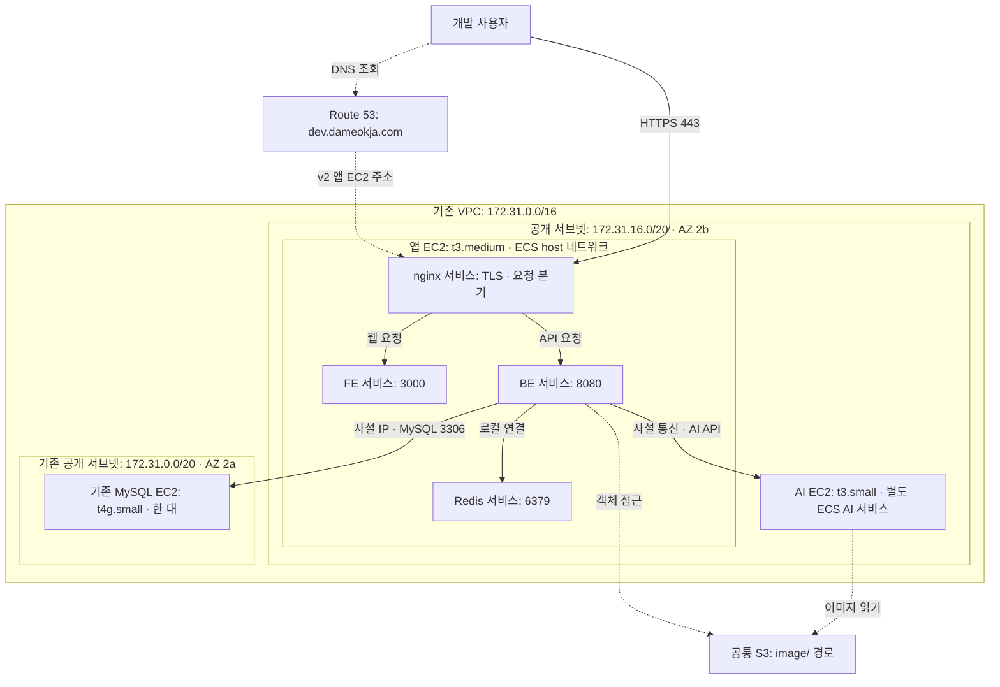
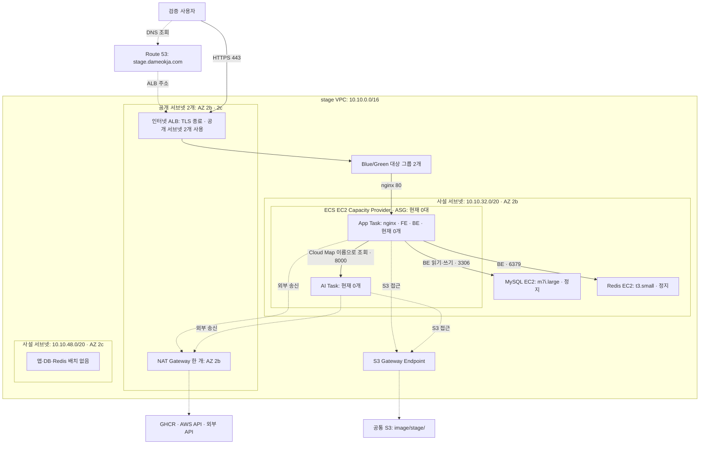
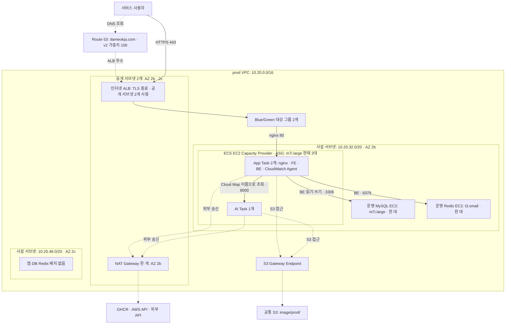
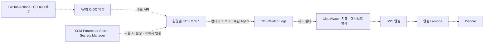

# v2 환경별 구축 아키텍처 — dev · stage · prod

> 조회 기준: **2026-10-22 16:18 KST**, AWS 계정 `906462447513`, 서울 리전 `ap-northeast-2`.
> 이 문서는 실제 구축 상태를 나타낸다. [v2 목표 설계](wiki/ktb4-cloud-wiki-v2.md)의 DB 이중화·Read Replica·Orchestrator 계획과 구분한다.

## 1. 환경별 차이부터 보기

| 구분 | dev | stage | prod |
| --- | --- | --- | --- |
| 용도 | 개발 기능 확인 | 운영 전 검증 | 실제 서비스 |
| 진입 주소 | `dev.dameokja.com` | `stage.dameokja.com` | `dameokja.com` |
| DNS 대상 | 앱 EC2 공개 주소 | stage ALB | prod ALB, v2 가중치 100 |
| VPC | 기존 `172.31.0.0/16` 재사용 | 전용 `10.10.0.0/16` | 전용 `10.20.0.0/16` |
| TLS 처리 | 앱 EC2의 nginx | ALB·ACM 인증서 | ALB·ACM 인증서 |
| 앱 배포 단위 | nginx·FE·BE·Redis 각각 별도 ECS 서비스 | nginx·FE·BE를 App Task 하나로 묶음 | nginx·FE·BE·CloudWatch Agent를 App Task 하나로 묶음 |
| 태스크 네트워크 | 호스트 네트워크 공유 | 태스크별 사설 IP | 태스크별 사설 IP |
| AI | 별도 EC2의 ECS 서비스 | 같은 ECS 클러스터의 별도 서비스 | 같은 ECS 클러스터의 별도 서비스 |
| Redis | 앱 EC2의 ECS 컨테이너 | 별도 사설 EC2 | 별도 사설 EC2 |
| MySQL | 기존 별도 EC2 재사용 | 별도 사설 EC2 한 대 | 별도 사설 EC2 한 대 |
| 앱 배포 방식 | Rolling | ECS Blue/Green | ECS Blue/Green |
| 조회 당시 상태 | 서비스 5개 모두 각 1개 실행 | 앱·AI 0개, 앱 ASG 0대, DB·Redis 정지 | App Task 2개, AI Task 1개, 앱 EC2 2대 실행 |

**그림 읽는 법:** 실선은 서비스·데이터 요청 경로, 점선은 DNS 해석·스케줄링·외부 송신 등 보조 경로다. DNS는 요청을 대신 전달하는 프록시가 아니며, 실제 HTTPS 요청은 사용자가 해석된 주소로 직접 보낸다. stage 그림은 구성된 자원 간 관계를 나타내며, 조회 당시 요청을 처리하고 있다는 뜻은 아니다.

## 2. dev — 공개 EC2 기반의 개발 환경

### 2.1. 실제 배치

| 자원 | 확인한 상태 |
| --- | --- |
| 앱 서버 | `dameokja-dev-v2`, `t3.medium`, AZ 2b, nginx·FE·BE·Redis 서비스 각 1개 |
| AI 서버 | `dameokja-dev-v2-ai`, `t3.small`, 앱 서버와 같은 공개 서브넷, AI 서비스 1개 |
| DB 서버 | `dameokja-v2-dev-DB`, `t4g.small`, AZ 2a, 사설 주소 `172.31.4.192` |
| ECS 클러스터 | `dameokja-dev`, 개별 서비스 5개, 모두 `host` 네트워크 |
| DNS | `dev.dameokja.com` v1 가중치 0 / v2 100. `v2.dameokja.com`도 같은 v2 앱 EC2 주소를 가리킴 |

dev 스택에는 ALB·NAT Gateway·ASG가 없다. EC2 공개 주소로 들어온 요청을 nginx가 FE와 BE에 나누고, FE·BE·Redis는 같은 호스트의 포트로 통신한다. 앱·AI는 dev 스택이 관리하지만, 기존 VPC·서브넷·DB EC2 전체를 새로 만드는 구성은 아니다. DB는 공개 주소를 가진 서브넷에 있으며, 그림의 사설 연결선은 DB가 사설 서브넷에 있다는 뜻이 아니다.

dev의 이미지 prefix 기본값은 IaC 기준 `image/`이다. stage·prod의 `image/stage/`, `image/prod/`보다 넓은 범위이므로 세 환경의 접근 범위가 완전히 격리돼 있다고 해석하면 안 된다. S3는 환경별로 새 버킷을 만드는 방식이 아니라 기존 버킷을 재사용한다.

## 3. stage — ALB와 사설 ECS를 사용하는 검증 환경

> **조회 당시 정지 상태:** App·AI 서비스의 실행 목표와 실제 태스크가 모두 0개이고, 앱 ASG도 0대다. DB·Redis EC2는 정지돼 있다. ALB는 남아 있으며 DNS도 ALB를 가리킨다.

### 3.1. 요청과 배포 경로

1. ALB가 HTTPS를 종료하고 Blue/Green 대상 그룹을 통해 App Task의 nginx로 요청을 전달한다.
2. 같은 App Task의 nginx가 웹 요청은 FE `3000`, API 요청은 BE `8080`으로 나눈다. 세 컨테이너는 태스크 네트워크를 공유한다.
3. BE는 별도 DB·Redis EC2에 연결한다. AI는 같은 클러스터의 별도 태스크이며 `ai.stage.dameokja.internal:8000`으로 찾는다.
4. 일반 외부 송신은 NAT, S3 송신은 Gateway Endpoint를 사용하는 경로가 구성돼 있다. NAT는 사용자 요청의 진입점이 아니다.

### 3.2. 실제 배치와 정지 상태

| 자원 | 구성·조회 결과 |
| --- | --- |
| 공개 서브넷 | `10.10.0.0/20` AZ 2b, `10.10.16.0/20` AZ 2c. ALB가 둘 다 사용 |
| 앱·AI 서브넷 | `10.10.32.0/20`, AZ 2b 한 곳으로 제한 |
| 앱 ASG | 현재 최소 0·목표 0·최대 4. IaC 기본 최소는 2이므로 정지 운영값과 구분 |
| 서비스 | App 목표·실행 `0/0`, AI 목표·실행 `0/0` |
| DB | `dameokja-stage-db`, `m7i.large`, `10.10.41.4`, 같은 AZ 2b 사설 서브넷, 정지 |
| Redis | `dameokja-stage-redis`, `t3.small`, `10.10.40.126`, 같은 AZ 2b 사설 서브넷, 정지 |
| 사용하지 않는 서브넷 | `10.10.48.0/20`, AZ 2c. DB Standby·Read Replica는 현재 구성돼 있지 않음 |

DB 한 대와 Redis 한 대를 EC2로 운영한다. ALB의 두 AZ 구성을 앱·DB의 다중 AZ 배치로 해석하면 안 된다. stage를 켜면 태스크 수와 ASG 목표가 바뀔 수 있으므로 이 문서의 0개는 조회 시점의 상태다.

## 4. prod — 운영 트래픽과 자체 구축 DB를 사용하는 환경

### 4.1. 실제 배치

| 자원 | 확인한 상태 |
| --- | --- |
| 공개 서브넷 | `10.20.0.0/20` AZ 2b, `10.20.16.0/20` AZ 2c. ALB가 둘 다 사용 |
| 앱 ASG | 최소 2·목표 2·최대 4, 실제 `m7i.large` 2대. 모두 AZ 2b 사설 서브넷 |
| App 서비스 | `dameokja-prod-app`, 목표·실행 `2/2`, `awsvpc`, Blue/Green |
| App Task 구성 | nginx·FE·BE·CloudWatch Agent. 조회 당시 태스크 정의 `dameokja-prod-app:11` |
| AI 서비스 | `dameokja-prod-ai`, 목표·실행 `1/1`, `awsvpc`, Rolling. 내부 주소 `ai.prod.dameokja.internal:8000` |
| DB | `dameokja-prod-db`, `m7i.large`, `10.20.33.212`, AZ 2b, 실행 중 |
| Redis | `dameokja-prod-redis`, `t3.small`, `10.20.35.176`, AZ 2b, 실행 중 |
| 사용하지 않는 서브넷 | `10.20.48.0/20`, AZ 2c. DB Standby·Read Replica는 현재 구성돼 있지 않음 |

prod는 10월 19일 v1 DB에서 데이터를 이전한 v2 DB를 사용한다. 과거 이전용 GTID 복제를 현재의 상시 DB 이중화로 표현하지 않는다. 환경 이전 과정과 장애는 [운영 전환 결과](../implementation/v2%20prod%20전환%20결과.md)를 참고한다.

### 4.2. 확장과 배포를 구분하기

- **태스크 확장:** App 서비스에는 CPU 목표 60%, 태스크 최소 2·최대 4의 정책이 IaC에 정의돼 있다.
- **호스트 확장:** 태스크가 올라갈 EC2 용량은 Capacity Provider와 ASG가 관리한다. 조회 당시 호스트 2대와 App Task 2개가 있다고 해서 항상 호스트당 App Task 1개로 고정된다는 뜻은 아니다.
- **Blue/Green:** 새 App Task를 준비하고 ALB의 대상 그룹을 전환한다. 두 대상 그룹이 있다는 사실을 평상시 App Task를 각각 2개씩, 총 4개 운영한다는 뜻으로 읽으면 안 된다.
- **AI 배포:** 별도 서비스의 Rolling 배포다. App 서비스의 Blue/Green과 구분한다.

## 5. 공통 관리·관측 경로

| 대상 | 현재 방식 |
| --- | --- |
| dev 로그·앱 지표 | 앱 호스트의 CloudWatch Agent가 nginx·BE 로그와 앱 지표를 수집, `/dameokja/dev/*`. 태스크 정의에는 `awslogs` 드라이버를 쓰지 않으며 AI 로그 수집은 이번에 확인하지 않음 |
| stage 로그 | `awslogs` → `/dameokja/stage/{nginx,frontend,backend,ai}` |
| prod 로그 | `awslogs` → `/dameokja/v2-prod/{nginx,frontend,backend,ai}`. App Task에 CloudWatch Agent 컨테이너도 포함 |
| 모니터링 스택 | `dameokja-stage-monitoring`, `dameokja-v2-prod-monitoring`이 배포돼 있음 |
| 설정 | `/dameokja-v2-dev/*`, `/dameokja-v2-stage/*`, `/dameokja-v2-prod/*`를 태스크 기동 시 주입 |
| 이미지 저장소 | GHCR. stage·prod 태스크는 비공개 네트워크에서 NAT 경유로 외부 레지스트리에 접근 |
| S3 | 공통 기존 버킷 `dameokja-906462447513-ap-northeast-2-an` 재사용. IaC 기본 prefix는 dev `image/`, stage `image/stage/`, prod `image/prod/`. stage·prod VPC에는 S3 Gateway Endpoint 존재 |

이 그림은 관리·관측 관계를 묶어 표시한 것이다. 세 환경이 모두 같은 모니터링 스택·같은 수집 방식을 사용한다는 뜻은 아니다. 다먹자에 연결된 CloudFront 배포는 이번 계정 조회에서 확인되지 않아 환경 진입 경로에 그리지 않았다.

## 6. 목표 설계와 현재 구축의 차이

| 설계 항목 | 현재 구축 | 문서를 읽을 때의 주의점 |
| --- | --- | --- |
| MySQL Primary·Standby·Read Replica | stage·prod는 각각 DB EC2 한 대 | 목표의 DB 4대를 실제 운영 자원처럼 그리지 않음 |
| DB 자동 장애 조치 | 해당 스택에 Orchestrator·ProxySQL 자원 없음 | 수동 이전 작업을 상시 자동 승격으로 해석하지 않음 |
| 다중 AZ | stage·prod ALB·서브넷은 AZ 2b·2c, 현재 앱·DB·Redis는 AZ 2b | ALB 다중 AZ와 전체 시스템의 다중 AZ는 다름 |
| 개발 환경 분리 | 기존 VPC·DB를 재사용하는 단순 ECS 구조 | stage·prod와 동일한 네트워크 구조가 아님 |
| 가동 상태 | stage는 정지, dev·prod 실행 | 구조가 존재하는 것과 현재 요청을 처리하는 것을 구분 |

## 7. 근거와 갱신 기준

- IaC 비교 기준: CLOUD main 커밋 `68a2fb1`, `infra/v2/{dev,stage,prod}.yaml`, 각 환경의 태스크 정의와 파라미터.
- 실제 조회: CloudFormation 스택·자원 목록, ECS 서비스·태스크 정의, EC2·서브넷, ASG, ALB, Route 53, CloudFront 배포 목록.
- 태스크의 환경변수 값·비밀번호·쿠키는 수집하지 않았다.
- 서비스 간 연결선은 IaC·태스크 구성과 배치를 대조한 경로다. 이번 작업에서 실제 SQL·AI 요청·네트워크 도달성 시험을 새로 실행하지는 않았다.
- stage를 켜거나 태스크·인스턴스 타입·DB 구성·서브넷·도메인이 바뀌면 해당 환경 그림과 상태 표를 함께 갱신한다. 동적으로 바뀌는 태스크 IP나 컨테이너 이미지 digest는 그림에 고정하지 않는다.

기존 목표 아키텍처는 [v2 인프라 위키](wiki/ktb4-cloud-wiki-v2.md), 결정 이유는 [설계 의사결정 근거](인프라%20설계%20의사결정%20근거.md), 적용 과정은 [v2 구현 기록](../implementation/v2%20구현%20기록.md)을 참고한다.
