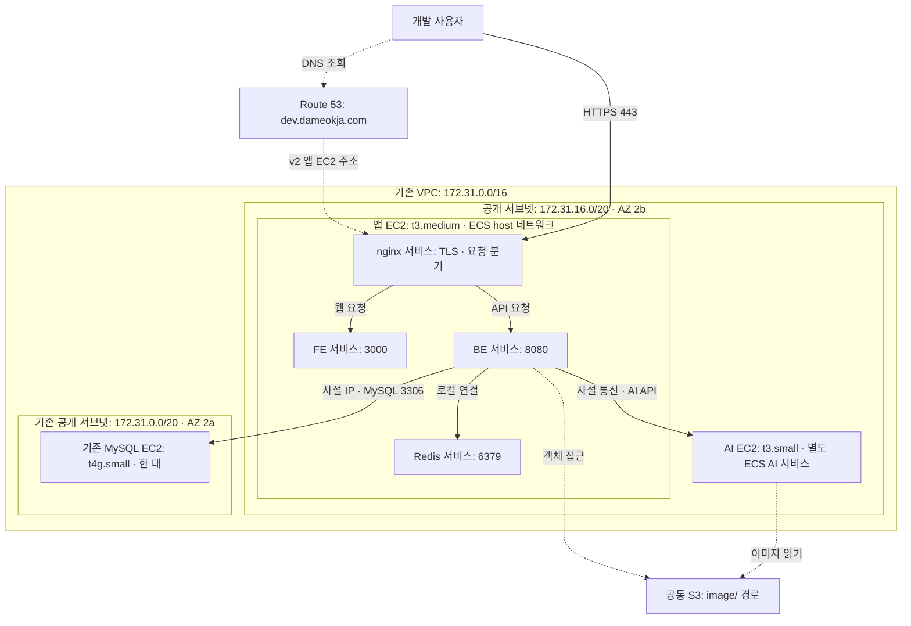
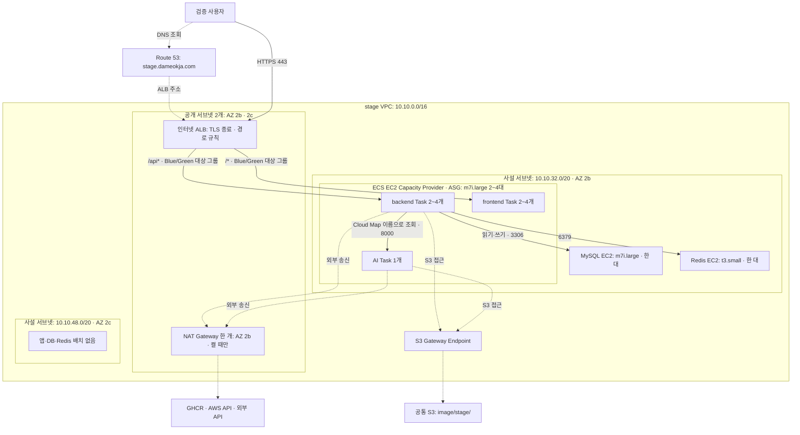
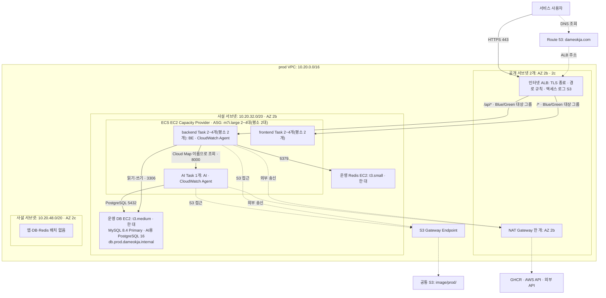
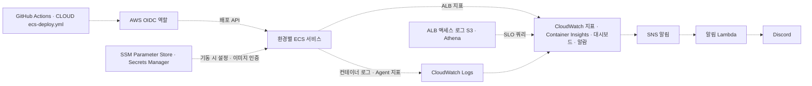

# v2 환경별 구축 아키텍처 — dev · stage · prod

> 기준: v2 마지막 운영 구성(2026-11-08). v2는 2026-11-09 v3(EKS)로 전환한 뒤 종료했다. AWS 계정 `906462447513`, 서울 리전 `ap-northeast-2`, IaC는 CLOUD [`638e11f`](https://github.com/100-hours-a-week/KTB4-5th-CLOUD/tree/638e11f/infra/v2).
> 각 결정의 이유는 [v2 인프라 위키](wiki/ktb4-cloud-wiki-v2.md)와 [설계 의사결정 근거](인프라%20설계%20의사결정%20근거.md)의 같은 번호를 참고한다. dev·stage는 2026-11-05에 먼저 v3로 옮겨 각각 그 직전 구성을 적었다.

## 1. 환경별 차이부터 보기

| 구분 | dev | stage | prod |
| --- | --- | --- | --- |
| 용도 | 개발 기능 확인 | 운영 전 검증 | 실제 서비스 |
| 진입 주소 | `dev.dameokja.com` | `stage.dameokja.com` | `dameokja.com` |
| DNS 대상 | 앱 EC2 공개 주소 | stage ALB | prod ALB |
| VPC | 기존 `172.31.0.0/16` 재사용 | 전용 `10.10.0.0/16` | 전용 `10.20.0.0/16` |
| TLS 처리 | 앱 EC2의 nginx | ALB·ACM 인증서 | ALB·ACM 인증서 |
| 요청 분기 | nginx가 FE·BE로 나눔 | ALB 경로 규칙이 backend·frontend 서비스로 나눔 | ALB 경로 규칙이 backend·frontend 서비스로 나눔 |
| 앱 배포 단위 | nginx·FE·BE·Redis 각각 별도 ECS 서비스 | backend·frontend 서비스 | backend(BE + CloudWatch Agent)·frontend 서비스 |
| 태스크 네트워크 | 호스트 네트워크 공유 | 태스크별 사설 IP | 태스크별 사설 IP |
| AI | 별도 EC2의 ECS 서비스 | 같은 ECS 클러스터의 별도 서비스 | 같은 ECS 클러스터의 별도 서비스 |
| Redis | 앱 EC2의 ECS 컨테이너 | 별도 사설 EC2 | 별도 사설 EC2 |
| MySQL | 기존 별도 EC2 재사용 | 별도 사설 EC2 한 대 | 별도 사설 EC2 한 대(Primary만) |
| 앱 배포 방식 | Rolling | ECS Blue/Green | ECS Blue/Green |
| 운영 방식 | 서비스 5개 각 1개 상시 실행 | 필요할 때만 켬. 끄면 서비스·ASG 0, DB·Redis 정지, NAT 삭제 | backend 2개, frontend 2개, AI 1개, 앱 EC2 2대 상시 실행 |

**그림 읽는 법:** 실선은 서비스·데이터 요청 경로, 점선은 DNS 해석·스케줄링·외부 송신 등 보조 경로다. DNS는 요청을 대신 전달하는 프록시가 아니며, 실제 HTTPS 요청은 사용자가 해석된 주소로 직접 보낸다. stage 그림은 켜 둔 상태의 자원 관계다.

## 2. dev — 공개 EC2 기반의 개발 환경

### 2.1. 실제 배치

| 자원 | 구성 |
| --- | --- |
| 앱 서버 | `dameokja-dev-v2`, `t3.medium`, AZ 2b, nginx·FE·BE·Redis 서비스 각 1개 |
| AI 서버 | `dameokja-dev-v2-ai`, `t3.small`, 앱 서버와 같은 공개 서브넷, AI 서비스 1개 |
| DB 서버 | `dameokja-v2-dev-DB`, `t4g.small`, AZ 2a. 기존 dev DB EC2를 재사용 |
| ECS 클러스터 | `dameokja-dev`, 개별 서비스 5개, 모두 `host` 네트워크 |
| DNS | `dev.dameokja.com` v1 가중치 0 / v2 100 |

dev 스택에는 ALB·NAT Gateway·ASG가 없다. stage·prod와 같은 구조는 dev 용도에 과해, 같은 구조의 검증은 stage가 맡고 dev는 기존 VPC·DB를 재사용하는 앱 EC2 한 대(AI는 별도 EC2 한 대)로 둔다(#7). EC2 공개 주소로 들어온 요청을 nginx가 FE와 BE에 나누고, FE·BE·Redis는 같은 호스트의 포트로 통신한다. 앱·AI는 dev 스택이 관리하지만, 기존 VPC·서브넷·DB EC2 전체를 새로 만드는 구성은 아니다. DB는 공개 주소를 가진 서브넷에 있으며, 그림의 사설 연결선은 DB가 사설 서브넷에 있다는 뜻이 아니다.

dev의 이미지 prefix 기본값은 IaC 기준 `image/`이다. stage·prod의 `image/stage/`, `image/prod/`보다 넓은 범위이므로 세 환경의 접근 범위가 완전히 격리돼 있다고 해석하면 안 된다. S3는 환경별로 새 버킷을 만드는 방식이 아니라 기존 버킷을 재사용한다.

## 3. stage — ALB와 사설 ECS를 사용하는 검증 환경

> **필요할 때만 켜는 환경:** `stage 켜기·끄기` 워크플로(#62·#132)로 켜고 끈다. 켜면 아래 그림처럼 prod와 같은 구조로 돌고, 끄면 backend·frontend·AI 서비스와 앱 ASG를 0으로, DB·Redis EC2를 정지로 두며 NAT Gateway(시간·IP 요금)를 지운다. ALB와 DNS는 남긴다. 인프라 PR 머지 배포는 지금 켜짐 상태를 그대로 써서, 꺼 둔 stage가 다시 켜지지 않는다.

### 3.1. 요청과 배포 경로

1. ALB가 HTTPS를 종료하고 경로 규칙으로 요청을 나눈다. `/api`, `/api/*`, `/swagger-ui*`, `/v3/api-docs*`는 backend(`8080`), 나머지 `/*`는 frontend(`3000`)로 간다. 서비스마다 Blue/Green 대상 그룹이 2개씩 있다.
2. BE는 별도 DB·Redis EC2에 연결한다. AI는 같은 클러스터의 별도 태스크이며 `ai.stage.dameokja.internal:8000`으로 찾는다.
3. 일반 외부 송신은 NAT, S3 송신은 Gateway Endpoint를 사용한다. NAT는 사용자 요청의 진입점이 아니다.

### 3.2. 실제 배치

| 자원 | 구성 |
| --- | --- |
| 공개 서브넷 | `10.10.0.0/20` AZ 2b, `10.10.16.0/20` AZ 2c. ALB가 둘 다 사용 |
| 앱·AI 서브넷 | `10.10.32.0/20`, AZ 2b 한 곳으로 제한 |
| 앱 ASG | 켜면 최소 2·최대 4, 끄면 0 |
| 서비스 | 켜면 backend·frontend Task 2~4개(Target Tracking CPU 60%), AI 1개. 끄면 모두 0 |
| DB | `dameokja-stage-db`, `m7i.large`, AZ 2b 사설 서브넷 |
| Redis | `dameokja-stage-redis`, `t3.small`, AZ 2b 사설 서브넷 |
| 사용하지 않는 서브넷 | `10.10.48.0/20`, AZ 2c |

DB 한 대와 Redis 한 대를 EC2로 운영한다. ALB의 두 AZ 구성을 앱·DB의 다중 AZ 배치로 해석하면 안 된다. stage DB는 prod와 달리 처음 사양(`m7i.large`)을 유지했다.

## 4. prod — 운영 트래픽과 자체 구축 DB를 사용하는 환경

### 4.1. 실제 배치

| 자원 | 구성 |
| --- | --- |
| 공개 서브넷 | `10.20.0.0/20` AZ 2b, `10.20.16.0/20` AZ 2c. ALB가 둘 다 사용 |
| 앱 ASG | 최소 2·최대 4, 평소 `m7i.large` 2대. 모두 AZ 2b 사설 서브넷. ECS 최적화 AMI를 ID로 고정. 새 서버는 축소 보호 상태로 뜸(#187) |
| backend 서비스 | `dameokja-prod-backend`, 평소 2개, Blue/Green. BE CPU 1024 예약·메모리 하드 리밋 2560MB(#171), CloudWatch Agent 사이드카(HikariCP 지표) |
| frontend 서비스 | `dameokja-prod-frontend`, 평소 2개, Blue/Green. 메모리 하드 리밋 768MB |
| AI 서비스 | `dameokja-prod-ai`, 1개, Rolling. 내부 주소 `ai.prod.dameokja.internal:8000`. AI 지표용 CloudWatch Agent 포함 |
| 배치 | 세 서비스 모두 메모리 기준 binpack, AZ 재분배 끔(#147) |
| DB | `dameokja-prod-db`, `t3.medium`, AZ 2b. MySQL 8.4 Primary 한 대(binlog·GTID, 복제 계정·CLONE 준비)와 AI용 PostgreSQL 16. BE는 고정 이름 `db.prod.dameokja.internal`(사설 DNS, TTL 5초)로 접속 |
| Redis | `dameokja-prod-redis`, `t3.small`, AZ 2b, AOF |
| 사용하지 않는 서브넷 | `10.20.48.0/20`, AZ 2c |

prod는 10월 19일 v1 DB에서 데이터를 이전한 v2 DB를 사용한다. 환경 이전 과정과 장애는 [운영 전환 결과](../implementation/v2%20prod%20전환%20결과.md)를 참고한다.

DB는 Primary 한 대다. 한계 부하에서 Primary 한 대가 설계 피크(약 95 RPS)의 약 2배(약 190 iter/s)를 처리했고, Standby·Orchestrator는 월 약 $50이 들어 두지 않았다. Read Replica·Standby·Orchestrator는 구현해 장애 주입 5개를 통과한 뒤 비용으로 철거했다(#173·#203, 결과는 `tests/DB HA/결과.md`). 앱·DB·Redis를 모두 AZ 2b에 둔 이유는 DB·Redis가 단일 노드인 동안 앱만 나눠도 AZ 장애 가용성은 그대로이고 AZ 간 전송 요금·지연만 늘기 때문이다(#57, [위키 20번](wiki/ktb4-cloud-wiki-v2.md#20-auto-scaling-전략-설계)).

### 4.2. 확장과 배포를 구분하기

- **태스크 확장:** backend·frontend 서비스마다 CPU 목표 60%, 태스크 최소 2·최대 4의 Target Tracking 정책을 둔다. 시각 기반 Scheduled Scaling은 두지 않는다.
- **호스트 확장:** 태스크가 올라갈 EC2 용량은 Capacity Provider(관리형 확장, 목표 용량 100%)와 ASG가 관리한다. Capacity Provider의 종료 보호로 태스크가 있는 서버는 축소 대상에서 빠진다(#187).
- **Blue/Green:** 새 태스크 묶음을 띄우고 ALB 대상 그룹을 바꾼 뒤 5분(Bake) 동안 이전 묶음을 남겨 둔다. 실패하면 회로 차단기가 이전 태스크 정의로 되돌린다. CloudWatch 알람 연동 롤백은 쓰지 않는다. 배포가 끝나면 `ecs-deploy.yml`이 흩어진 태스크를 한 서버로 모아 빈 서버를 줄인다(#189).
- **AI 배포:** 별도 서비스의 Rolling 배포다. backend·frontend의 Blue/Green과 구분한다.

## 5. 공통 관리·관측 경로

| 대상 | 운영 방식 |
| --- | --- |
| dev 로그·앱 지표 | 앱 호스트의 CloudWatch Agent가 nginx·BE 로그와 앱 지표를 수집, `/dameokja/dev/*` |
| stage 로그 | `awslogs` → `/dameokja/stage/{frontend,backend,ai}` |
| prod 로그 | `awslogs` → `/dameokja/v2-prod/{frontend,backend,ai}`. 보관 backend 14일, frontend·AI 30일 |
| prod 지표 | ALB 지표(5xx·응답 시간), Container Insights(태스크·컨테이너 CPU·메모리), backend 사이드카 Agent의 HikariCP 지표, AI 사이드카 Agent의 AI 지표 |
| 모니터링 스택 | `dameokja-stage-monitoring`, `dameokja-v2-prod-monitoring`. SLO는 ALB 액세스 로그를 Athena로 조회 |
| 설정 | `/dameokja-v2-dev/*`, `/dameokja-v2-stage/*`, `/dameokja-v2-prod/*`를 태스크 기동 시 주입 |
| 이미지 저장소 | GHCR 비공개 패키지. 태스크는 Secrets Manager의 GHCR 인증 정보로 받고, stage·prod는 NAT 경유 |
| S3 | 공통 기존 버킷 `dameokja-906462447513-ap-northeast-2-an` 재사용. IaC 기본 prefix는 dev `image/`, stage `image/stage/`, prod `image/prod/`. 프로필 사진은 Presigned URL로 클라이언트가 직접 받음. stage·prod VPC에는 S3 Gateway Endpoint 존재 |
| 서버 접속 | 세 환경 모두 SSH 22를 열지 않고 SSM Session Manager로 접속. stage·prod ECS 호스트 보안 그룹은 인바운드 없음 |

이 그림은 관리·관측 관계를 묶어 표시한 것이다. 세 환경이 모두 같은 모니터링 스택·같은 수집 방식을 사용한다는 뜻은 아니다.

## 6. 근거와 갱신 기준

- IaC 기준: CLOUD 커밋 `638e11f`의 [`infra/v2/`](https://github.com/100-hours-a-week/KTB4-5th-CLOUD/tree/638e11f/infra/v2) (`{dev,stage,prod}.yaml`, `ecs/<env>/*.json`). 이 커밋 뒤 2026-11-08까지 prod 앱 구성을 바꾼 IaC 변경은 없다. dev·stage IaC는 v3 전환 뒤 지웠다(#284).
- 자원 이름·서브넷 배치는 2026-11-02 읽기 전용 조회 결과([구축 조회 스냅샷](assets/v2-architecture-2026-11-02/services.json))와 IaC를 대조했다.
- 태스크의 환경변수 값·비밀번호·쿠키는 수집하지 않았다.
- 서비스 간 연결선은 IaC·태스크 구성과 배치를 대조한 경로다. 실제 SQL·AI 요청·네트워크 도달성 시험을 새로 실행하지는 않았다.
- v2는 종료돼 이 문서를 더 갱신하지 않는다. prod 스택의 네트워크(VPC `10.20.0.0/16`, 서브넷 4개, NAT, S3 엔드포인트)는 v3 EKS가 그대로 쓰도록 남겼다(#321).

결정 이유는 [v2 인프라 위키](wiki/ktb4-cloud-wiki-v2.md)와 [설계 의사결정 근거](인프라%20설계%20의사결정%20근거.md), 적용 과정은 [v2 구현 기록](../implementation/v2%20구현%20기록.md)을 참고한다.
