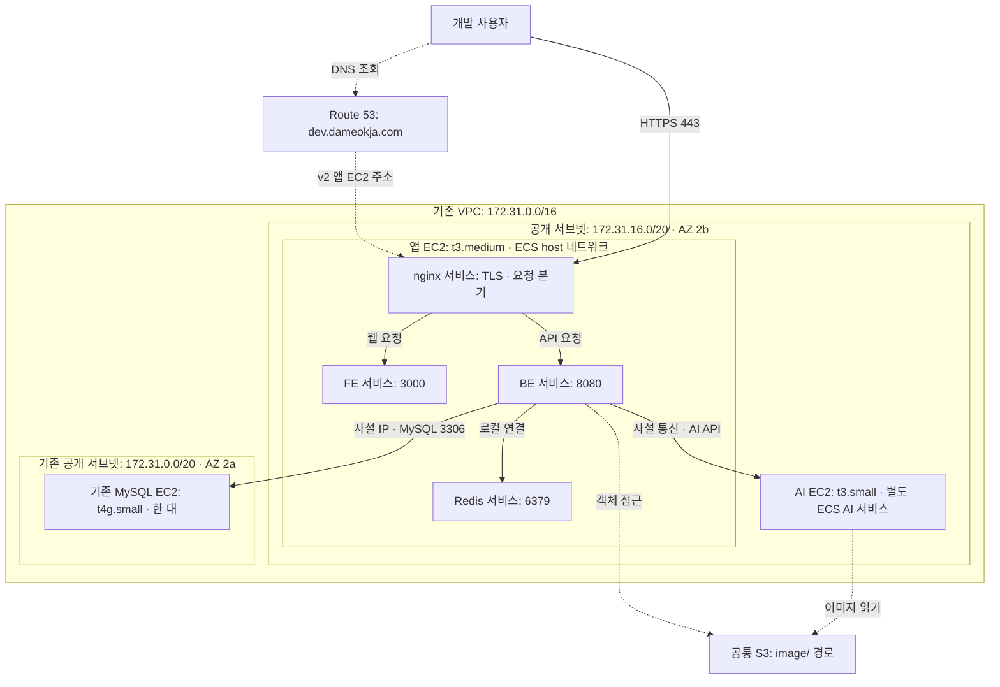
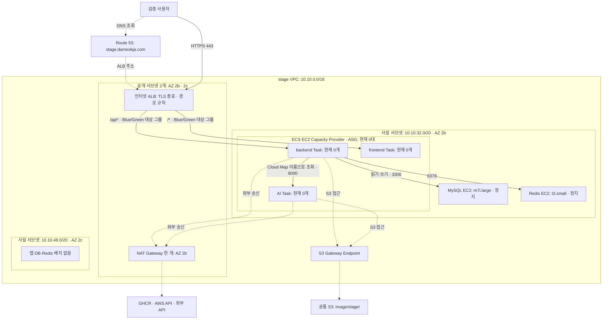
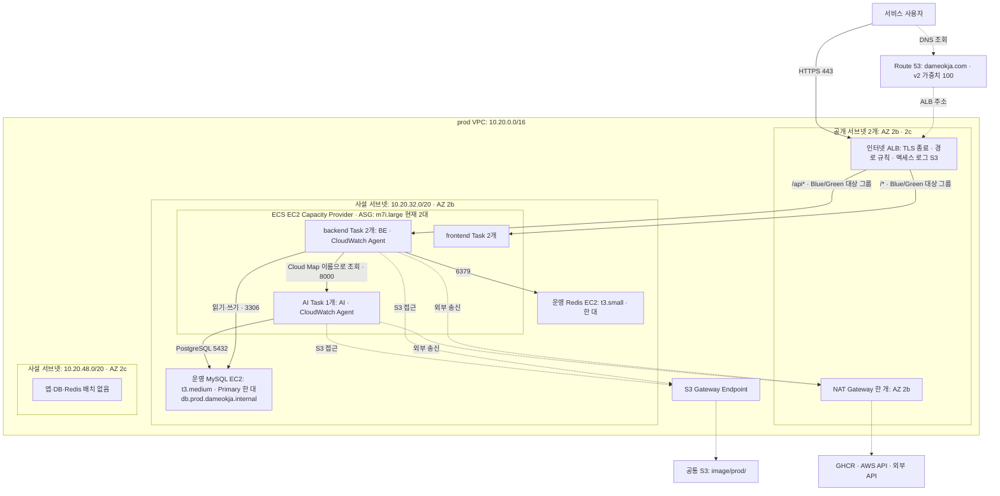
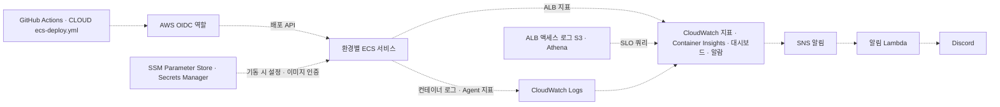

# v2 환경별 구축 아키텍처 — dev · stage · prod

> 조회 기준: **2026-11-02 21:20 KST**, AWS 계정 `906462447513`, 서울 리전 `ap-northeast-2`. IaC 기준은 CLOUD main `638e11f`.
> 이 문서는 실제 구축 상태를 나타낸다. [v2 목표 설계](wiki/ktb4-cloud-wiki-v2.md)와 다른 점은 [6절](#6-설계와-달라진-점)에 모았다.

## 1. 환경별 차이부터 보기

| 구분 | dev | stage | prod |
| --- | --- | --- | --- |
| 용도 | 개발 기능 확인 | 운영 전 검증 | 실제 서비스 |
| 진입 주소 | `dev.dameokja.com` | `stage.dameokja.com` | `dameokja.com` |
| DNS 대상 | 앱 EC2 공개 주소 | stage ALB | prod ALB, v2 가중치 100 |
| VPC | 기존 `172.31.0.0/16` 재사용 | 전용 `10.10.0.0/16` | 전용 `10.20.0.0/16` |
| TLS 처리 | 앱 EC2의 nginx | ALB·ACM 인증서 | ALB·ACM 인증서 |
| 요청 분기 | nginx가 FE·BE로 나눔 | ALB 경로 규칙이 backend·frontend 서비스로 나눔 | ALB 경로 규칙이 backend·frontend 서비스로 나눔 |
| 앱 배포 단위 | nginx·FE·BE·Redis 각각 별도 ECS 서비스 | backend·frontend 서비스 | backend(BE + CloudWatch Agent)·frontend 서비스 |
| 태스크 네트워크 | 호스트 네트워크 공유 | 태스크별 사설 IP | 태스크별 사설 IP |
| AI | 별도 EC2의 ECS 서비스 | 같은 ECS 클러스터의 별도 서비스 | 같은 ECS 클러스터의 별도 서비스 |
| Redis | 앱 EC2의 ECS 컨테이너 | 별도 사설 EC2 | 별도 사설 EC2 |
| MySQL | 기존 별도 EC2 재사용 | 별도 사설 EC2 한 대 | 별도 사설 EC2 한 대(Primary만) |
| 앱 배포 방식 | Rolling | ECS Blue/Green | ECS Blue/Green |
| 조회 당시 상태 | 서비스 5개 모두 각 1개 실행 | 서비스 모두 0개, 앱 ASG 0대, DB·Redis 정지 | backend 2개, frontend 2개, AI 1개, 앱 EC2 2대 실행 |

**그림 읽는 법:** 실선은 서비스·데이터 요청 경로, 점선은 DNS 해석·스케줄링·외부 송신 등 보조 경로다. DNS는 요청을 대신 전달하는 프록시가 아니며, 실제 HTTPS 요청은 사용자가 해석된 주소로 직접 보낸다. stage 그림은 구성된 자원 간 관계를 나타내며, 조회 당시 요청을 처리하고 있다는 뜻은 아니다.

## 2. dev — 공개 EC2 기반의 개발 환경

### 2.1. 실제 배치

| 자원 | 확인한 상태 |
| --- | --- |
| 앱 서버 | `dameokja-dev-v2`, `t3.medium`, AZ 2b, nginx·FE·BE·Redis 서비스 각 1개 |
| AI 서버 | `dameokja-dev-v2-ai`, `t3.small`, 앱 서버와 같은 공개 서브넷, AI 서비스 1개 |
| DB 서버 | `dameokja-v2-dev-DB`, `t4g.small`, AZ 2a, 사설 주소 `172.31.4.192` |
| ECS 클러스터 | `dameokja-dev`, 개별 서비스 5개, 모두 `host` 네트워크 |
| DNS | `dev.dameokja.com` v1 가중치 0 / v2 100 |

dev 스택에는 ALB·NAT Gateway·ASG가 없다. EC2 공개 주소로 들어온 요청을 nginx가 FE와 BE에 나누고, FE·BE·Redis는 같은 호스트의 포트로 통신한다. 앱·AI는 dev 스택이 관리하지만, 기존 VPC·서브넷·DB EC2 전체를 새로 만드는 구성은 아니다. DB는 공개 주소를 가진 서브넷에 있으며, 그림의 사설 연결선은 DB가 사설 서브넷에 있다는 뜻이 아니다.

dev의 이미지 prefix 기본값은 IaC 기준 `image/`이다. stage·prod의 `image/stage/`, `image/prod/`보다 넓은 범위이므로 세 환경의 접근 범위가 완전히 격리돼 있다고 해석하면 안 된다. S3는 환경별로 새 버킷을 만드는 방식이 아니라 기존 버킷을 재사용한다.

## 3. stage — ALB와 사설 ECS를 사용하는 검증 환경

> **조회 당시 꺼진 상태:** backend·frontend·AI 서비스의 실행 목표와 실제 태스크가 모두 0개이고, 앱 ASG도 0대다. DB·Redis EC2는 정지돼 있다. ALB와 NAT Gateway는 남아 있으며 DNS도 ALB를 가리킨다. 켜고 끄는 방법은 `stage 켜기·끄기` 워크플로(#62·#132)를 따른다.

### 3.1. 요청과 배포 경로

1. ALB가 HTTPS를 종료하고 경로 규칙으로 요청을 나눈다. `/api`, `/api/*`, `/swagger-ui*`, `/v3/api-docs*`는 backend(`8080`), 나머지 `/*`는 frontend(`3000`)로 간다. 서비스마다 Blue/Green 대상 그룹이 2개씩 있다.
2. BE는 별도 DB·Redis EC2에 연결한다. AI는 같은 클러스터의 별도 태스크이며 `ai.stage.dameokja.internal:8000`으로 찾는다.
3. 일반 외부 송신은 NAT, S3 송신은 Gateway Endpoint를 사용하는 경로가 구성돼 있다. NAT는 사용자 요청의 진입점이 아니다.

### 3.2. 실제 배치와 꺼진 상태

| 자원 | 구성·조회 결과 |
| --- | --- |
| 공개 서브넷 | `10.10.0.0/20` AZ 2b, `10.10.16.0/20` AZ 2c. ALB가 둘 다 사용 |
| 앱·AI 서브넷 | `10.10.32.0/20`, AZ 2b 한 곳으로 제한 |
| 앱 ASG | 현재 최소 0·목표 0·최대 4. IaC 기본 최소는 2이므로 꺼진 상태 값과 구분 |
| 서비스 | backend·frontend·AI 목표·실행 모두 `0/0` |
| DB | `dameokja-stage-db`, `m7i.large`, `10.10.41.4`, AZ 2b 사설 서브넷, 정지 |
| Redis | `dameokja-stage-redis`, `t3.small`, `10.10.40.126`, AZ 2b 사설 서브넷, 정지 |
| 사용하지 않는 서브넷 | `10.10.48.0/20`, AZ 2c |

DB 한 대와 Redis 한 대를 EC2로 운영한다. ALB의 두 AZ 구성을 앱·DB의 다중 AZ 배치로 해석하면 안 된다. stage를 켜면 태스크 수와 ASG 목표가 바뀔 수 있으므로 이 문서의 0개는 조회 시점의 상태다.

## 4. prod — 운영 트래픽과 자체 구축 DB를 사용하는 환경

### 4.1. 실제 배치

| 자원 | 확인한 상태 |
| --- | --- |
| 공개 서브넷 | `10.20.0.0/20` AZ 2b, `10.20.16.0/20` AZ 2c. ALB가 둘 다 사용 |
| 앱 ASG | 최소 2·목표 2·최대 4, 실제 `m7i.large` 2대. 모두 AZ 2b 사설 서브넷. 새 서버는 축소 보호 상태로 뜸 |
| backend 서비스 | `dameokja-prod-backend`, 목표·실행 `2/2`, Blue/Green. 태스크 정의 `dameokja-prod-backend:7`(BE CPU 1024·메모리 2560MB, CloudWatch Agent 128MB) |
| frontend 서비스 | `dameokja-prod-frontend`, 목표·실행 `2/2`, Blue/Green. 태스크 정의 `dameokja-prod-frontend:1`(메모리 768MB) |
| AI 서비스 | `dameokja-prod-ai`, 목표·실행 `1/1`, Rolling. 내부 주소 `ai.prod.dameokja.internal:8000`. AI 지표용 CloudWatch Agent 포함 |
| 배치 | 세 서비스 모두 메모리 기준 binpack, AZ 재분배 끔 |
| DB | `dameokja-prod-db`, `t3.medium`, `10.20.33.212`, AZ 2b. MySQL 8.4 Primary 한 대와 AI용 PostgreSQL 16. BE는 고정 이름 `db.prod.dameokja.internal`로 접속 |
| Redis | `dameokja-prod-redis`, `t3.small`, `10.20.35.176`, AZ 2b |
| 사용하지 않는 서브넷 | `10.20.48.0/20`, AZ 2c |

prod는 10월 19일 v1 DB에서 데이터를 이전한 v2 DB를 사용한다. 환경 이전 과정과 장애는 [운영 전환 결과](../implementation/v2%20prod%20전환%20결과.md)를 참고한다.

### 4.2. 확장과 배포를 구분하기

- **태스크 확장:** backend·frontend 서비스마다 CPU 목표 60%, 태스크 최소 2·최대 4의 Target Tracking 정책이 IaC에 정의돼 있다. 시각 기반 Scheduled Scaling은 없다.
- **호스트 확장:** 태스크가 올라갈 EC2 용량은 Capacity Provider(관리형 확장, 목표 용량 100%)와 ASG가 관리한다. Capacity Provider의 종료 보호로 태스크가 있는 서버는 축소 대상에서 빠진다.
- **Blue/Green:** 새 태스크 묶음을 띄우고 ALB 대상 그룹을 바꾼 뒤 5분(Bake) 동안 이전 묶음을 남겨 둔다. 실패하면 회로 차단기가 이전 태스크 정의로 되돌린다. 배포가 끝나면 `ecs-deploy.yml`이 흩어진 태스크를 한 서버로 모아 빈 서버를 줄인다(#189).
- **AI 배포:** 별도 서비스의 Rolling 배포다. backend·frontend의 Blue/Green과 구분한다.

## 5. 공통 관리·관측 경로

| 대상 | 현재 방식 |
| --- | --- |
| dev 로그·앱 지표 | 앱 호스트의 CloudWatch Agent가 nginx·BE 로그와 앱 지표를 수집, `/dameokja/dev/*` |
| stage 로그 | `awslogs` → `/dameokja/stage/{frontend,backend,ai}` |
| prod 로그 | `awslogs` → `/dameokja/v2-prod/{frontend,backend,ai}`. 보관 14일 |
| prod 지표 | ALB 지표(5xx·응답 시간), Container Insights(태스크·컨테이너 CPU·메모리), backend 사이드카 Agent의 HikariCP 지표, AI 사이드카 Agent의 AI 지표 |
| 모니터링 스택 | `dameokja-stage-monitoring`, `dameokja-v2-prod-monitoring`. SLO는 ALB 액세스 로그를 Athena로 조회 |
| 설정 | `/dameokja-v2-dev/*`, `/dameokja-v2-stage/*`, `/dameokja-v2-prod/*`를 태스크 기동 시 주입 |
| 이미지 저장소 | GHCR. 태스크는 Secrets Manager의 GHCR 인증 정보로 받고, stage·prod는 NAT 경유 |
| S3 | 공통 기존 버킷 `dameokja-906462447513-ap-northeast-2-an` 재사용. IaC 기본 prefix는 dev `image/`, stage `image/stage/`, prod `image/prod/`. stage·prod VPC에는 S3 Gateway Endpoint 존재 |

이 그림은 관리·관측 관계를 묶어 표시한 것이다. 세 환경이 모두 같은 모니터링 스택·같은 수집 방식을 사용한다는 뜻은 아니다.

## 6. 설계와 달라진 점

[v2 목표 설계](wiki/ktb4-cloud-wiki-v2.md)와 지금 구축이 다른 항목이다. 이유는 각 이슈·PR에 남긴 판단을 옮겼다.

| 설계 항목 | 지금 구축 | 경과와 판단 |
| --- | --- | --- |
| 앱 Task = nginx+FE+BE 한 묶음 | stage·prod는 nginx 없이 ALB 경로 규칙으로 backend·frontend 서비스를 나눔. dev만 nginx 유지 | 한 묶음이면 FE·BE가 함께 늘고 함께 배포되며 지표도 섞여, 서비스별로 따로 배포·확장·관찰하도록 나눔(#147) |
| MySQL Primary·Standby·Read Replica, Orchestrator 자동 장애조치 | prod DB는 Primary 한 대 | 설계대로 구현해 검증한 뒤 비용 때문에 내림. Read Replica는 1대(#145)·2대(#169)로 읽기 분산 한계 부하를 측정하고 제거(#173). Standby(2c)·Orchestrator는 #179~#200으로 만들어 장애 주입 테스트 5개를 통과(유실 0, `tests/DB HA/결과.md`)한 뒤 철거(#203, 월 약 $50). 다시 만들 때 쓰도록 DB 고정 이름, BE 연결·쿼리 타임아웃, Hikari 연결 수명 2분, JVM DNS 캐시 5초는 남김 |
| 앱 서버 다중 AZ 배치 | stage·prod의 앱·DB·Redis가 모두 AZ 2b. ALB와 2c 서브넷만 두 AZ | AZ 장애 가용성은 가장 약한 구성 요소가 정한다. DB·Redis가 2b 한 대뿐인 동안 앱만 나누면 AZ 장애 가용성은 그대로이고, 앱↔DB·Redis 요청마다 AZ 간 전송 요금·지연과 2c NAT 비용만 늘어난다. 그래서 앱 분산은 DB 이중화와 함께 적용할 항목으로 두었다(#57). DB 이중화를 다시 켜면 ASG·서비스 서브넷에 2c를 추가한다 |
| Redis | EC2 자체 구축 단일 노드(AOF) | ElastiCache 대신 DB와 같은 자체 구축 방향(#57) |
| Scheduled Scaling + Target Tracking | Target Tracking(CPU 60%)만 | Scheduled Scaling은 아직 만들지 않음. 설계 20번도 피크 시각·규모를 실측으로 다시 정하는 것을 전제로 함 |
| 앱이 설치된 AMI | 앱 없는 ECS 최적화 AMI를 ID로 고정 | 컨테이너 이미지는 GHCR에서 받으므로 AMI에 앱을 넣지 않음. 최신 AMI 경로를 쓰면 AWS가 새 AMI를 낼 때 서버가 교체돼 ID를 고정함 |
| 개발 환경 | 기존 VPC·DB를 재사용하는 ECS 한 대 구조 | stage·prod와 같은 구조는 dev 용도에 과해, 같은 구조는 stage에서 검증함 |
| 가동 상태 | stage는 꺼 둠, dev·prod 실행 | 구조가 있는 것과 지금 요청을 처리하는 것을 구분 |

## 7. 근거와 갱신 기준

- IaC 비교 기준: CLOUD main 커밋 `638e11f`, `infra/v2/{dev,stage,prod}.yaml`, `infra/v2/ecs/<env>/*.json`.
- 실제 조회(읽기 전용): CloudFormation 스택·자원 목록, ECS 서비스·태스크 정의, EC2·서브넷, ASG, NAT Gateway, ALB, Route 53. 결과는 [구축 조회 스냅샷](assets/v2-architecture-2026-11-02/services.json)에 보관한다.
- 태스크의 환경변수 값·비밀번호·쿠키는 수집하지 않았다.
- 서비스 간 연결선은 IaC·태스크 구성과 배치를 대조한 경로다. 이번 작업에서 실제 SQL·AI 요청·네트워크 도달성 시험을 새로 실행하지는 않았다.
- stage를 켜거나 태스크·인스턴스 타입·DB 구성·서브넷·도메인이 바뀌면 해당 환경 그림과 상태 표를 함께 갱신한다. 동적으로 바뀌는 태스크 IP나 컨테이너 이미지 digest는 그림에 고정하지 않는다.

기존 목표 아키텍처는 [v2 인프라 위키](wiki/ktb4-cloud-wiki-v2.md), 결정 이유는 [설계 의사결정 근거](인프라%20설계%20의사결정%20근거.md), 적용 과정은 [v2 구현 기록](../implementation/v2%20구현%20기록.md)을 참고한다.
