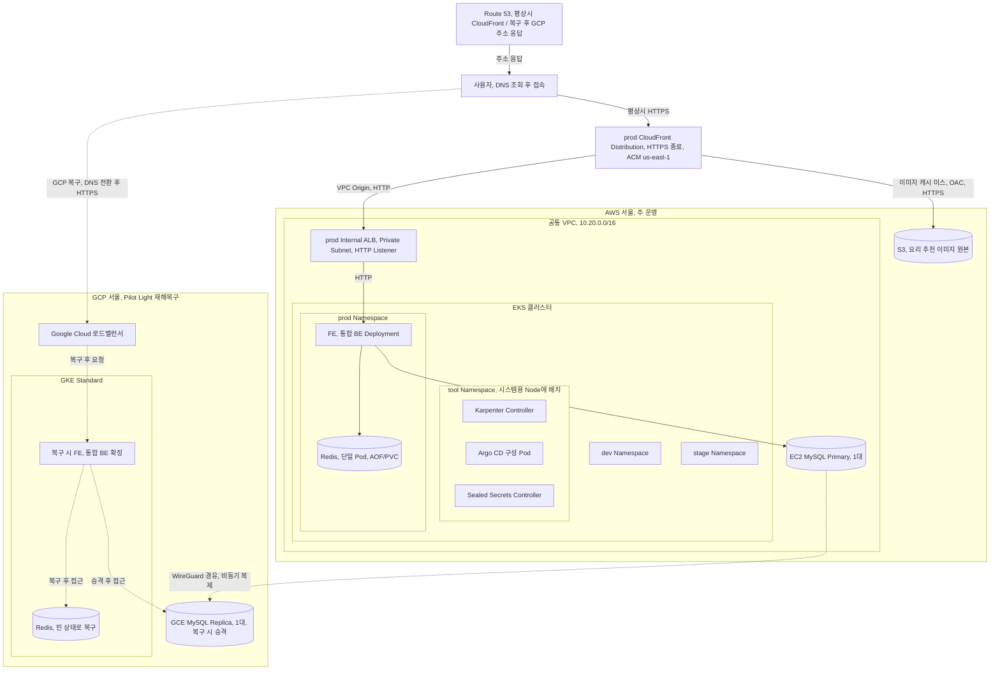
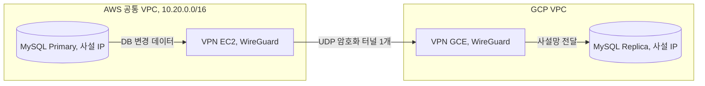
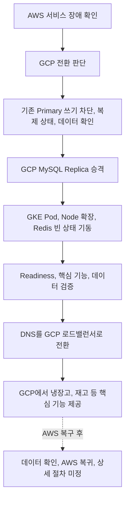

# v3 GCP 재해복구 설계 초안

> 상태: AWS, EKS 설계 이후 구체화할 후속 범위 / 기준일: 2026-10-28
>
> 주 운영 환경: [v3 AWS 인프라 설계](v3%20인프라%20설계.md)

기존 멀티클라우드 결정과 검토 내용을 보관합니다. 현재 작성 중인 AWS, EKS 설계의 구축 범위에는 포함하지 않습니다.

## 1. 복구 환경과 플랫폼

| 항목 | 기존 결정 |
|---|---|
| 역할 | AWS 장애 시 냉장고, 재고 등 핵심 서비스를 복구합니다. 평상시 피크 요청은 AWS에서 처리합니다. |
| 리전, 클러스터 | GCP 서울 `asia-northeast3`, GKE Standard 클러스터 1개 |
| 대기 방식 | Pilot Light. Control Plane, 최소 Node, 복제 경로를 유지하고 앱은 0개 또는 최소 Replica로 대기합니다. |
| IaC | 구축 도구는 후속 설계에서 결정합니다. AWS CloudFormation 관리 범위와 구분합니다. |

### 전체 구성 구상

### 멀티클라우드 선택 근거

AWS 주 운영 환경에 접근하기 어려운 장애에도 복구할 데이터를 확보하기 위해 GCP를 선택했습니다. AWS 멀티리전보다 사업자 의존성 분산을 우선했으며, 클라우드 간 데이터 전송, 권한, 네트워크, 장애 대응의 운영 부담을 감수하기로 했습니다.

기존 인프라와 국내 사용자 접근을 고려해 서울을 선택했습니다. 사업자는 분리하지만 서울 지역 전체의 광역 재해를 대비하는 지리적 분산은 포함하지 않았습니다.

AWS 앱, 시스템 Node와 MySQL Primary는 단일 AZ에 배치하고, DB 복구용 Replica는 GCP에 두기로 했습니다. 앱 AZ 장애 시에도 AWS 복구와 GCP 전환의 판단이 필요하며, EKS Control Plane, ALB의 관리형 가용성과는 구분했습니다.

### GKE Standard 선택 근거

Node Pool, 자원 배치, 확장, 정비 정책을 직접 구성하고 검증하는 학습 범위를 확보하기 위해 Standard를 선택했습니다. Autopilot보다 직접 담당할 Node 운영 범위가 늘어나는 부담은 Cloud 팀이 맡기로 했습니다.

### 공통 운영 플랫폼 선택 근거

**결정:** AWS, GCP의 배포, 운영 기준을 공유하기 위해 Kubernetes를 도입하기로 했습니다.

| 대안 | 판단 |
|---|---|
| ECS 유지, 개선 + GCP 별도 플랫폼 | 기존 ECS 경험을 활용할 수 있지만 두 환경의 배포 정의, 운영 절차를 각각 관리해야 했습니다. |
| EKS + GKE | Kubernetes API, Helm, GitOps 운영 방식을 공유할 수 있어 선택했습니다. 전환 작업과 클러스터, 구성요소의 유지관리 부담은 감수하기로 했습니다. |

도입 효과는 배포 설정의 재사용 범위와 AWS 장애 중 GCP 복구 가능성을 기준으로 검증하기로 했습니다.

## 2. 클라우드 간 연결

AWS EC2, GCP GCE에 WireGuard VM을 한 대씩 두고 UDP 암호화 터널 1개로 연결합니다. 공개키로 상호 인증하며 MySQL은 사설 IP로 복제합니다.

화살표는 DB 변경 데이터의 이동 방향입니다. 복제 연결은 GCP Replica에서 AWS Primary로 시작하며 양쪽에 왕복 정적 경로를 구성합니다. VPN VM은 필요한 DB 대역의 패킷만 중계하고 보안 그룹, 방화벽으로 접근을 제한합니다.

공인 IP는 VPN 종단에 사용합니다. EC2의 source/destination check를 해제하고 GCE, 게스트 OS의 IP forwarding을 허용합니다.

VPN VM, 터널 장애 시 복제가 중단되는 한계를 감수합니다. 복구 후 복제 재개, 지연 회복을 검증하고 VM, 터널 이중화와 자동 경로 전환은 고도화로 둡니다.

### 연결 방식, 도구 선택 근거

### 연결 방식 비교

MySQL 비동기 복제에 필요한 사설 경로를 기준으로 비교했습니다.

| 대안 | 판단 |
|---|---|
| 공인 경로 + TLS | 구축은 간단하지만 DB 접속 지점을 사설망으로 제한하는 운영 방향에 맞춰 제외했습니다. |
| 관리형 VPN | Gateway 운영을 맡길 수 있지만, 초기에는 소규모 연결을 직접 구성, 운영하기로 했습니다. |
| 직접 구축 VPN | 두 VM과 단일 터널로 시작할 수 있어 선택했습니다. 라우팅, 패치, 키 관리, 장애 대응은 직접 담당하기로 했습니다. |
| Interconnect, Partner Cross-Cloud Interconnect | 전용 연결의 대역폭과 구축 편의성을 검토했으나 고정 비용, 지원 리전 조합의 제약과 현재 복제 용도를 고려해 보류했습니다. |

참고: [Partner Cross-Cloud Interconnect](https://docs.cloud.google.com/network-connectivity/docs/interconnect/concepts/partner-cci-for-aws-overview), [지원 리전 조합](https://docs.cloud.google.com/network-connectivity/interconnect/how-to/partner-cci-for-aws/paired-locations), [GCP 연결 요금](https://cloud.google.com/network-connectivity/interconnect/pricing).

### 초기 선택: VPN VM 직접 구축

DB 복제용 소규모 연결이므로 두 VM과 정적 경로로 시작하고, VM, 디스크, 공인 IP, 전송 비용과 직접 운영 부담을 감수하기로 했습니다.

### VPN 소프트웨어 선택

**결정:** 두 VPN VM을 직접 관리하는 단순한 연결에 맞춰 WireGuard를 선택했습니다.

| 후보 | 판단 |
|---|---|
| WireGuard | 공개키, 접속 주소, 허용 대역으로 구성할 수 있고 별도의 인증서 발급, 갱신 체계가 필요하지 않아 선택했습니다. |
| strongSwan | IPsec 장비, 관리형 VPN과의 호환성이 장점이지만 현재 연결 범위에서는 필요하지 않았습니다. |

참고: [WireGuard](https://www.wireguard.com/), [strongSwan](https://docs.strongswan.org/docs/latest/howtos/introduction.html).

### 운영 부담과 이중화 고도화

초기 단일 VM, 터널 장애 시 DB 복제가 중단되는 한계를 감수했습니다. 복구 후 재접속, 복제 재개, 지연 회복을 검증하고, VM, 터널 이중화와 자동 경로 전환은 고도화로 남겼습니다.

## 3. 데이터와 작업 복구 범위

| 대상 | 운영 구성 |
|---|---|
| MySQL | Kubernetes 외부의 EC2, GCE에서 운영합니다. AWS Primary 1대에서 GCP 복구용 Replica 1대로 비동기 복제합니다. GCP Replica가 Standby 역할을 맡고 장애 시 Primary로 승격합니다. AWS 내부의 별도 Multi-AZ Standby는 두지 않으며, 읽기 분산용 Replica의 추가 여부, 대수, 배치는 별도로 정합니다. |
| Redis | Kubernetes 내부 단일 Pod에서 세션, 알림, 임시 작업 상태를 저장하고 AOF를 PVC에 보관합니다. GCP에서는 복제 없이 빈 상태로 복구합니다. AWS의 자원 관리 기준은 [Redis 운영](v3%20인프라%20설계.md#55-redis-운영)에서 다룹니다. |

Redis 상태 유실에 따른 재로그인, 진행 중 작업 중단을 감수합니다.

비동기 복제의 지연, 유실 가능성을 감수하되 VPN 단절만으로 DB를 승격하지 않습니다. 기존 Primary의 쓰기 차단, 복제 상태 확인, AWS 복귀 절차를 검증합니다.

Kafka 메시지, Consumer 처리 위치와 알림 Consumer의 복구 범위는 미정입니다. AI Consumer는 AI 기능의 복구 제외 방침을 따릅니다.

## 4. 재해복구 절차

평상시에는 데이터 복제와 클러스터 기반을 유지하고, AWS 주 운영 환경에 장애가 발생하면 GKE 워크로드를 확장합니다.

| 복구 목표 | 값 |
|---|---|
| RTO | 30분 |
| RPO | 5분 |

| 구분 | 내용 |
|---|---|
| 평상시 유지 | DB 비동기 복제, GKE Control Plane, 최소 Node, 네트워크를 유지합니다. 공통 Chart와 GCP Values를 준비하고 앱은 replicas 0 또는 최소로 대기합니다. |
| 복구 대상 | FE, BE를 GKE에서 실행하여 냉장고, 재고 관리 등 기본 서비스를 제공합니다. |
| 복구 제외 | AI 추론(레시피 추천)과 S3 이미지는 복제하지 않으며, 장애 기간에는 해당 기능을 제한합니다. 서비스를 완전히 복구하기보다 기본 기능을 유지하는 것을 우선합니다. |

자동화 범위와 실행 주체는 후속 결정 대상입니다. 검증에 실패하면 원인을 조치한 뒤 진행하며, Node 기동, 이미지 Pull, DB 승격, DNS 전환을 포함한 실제 RTO, RPO는 복구 시험으로 확인합니다.

### Pilot Light와 복구 목표 선택 근거

**결정:** GCP는 Pilot Light로 운영하기로 했습니다. 평상시에는 데이터 복제, 클러스터 기반을 유지하고, 장애 시 핵심 서비스를 확장합니다.

| 목표 | 값 | 선택 이유 |
|---|---|---|
| RTO | 30분 | 식사 준비 시간대의 서비스 중단 시간을 제한하기 위해 정했습니다. |
| RPO | 5분 | 냉장고 재고 변경 데이터의 유실 범위를 제한하기 위해 정했습니다. |

상시 서비스 용량을 유지하는 비용을 줄이는 대신 워크로드 기동, 확장 시간이 필요한 점을 감수했습니다. 목표 달성 여부는 실제 복제 지연, 전환, 복귀 시험으로 검증하기로 했습니다.

참고: [AWS 재해복구 전략](https://docs.aws.amazon.com/wellarchitected/latest/framework/rel_planning_for_recovery_disaster_recovery.html), [GCP DR 계획](https://docs.cloud.google.com/architecture/dr-scenarios-planning-guide).

## 5. 배포, Secret, 관측 연동

- Helm Chart, GHCR을 공통으로 사용하되 GCP Values와 복구 Replica를 구분합니다.
- GKE의 Argo CD 배치, 관리 구성과 AWS 장애 중 동기화, 이미지 공급 경로를 별도로 정합니다.
- GKE의 기본 Secret 저장 암호화를 사용합니다. Sealed Secrets의 GCP 키, 공급, 복구 구성은 후속 설계에서 정합니다.
- GCP Alloy가 메트릭을 수집하여 AWS 관측 EC2의 Prometheus로 remote_write하고, 로그는 중앙 Loki로 전송합니다.
- 중앙 Prometheus의 remote write 수신과 클라우드 간 인증, 수집 대상 분배, 중복 방지를 구성합니다. 두 저장, 조회 스택의 운영 부담을 줄이기 위해 GCP의 관측 저장, 조회 스택은 초기에는 별도로 두지 않습니다.
- AWS 장애 중 중앙 관측을 이용할 수 없는 한계는 감수하며, GCP 독립 관측과 이중화는 고도화로 남깁니다.

## 6. 후속 결정, 검증

| 범위 | 남은 내용 |
|---|---|
| 클러스터, 네트워크 | Node Pool, 대기 용량, Zone, Pod 네트워크, AWS VPC, Pod, Service 대역과 겹치지 않는 주소 |
| 데이터 | DB 쓰기 차단, 승격, 복귀, 읽기 Replica 추가 여부, Kafka 복구 범위 |
| 진입점 | GCP 로드밸런서, 인증서, Gateway, Route 53 전환, TTL, 실행 주체와 AWS 장애 시 변경 가능 여부 |
| 기능 제한 | AI, 이미지 기능의 실패가 핵심 기능에 전파되지 않도록 하는 처리 |
| 배포, 운영 | Argo CD, Secret 공급, 키 복구, 관측 전송 경로, 인증과 자동화 범위 |
| 검증, 비용 | 실제 RTO, RPO, 복제 지연, 정합성, 복구 용량 검증, GCP, VPN, 클라우드 간 전송 비용 |

참고: [GKE Secret 암호화](https://docs.cloud.google.com/kubernetes-engine/docs/how-to/encrypting-secrets), [Prometheus remote write 수신](https://prometheus.io/docs/prometheus/latest/querying/api/#remote-write-receiver).
