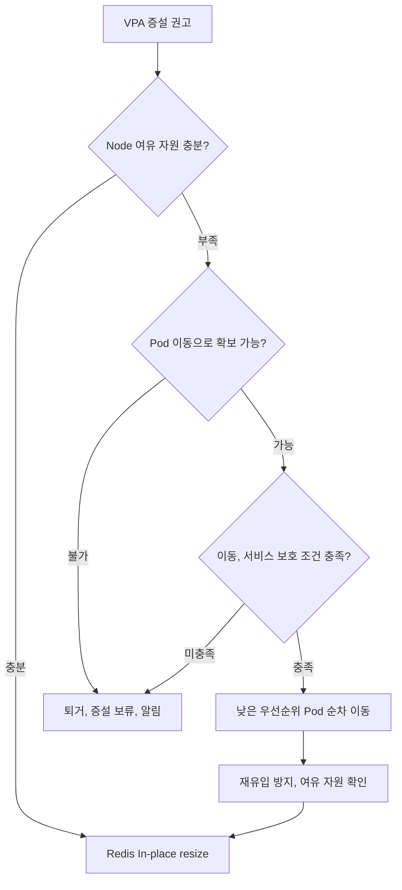

# v3 인프라 고도화 계획

> 기준일: 2026-11-11(CLOUD main `91e9c3f`의 구축 상태)
>
> 기준 설계: [v3 AWS, EKS 인프라 설계](v3%20인프라%20설계.md), 결정 근거: [v3 인프라 설계 의사결정 근거](v3%20인프라%20설계%20의사결정%20근거.md)

현재 구축 결과와 운영 데이터를 바탕으로 검토할 변경을 정리합니다. 각 항목의 "현재 구성"은 기준일의 구축 상태이며, 변경 방향과 적용 조건은 이 문서에서 관리합니다. 이슈, PR 번호는 CLOUD 저장소 기준입니다. GCP 재해복구는 [별도 후속 설계](v3%20GCP%20재해복구%20설계%20초안.md)에서 다룹니다.

## 목차

- [1. 실행 단위 분리와 CronJob 전환](#1-실행-단위-분리와-cronjob-전환)
- [2. 자원, 확장 정책 개선](#2-자원-확장-정책-개선)
- [3. Redis 자원 자동화와 확장](#3-redis-자원-자동화와-확장)
- [4. Pod 네트워크 개선](#4-pod-네트워크-개선)
- [5. 배포, IaC 개선](#5-배포-iac-개선)
- [6. 데이터 계층의 Kubernetes 운영](#6-데이터-계층의-kubernetes-운영)
- [7. 환경, 권한 격리 강화](#7-환경-권한-격리-강화)
- [8. 관측 시스템 가용성 개선](#8-관측-시스템-가용성-개선)
- [9. Kafka Streams 활용](#9-kafka-streams-활용)
- [10. Kafka 고가용성과 Kubernetes 운영](#10-kafka-고가용성과-kubernetes-운영)
- [11. 시스템용 Node 복구 자동화](#11-시스템용-node-복구-자동화)
- [12. Service Mesh 도입 검토](#12-service-mesh-도입-검토)
- [13. 내부 통신 암호화](#13-내부-통신-암호화)

## 1. 실행 단위 분리와 CronJob 전환

기준: [애플리케이션 배포 단위](v3%20인프라%20설계.md#42-애플리케이션-배포-단위)

현재 API, 알림 Consumer, AI 결과 Consumer, 정기 Batch는 같은 BE 프로세스, Pod, Deployment에서 실행합니다. BE의 Kafka Consumer는 dev, stage, prod 모두 켜져 있습니다. AI 작업 Consumer는 AI API Pod에서 실행하도록 Kafka 설정(`KAFKA_ENABLED`)과 토픽을 넣어 두었지만, 현재 AI 이미지가 이 설정을 읽지 않아 AI 결과는 BE의 HTTP 콜백으로 받습니다. 08시 정기 알림과 03시 보관 정리는 Spring 스케줄러와 ShedLock을 사용합니다.

| 변경 방향 | 적용 조건, 검증 |
|---|---|
| AI 작업의 Kafka 소비 시작 | AI 팀의 Kafka 코드가 main에 병합되어 이미지에 반영되면, 환경별로 요청, 완료 토픽의 발행, 소비와 offset 커밋, 재처리, 중복 방지를 확인합니다. 이후 HTTP 콜백 경로와 NetworkPolicy, SG의 AI→BE 8080 허용을 유지할지 정합니다. |
| 기능별 API, Consumer, Batch의 독립 배포 | 배포 일정, 자원, 확장 정책을 분리할 필요가 확인되면 실행 단위와 의존성을 구분합니다. |
| 정기 Batch를 Kubernetes CronJob으로 전환 | Batch를 독립 실행할 명령, 이미지를 준비한 뒤 스케줄, 시간대, 재시도, 중복 실행, 멱등성을 검증합니다. |

CronJob 자체가 실행의 정확히 한 번을 보장하지 않으므로 기존 중복 방지와 재처리 방식을 함께 검토합니다. 애플리케이션 실행 구조의 변경은 BE 팀과 진행합니다.

참고: [Kubernetes CronJob과 실행 제약](https://kubernetes.io/docs/concepts/workloads/controllers/cron-jobs/).

## 2. 자원, 확장 정책 개선

기준: [Pod requests, limits](v3%20인프라%20설계.md#51-pod-requests-limits), [HPA와 Replica](v3%20인프라%20설계.md#53-fe-be-hpa와-replica), [Karpenter 확장, 정리](v3%20인프라%20설계.md#54-karpenter-node-확장-정리)

| 현재 구성 | 변경 방향 | 적용 조건, 검증 |
|---|---|---|
| FE, BE HPA 없음. Replica 고정(dev 각 1, stage, prod 각 2). Metrics Server는 설치됨 | stage, prod FE, BE에 CPU 사용률 기반 HPA 도입(2~4개) | stage에서 부하 시험으로 목표 사용률, 확장, 축소 속도, 새 Pod, Node 기동 시간을 확인한 뒤 prod에 같은 정책을 적용합니다. BE Pod 증가에 따른 Kafka Consumer 실행량, Partition 재배정, DB 연결 수를 함께 검증하고, 활성 색상의 Replica를 Workflow, Argo CD 동기화가 덮어쓰지 않도록 HPA 대상과 values의 관계를 정합니다. |
| HPA 도입 후 | RPS 지표 추가 | CPU, RPS, 응답 지연의 관계를 확인하고 DB, 외부 API 병목에서 Pod 증가가 하위 시스템의 부하를 악화시키지 않는지 검증합니다. |
| AI API 모든 환경 1개 고정(분석 결과를 메모리에 둠, #267) | AI API 수평 확장 | 분석 결과, 작업 상태를 Redis, DB 등 외부 저장소로 옮기고 Kafka 소비(1절)가 시작된 뒤, 파티션 수, 소비 동시성, RunPod 처리 한도를 기준으로 Replica와 확장 정책을 정합니다. 애플리케이션 변경은 AI 팀과 진행합니다. |
| 초기 requests, limits(FE 250m/512Mi, BE 500m/1Gi, dev BE 250m, AI 250m/512Mi, limit 1536Mi, Redis 250m/512Mi) | 실측 기반 자원 정밀 조정 | 평시, Spike, 기동, Batch 구간의 CPU, 메모리, 응답 지연, OOM, DB 연결과 배포 여유를 함께 측정합니다. |
| 환경별 NodePool(`dev-app`, `stage-app`, `prod-app`, 모두 `m7i.large`, AZ 2b), 환경 안에서는 FE, BE, AI, Redis, Kafka 공유 | 환경 안에서 용도별 NodePool 분리 | 앱, 소비 작업의 자원 경합이나 서로 다른 배치, 정비 요구가 확인되면 검토합니다. |
| stage, prod는 빈 Node만 5분 후 정리, dev는 저활용 Node 통합(`WhenEmptyOrUnderutilized`, #280), 자발적 교체 한 대씩 | 정리 정책 비교, 조정 | 빈 Node 정리와 저활용 Node 통합의 실행 시간, 재확장 지연, 교체 횟수, Pod 대기, 작업 재실행을 비교합니다. |

## 3. Redis 자원 자동화와 확장

기준: [Redis 운영](v3%20인프라%20설계.md#55-redis-운영)

현재 Redis는 환경별 단일 Replica StatefulSet과 전용 PVC를 사용하고, AOF로 서비스 상태를 복원합니다. requests, limits를 고정값으로 관리하며 필요 시 수동 조정합니다. 아래 자동화와 확장은 초기 구축에 포함하지 않습니다.

### 3.1 VPA InPlace 도입

수동 자원 조정의 빈도와 운영 부담이 커지면 VPA를 통한 수직 확장을 검토합니다.

| 검토 항목 | 적용 조건, 검증 |
|---|---|
| 실행 중 증설 | VPA의 `InPlace` 모드로 Pod 재생성 없이 자원을 조정하는 동작을 검증합니다. |
| 지원 조건 | VPA 1.7.0에서 도입된 알파 기능의 지원 여부와 Kubernetes, VPA 버전, 기능 활성화를 확인합니다. |
| 자원 허용 범위 | OS, Kubernetes, 공통 Pod 자원을 제외한 단일 Node의 배치 가능 용량과 Redis의 처리 성능을 기준으로 상한을 정합니다. |
| 컨테이너 재시작 정책 | CPU, 메모리의 `resizePolicy.restartPolicy: NotRequired`를 검증합니다. |
| 증설 실패 | 재생성으로 전환하는 `InPlaceOrRecreate` 대신, 증설이 불가능하면 보류, 알림하는 방식을 검토합니다. |
| Redis 설정 연동 | `maxmemory`는 VPA가 자동 변경하지 않으므로 메모리 limit과의 여유, 허용 상한, 축소 여부와 변경 연동을 검증합니다. |

### 3.2 다른 Pod의 자원 회수 자동화

VPA 도입 후 같은 Node의 다른 Pod 때문에 증설이 보류되는 경우, 낮은 우선순위 Pod를 다른 Node로 이동하는 자동화를 검토합니다.

1. `PriorityClass`로 Redis보다 우선순위가 낮고 중단, 재배치를 허용한 워크로드를 선정합니다.
2. 대체 Node의 수용 용량, FE, BE 최소 운영 Replica와 PodDisruptionBudget을 확인한 뒤 순차 이동하고, 재생성된 Pod가 Redis Node로 돌아오지 않도록 배치를 제어합니다.

Kubernetes 기본 선점만으로 실행 중 증설과 자원 회수가 연결되지는 않으므로 별도 자동화의 필요성과 서비스 영향을 검증합니다.

### 3.3 단일 Node 용량 한계 이후 확장

| 한계, 요구 | 변경 방향 | 필요한 구성, 검증 |
|---|---|---|
| 다른 Pod를 이동해도 Node의 물리 용량 부족 | 더 큰 Node로 이전 또는 Replica 동기화 후 Primary 전환 | 볼륨 재연결, 메모리 상태의 동기화, 연결 전환, 중단과 데이터 유실 영향을 검증합니다. |
| 수직 확장 후에도 읽기 성능 부족 | 다른 Node의 읽기 Replica를 HPA로 확장 | Primary VPA를 도입한 경우의 연계, 읽기 부하에 따른 Replica 증감, 복제 연결 자동화, BE 읽기, 쓰기 경로 분리와 복제 지연을 검토합니다. |
| 저장 용량, Primary 쓰기 처리량 부족 | Redis Cluster 샤딩 | 데이터 분산, 클라이언트 호환성과 장애 복구를 검증합니다. 읽기 Replica만으로 이 한계를 해결하지는 못합니다. |

참고: [VPA InPlace](https://github.com/kubernetes/autoscaler/blob/master/vertical-pod-autoscaler/docs/features.md#eviction-free-in-place-updates-inplace), [컨테이너 resize 정책](https://kubernetes.io/docs/tasks/configure-pod-container/resize-container-resources/#container-resize-policies), [Redis 메모리 상한](https://redis.io/docs/latest/develop/reference/eviction/), [Redis 복제](https://redis.io/docs/latest/operate/oss_and_stack/management/replication/).

## 4. Pod 네트워크 개선

기준: [VPC와 네트워크](v3%20인프라%20설계.md#24-vpc와-네트워크)

현재 Amazon VPC CNI를 사용합니다. 통신 정책, 관측, IP 관리 요구가 늘어나면 Calico, Cilium과의 조합 또는 교체를 검토합니다. 필요한 기능과 기존 VPC CNI, AWS 연동의 호환성을 기준으로 비교합니다.

## 5. 배포, IaC 개선

기준: [CloudFormation](v3%20인프라%20설계.md#61-iac-aws-cloudformation), [Helm, Argo CD와 Blue/Green](v3%20인프라%20설계.md#63-cd-helm-argo-cd와-bluegreen)

### 5.1 IaC 전환과 적용 절차

| 현재 구성 | 변경 방향 | 적용 조건, 검증 |
|---|---|---|
| `infra-v3-cfn.yml`을 main에서 수동 실행해 plan(change set) 후 apply. PR에서는 cfn-lint만 실행하고 apply 승인 절차는 없음 | apply에 GitHub Environment 승인 추가 | prod에 영향을 주는 스택(eks, edge, prod-*, observability 등)부터 승인자를 지정하고, plan 결과(change set의 Replacement 여부)를 승인 화면에서 확인할 수 있게 합니다. 승인 대기 중 다른 plan이 끼어들지 않도록 실행 순서를 함께 정합니다. |
| 관리 도구, `platform` 차트, 환경별 데이터 차트(`*-data`)를 관리자 PC에서 Helm으로 적용. Argo CD는 앱과 SealedSecret만 관리 | Argo CD Application으로 인계 | Helm release와 Argo 관리가 겹치지 않도록 인계 순서를 정하고, Karpenter, Strimzi, Kafka 등 상태가 있는 자원은 prune을 끄고 동기화합니다. 데이터 차트의 토픽, PVC가 지워지지 않는지 먼저 확인합니다. |
| AWS CloudFormation | Terraform 전환 | State 관리, 기존 자원 이관을 검증하고, CloudFormation, Terraform, Karpenter, Load Balancer Controller의 관리 대상이 중복되지 않도록 구분합니다. |

### 5.2 Kafka Consumer의 Blue/Green 전환

현재 공통 앱 차트에는 색상(blue, green)별 Deployment와 `activeColor` 전환 구조가 있지만, 배포 Workflow는 활성 색상의 이미지 digest만 바꾸고 Deployment 전략은 `Recreate`입니다. BE, AI API는 같은 Kafka Consumer가 두 벌 뜨지 않도록 두 색상 동시 실행을 막아 두었습니다(`allowConcurrentConsumers: false`). 그래서 배포마다 새 Pod가 Ready가 될 때까지 해당 앱이 중단됩니다.

BE, AI API의 버전을 교체할 때 적용할 작업 전환 절차와 자동화를 구성해 색상 전환 배포를 적용합니다. Consumer가 없는 FE는 이 절차와 별개로 색상 전환 배포(green에 새 이미지, 확인 뒤 `activeColor` 전환, 이전 색상 0)를 Workflow에 먼저 적용할 수 있습니다. offset 커밋, Pod 재시작 후 미완료 작업 복구와 중복 반영 방지는 Kafka 연동 자체의 범위로 유지합니다.

| 검토 항목 | 변경 방향, 검증 |
|---|---|
| Consumer 전환 | HTTP 트래픽 전환과 Consumer 시작, 종료 순서를 구분하고, 신, 구 버전의 동시 소비 허용 여부를 정합니다. |
| 요청 접수 유지 | Kafka를 하나로 유지하면서 새 요청은 계속 저장하고, Consumer 교체 중 대기한 작업을 새 버전에서 이어 처리하는 방식을 검토합니다. 기존 메시지를 새 버전이 처리할 수 있는지 확인합니다. |
| 메시지 호환성 | BE, AI API의 요청, 완료 이벤트를 신, 구 버전이 처리할 수 있는지 검증합니다. 호환되지 않는 변경은 단계별 배포 또는 버전별 토픽 분리를 검토합니다. |
| 종료, 롤백 | 처리 중인 작업의 완료, offset 커밋과 담당 해제를 확인합니다. HTTP를 이전 버전으로 돌려도 이미 처리한 업무와 발행한 이벤트는 되돌아가지 않으므로 남은 작업의 처리 방식을 함께 정합니다. |

배포마다 Kafka 클러스터를 추가하거나 신규 작업 접수를 중단하는 방식은 확정하지 않습니다. 전환 중 처리 지연, 중복 실행, 작업 누락과 기존 버전 복귀 가능 여부를 검증한 뒤 절차를 정합니다. Consumer 제어와 메시지 계약 변경은 BE, AI 팀과 진행합니다.

참고: [Kafka Consumer의 offset, Consumer Group](https://kafka.apache.org/42/javadoc/org/apache/kafka/clients/consumer/KafkaConsumer.html), [메시지 스키마 호환성](https://docs.confluent.io/platform/current/schema-registry/fundamentals/schema-evolution.html).

### 5.3 Argo CD 관리 도메인

| 현재 구성 | 변경 방향 | 적용 조건, 검증 |
|---|---|---|
| Argo CD UI는 외부 도메인 없이 관리자 PC의 port-forward로만 접속. 로컬 계정 로그인, 익명 접근 끔, 기본 권한 `role:readonly` | 관리 도메인(예: `argocd.dameokja.com`)에서 HTTPS로 제공 | Grafana처럼 전용 CloudFront와 VPC Origin 또는 내부 ALB 경로를 검토하고, 공개 시에는 GitHub SSO(Dex 등)와 팀별 Argo RBAC를 함께 적용합니다. 관리 UI가 서비스 경로와 공용 설정을 공유하지 않도록 하고, 로컬 관리자 계정의 사용 범위를 정합니다. |

## 6. 데이터 계층의 Kubernetes 운영

기준: [데이터 배치](v3%20인프라%20설계.md#25-데이터-배치)

현재 MySQL과 AI용 PostgreSQL은 환경별 DB용 EC2에서 별도 엔진으로 함께 운영합니다. stage, prod는 EKS VPC의 `stage-db`, `prod-db`(t3.medium, Primary 1대, AZ 2b), dev는 기본 VPC의 기존 dev DB EC2를 VPC Peering으로 연결해 사용합니다. MySQL의 Operator 기반 운영을 검토할 때 Node 장애의 볼륨 분리, 재연결, 스토리지 배치와 복제, 장애조치, MySQL 메모리 설정을 함께 검증합니다. 이전 작업과 데이터 복구 절차를 확보한 뒤 전환 여부를 판단합니다.

## 7. 환경, 권한 격리 강화

기준: [Namespace 구성](v3%20인프라%20설계.md#41-namespace-구성), [운영 책임과 접근 권한](v3%20인프라%20설계.md#71-운영-책임과-접근-권한)

현재는 클러스터를 공유하고 Namespace로 환경을 나눕니다. 팀(FE, BE, AI)에는 Kubernetes 직접 접근 권한이 없고, 팀 권한은 IAM 그룹 `dameokja-iam`의 dev, stage SSM 경로 정책뿐입니다(#286, #307). 클러스터 안의 Role은 stage 켜기, 끄기(`stage-power`)와 Argo stage 앱 sync용만 있습니다. Grafana는 GitHub 아이디 허용 목록으로 GrafanaAdmin, Editor 역할만 나누고 환경을 구분하지 않습니다.

| 현재 구성 | 변경 방향 | 적용 조건, 검증 |
|---|---|---|
| 팀용 Role, RoleBinding 없음 | 팀별 Kubernetes RBAC 도입 | 팀별 IAM 역할 또는 Access Entry를 Kubernetes 그룹에 연결하고, 모든 환경의 Pod, 이벤트, 로그 조회와 dev의 Deployment 재시작 등 필요한 동작만 허용합니다. Secret은 `resourceNames`로 담당 Secret만 조회하게 하고 prod Secret 직접 접근은 주지 않습니다. 생성 이름은 RBAC만으로 제한할 수 없어 별도 검증 정책을 검토합니다. |
| Grafana 역할에 환경 구분 없음 | Grafana 환경별 권한 | 환경별 폴더, 데이터 소스 권한 또는 Loki, Prometheus 쿼리 라벨 제한으로 팀이 볼 수 있는 환경을 나누고, prod 로그의 개인정보 노출 범위를 함께 검토합니다. 허용 목록의 역할 매핑과 충돌하지 않는지 확인합니다. |
| SealedSecret은 관리자가 `seal-secrets.sh`로 SSM 값을 읽어 봉인, 커밋 | 팀이 담당 Secret을 직접 봉인, 변경 요청 | 공개 인증서로 팀이 봉인하고 PR로 제출하는 절차와, SSM 값 변경 뒤 반영 지연을 줄이는 방식을 비교합니다. 이름, Namespace 범위(`strict`)와 PR 검토 권한을 함께 정합니다. |

팀 RBAC 도입 뒤 dev의 Deployment 수정 권한으로 다른 트랙의 Secret을 참조할 수 있는 제약에 대해서는 워크로드 참조 제한이나 Namespace 분리를 검토합니다. 기존 배포, 접근 권한에 미치는 영향과 추가 운영 비용을 확인합니다. 강한 환경 격리나 서로 다른 정비 정책이 필요해지면 클러스터 분리를 검토합니다.

## 8. 관측 시스템 가용성 개선

기준: [Prometheus, Loki, Grafana 관측](v3%20인프라%20설계.md#8-관측-prometheus-loki-grafana)

현재는 별도 관측 EC2 한 대(t3.medium)의 PLG가 dev, stage, prod를 함께 받고, Node별 Alloy가 로그는 Loki로, 메트릭은 Prometheus remote-write로 보냅니다. 수신 포트는 인증 없이 SG로만 제한하고, Grafana는 전용 CloudFront와 GitHub 로그인으로 엽니다. 관측 EC2 장애 시 수집 공백, 일부 로그 유실을 감수합니다. 공백, 유실, 복구 시간이 운영 요구를 충족하지 못하면 수집, 저장, 조회 계층의 이중화를 검토합니다. 중복 수집 방지와 추가 자원, 저장 비용을 함께 검증합니다.

## 9. Kafka Streams 활용

기준: [Kafka 연동](v3%20인프라%20설계.md#45-kafka-연동)

현재 Kafka의 도입 범위는 이벤트, 작업의 보관, 분배입니다. 발행, 소비와 누락, 중복, 순서 제어를 검증한 뒤 다음 기능의 활용을 검토합니다.

- 요리 완료 이벤트로 사용자별, 기간별 완료 횟수를 집계합니다.
- AI 요청, 완료 이벤트를 작업 ID로 결합하여 처리 시간과 평균을 갱신합니다.

참고: [Kafka Streams](https://kafka.apache.org/documentation/streams/).

## 10. Kafka 고가용성과 Kubernetes 운영

기준: [Kafka 연동](v3%20인프라%20설계.md#45-kafka-연동)

현재 Kafka는 Strimzi로 환경별 클러스터를 분리했습니다. dev는 Broker, Controller 겸용 Pod 1개와 gp3 PVC 10Gi, 업무 메시지 30일 보관입니다. stage, prod는 겸용 Pod 3개를 Node마다 1개씩 두고 RF 3, min.insync 2로 구축했습니다(#261, #304). 세 Pod가 모두 AZ 2b에 있어 AZ 장애에는 대비하지 않습니다.

| 현재 한계 | 변경 방향 | 적용 조건, 검증 |
|---|---|---|
| dev의 단일 Broker 장애 시 이용 중단 | dev 다중 구성 전환 | 개발 연동의 허용 중단 시간이 짧아지면 Broker, Controller 수와 메시지 복제, Node 배치를 재검토합니다. |
| stage, prod Kafka가 단일 AZ 2b | 여러 AZ에 Broker 분산 | AZ 간 전송 비용, 지연과 DB, Redis의 AZ 배치를 함께 검토합니다. 앱 계층만 나누면 AZ 장애 가용성이 오르지 않습니다. |
| 다중 Broker의 배치, 자원 불균형 | 재분배와 정비 자동화 | 운영 데이터를 기준으로 Cruise Control 등의 필요성을 확인하고 파티션 이동, Node 정비 중의 처리 지연과 복제 상태를 검증합니다. |

Strimzi와 Kafka 버전 변경, 저장소 확장과 배치 변경은 기존 데이터 보존과 Consumer 연결, 복제 상태를 확인한 뒤 적용합니다.

참고: [Kafka KRaft](https://kafka.apache.org/42/operations/kraft/), [Strimzi](https://strimzi.io/).

## 11. 시스템용 Node 복구 자동화

기준: [Worker Node 운영 구조](v3%20인프라%20설계.md#32-worker-node-운영-구조), [시스템용, 앱 Node 배치](v3%20인프라%20설계.md#52-시스템용-앱-node-배치)

현재 Karpenter, Argo CD, Sealed Secrets Controller, Strimzi Cluster Operator, Load Balancer Controller, CoreDNS(1개), Metrics Server, kube-state-metrics, Strimzi Topic Operator는 ASG 없이 시스템용 EC2(`m7i.large`) 한 대에서 실행하며, Node 장애 시 Cloud 팀이 수동으로 복구, 교체합니다. 이 Node가 멈추면 클러스터 DNS 조회도 함께 영향을 받습니다.

| 현재 구성 | 변경 방향 | 적용 조건, 검증 |
|---|---|---|
| 시스템용 EC2 한 대 상시 운영, 수동 복구 | 고정 대수 ASG로 EC2 한 대 유지와 비정상 인스턴스 교체 자동화 | 복구 시간이 운영 요구를 충족하지 못하면 검토합니다. 검증한 AMI, 초기화, 클러스터 등록과 라벨, taint 적용을 자동화하고, EC2 상태 검사와 Kubernetes Node 장애의 감지 범위를 구분하여 검증합니다. |

ASG는 시스템용 EC2의 유지, 교체를 담당하고 앱 Node는 계속 Karpenter가 ASG 없이 공급하도록 관리 범위를 구분합니다.

## 12. Service Mesh 도입 검토

기준: [VPC와 네트워크](v3%20인프라%20설계.md#24-vpc와-네트워크)

현재는 Amazon VPC CNI의 NetworkPolicy와 보안그룹으로 필요한 통신을 제어합니다. 추가적인 서비스 간 통신 기능을 공통 계층에서 관리할 필요가 아직 크지 않아, Service Mesh의 자원과 운영 부담을 추가하지 않기로 했습니다. [Service Mesh 미도입 근거](v3%20인프라%20설계%20의사결정%20근거.md#service-mesh-미도입)

서비스 간 통신 관계가 복잡해지고 인증서, 접근 정책, 요청 제어의 개별 관리 부담이 커지면 Istio, Linkerd의 도입을 검토합니다. MSA 여부나 서비스 수만으로 도입을 결정하지 않고, 공통 관리 효과와 프록시의 자원 사용량, 운영 부담을 비교합니다. NetworkPolicy와의 역할 구분, Kafka와 DB 등 Mesh 외부 통신의 보안 범위를 확인한 뒤 구현체와 적용 범위를 정합니다.

mTLS가 필요한 구간이 생기더라도 Service Mesh 도입이 반드시 필요한 것은 아니므로, 애플리케이션이나 프록시에서 직접 구성하는 방식도 함께 검토합니다.

## 13. 내부 통신 암호화

기준: [HTTPS, 인증서](v3%20인프라%20설계.md#443-https-인증서), [Kafka 연동](v3%20인프라%20설계.md#45-kafka-연동), [Redis 운영](v3%20인프라%20설계.md#55-redis-운영)

현재 CloudFront 이후 구간(VPC Origin → internal ALB → Pod, Grafana는 VPC Origin → 관측 EC2 3000)은 HTTP, Kafka의 클라이언트 연결은 dev, stage, prod 모두 PLAINTEXT를 사용하고, 접근은 사설 경로와 SG, NetworkPolicy로 제한합니다. Alloy에서 관측 EC2로 가는 Loki, remote-write 전송도 인증 없는 HTTP입니다. Strimzi의 내부 연결은 지원 기본 구성을 사용합니다. 사용자 HTTPS(CloudFront에서 종료), 외부 API HTTPS와 Secret 저장 암호화(EKS 기본 암호화)는 유지합니다.

통신 보안 요구가 확대되면 Kafka의 TLS와 접속 인증, Redis와 DB의 TLS, 내부 HTTP 구간의 HTTPS 또는 mTLS 적용을 검토합니다. 적용 구간, 인증서 발급과 갱신, 신뢰 관계, 클라이언트 설정과 전환 중 연결 영향을 함께 확인합니다. 내부 통신 암호화와 Service Mesh 도입 여부는 구분하여 판단합니다.
