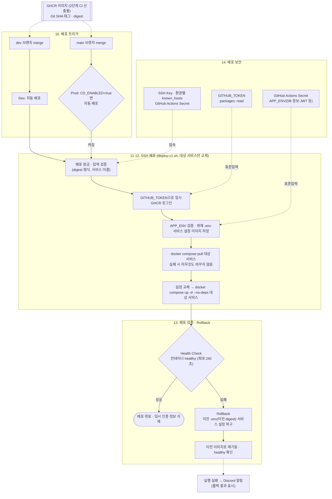

# 다먹자 v1 인프라 위키 — 3단계: CD(지속적 배포) 파이프라인 설계

> 기준: v1 마지막 운영 구성(2026-10-19 v2 prod 전환 전, dev는 2026-10-09~11 v2 dev 전환 전). v1은 v2로 전환한 뒤 종료했다. v2 이후 CD는 [4단계 문서](ktb4-cloud-wiki-v2.md#23-cicd-변경사항-설계)를 따른다.

> KTB 4조 다먹자 팀의 v1 인프라 설계 문서입니다. 이 문서는 **3단계(CD 파이프라인 설계)** 만 다룹니다. 1단계(EC2 + Docker Compose 기반 초기 배포)는 [ktb4-cloud-wiki-v1.md](ktb4-cloud-wiki-v1.md), 2단계(CI)는 [ktb4-cloud-wiki-ci.md](ktb4-cloud-wiki-ci.md)를 참고하세요.
> 각 결정 항목은 **상황 → 결론 → 이유 → 트레이드오프** 순서로 정리합니다. 배포 절차는 FE·BE 저장소의 `.github/workflows/v1-cicd.yml`(배포 job)과 [배포 스크립트](../../../v1/scripts/deploy-v1.sh)가 구현합니다.

## 목차
10. [CD 적용 범위 및 방식 결정](#10-cd-적용-범위-및-방식-결정)
11. [EC2 + Docker Compose CD Pipeline 설계](#11-ec2--docker-compose-cd-pipeline-설계)
12. [배포 전략 결정](#12-배포-전략-결정)
13. [배포 검증 및 Rollback 설계](#13-배포-검증-및-rollback-설계)
14. [배포 보안 설계](#14-배포-보안-설계)

---

## 상황 및 필요성

**상황**: CI를 통해 안정적으로 Docker Image를 만들 수 있게 되었음. 하지만 새 버전을 배포할 때마다 클라우드 담당자가 EC2에 접속해 `docker compose pull` / `docker compose up -d`를 직접 실행해야 한다면, 배포 빈도가 늘어날수록 문제가 커짐 — Application Delivery 과정의 자동화가 필요함.

---

## CD 파이프라인 다이어그램

(10~14번 결정사항을 한눈에 보기 위한 Mermaid 다이어그램)

> 참고: Health Check만으로는 특정 API만 깨진 경우를 못 잡음(13번 트레이드오프) — Smoke Test는 v1 미도입. IAM은 CD 파이프라인 실행 자체(SSH)에는 쓰이지 않음(14번).

---

### 10. CD 적용 범위 및 방식 결정
- **상황**: 2단계 CI까지는 자동으로 Docker Image가 만들어지지만, 실제 EC2에 반영하는 과정은 여전히 사람이 SSH로 접속해 `docker compose pull` / `up -d`를 수동 실행해야 함. dev는 AI 1명, 풀스택 3명, 클라우드 1명 전체 팀이 매일 붙어서 확인하는 공유 테스트 환경이라, 변경사항 반영 속도가 곧 개발 속도에 직결됨. 반면 prod는 KTB 훈련생 등 실사용자가 실제로 쓰는 환경이라, 검증이 덜 된 버전이 바로 노출되지 않도록 사람이 판단하는 지점이 있어야 함.
- **결론**:
  - **Dev**: **자동 배포 (Continuous Deployment)** — `dev` 브랜치에 merge되어 CI에서 이미지가 만들어지면, 사람 승인 없이 즉시 dev 서버에 배포
  - **Prod**: `main` 브랜치 merge가 곧 운영 배포 결정 — 이미지가 만들어지면 배포 job이 바로 prod 서버에 배포. 배포 단계에 별도 승인(GitHub Environments)은 두지 않고, 저장소 변수 `CD_ENABLED`가 `true`일 때만 prod 배포 job이 실행됨(FE·BE 모두 2026-09-21부터 켬)
  - **배포 전략**: dev/prod 모두 **대상 서비스 컨테이너 교체 + 실패 시 자동 복구** (12번)
- **이유**:
  - **Dev는 자동 배포** — dev는 속도가 생명인 환경. 팀원들이 변경사항을 최대한 빨리 확인하고 다음 작업으로 넘어가야 하므로, 승인 단계 없이 바로 반영되도록 함.
  - **Prod는 main 병합을 판단 지점으로 둠** — dev에서 확인한 변경을 `main`으로 올리는 PR 병합이 운영 반영 결정이 됨. `CD_ENABLED`는 운영 자동 배포 자체를 켜고 끄는 스위치로, 끄면 `main` 병합이 있어도 이미지만 만들고 배포하지 않음.
  - **배포 전략** — 앱 서버·서비스 복제본이 하나라 Rolling Update가 성립하지 않음(12번).
- **트레이드오프**:
  - Dev 자동 배포는 검증 없이 바로 반영되므로 잘못된 빌드가 dev에 즉시 노출될 위험이 있음 — 다만 2단계에서 PR 트리거(테스트·빌드)를 이미 게이트로 두고 있어 최소한의 검증은 거친 상태이고, dev는 원래 실험적인 공간이라 이 정도 리스크는 감수하기로 함.
  - Prod는 `main` 병합 즉시 배포되므로, 병합 시점에 배포 결과를 지켜보고 대응할 사람이 있어야 함. 병합과 배포 시점을 따로 정할 수 없고, `CD_ENABLED`를 끄면 FE 또는 BE의 운영 배포 전체가 멈춤.

### 11. EC2 + Docker Compose CD Pipeline 설계
- **상황**: 10번에서 dev·prod 배포 시점은 정했지만, "이미지를 서버에 반영하는 과정"이 사람 손을 타면 배포 때마다 클라우드 담당자를 붙잡아야 하고, 명령어를 잘못 입력하거나 순서를 헷갈릴 실수 위험도 있음. 1단계에서 dev 서비스 서버·prod 앱 서버 모두 nginx+FE+BE를 Compose로 실행하고 SSH 접근 방식을 채택해뒀으므로, 이 구조 위에서 "사람이 직접 치던 명령"을 파이프라인으로 옮길 방법을 정해야 함.
- **고려한 후보**: AWS SSM Run Command, EC2에 Self-hosted GitHub Actions Runner 설치, AWS CodeDeploy
- **결론**: **SSH 스크립트** — GitHub Actions 배포 job(GitHub 호스팅 러너)이 대상 EC2에 SSH로 접속해 서버의 `scripts/deploy-v1.sh <서비스> <이미지 digest> <Compose 프로젝트> <Compose 파일> <GHCR 사용자>`를 실행. 표준입력 첫 줄로 GHCR 토큰, 나머지로 서비스 설정(APP_ENV)을 넘김.

  1. **준비**: 입력값(서비스 이름 `frontend`·`backend`, `ghcr.io/...@sha256:...` 형식) 검증, 배포 잠금(`flock`, 최대 600초 대기)으로 같은 서버의 동시 배포 차단
  2. **인증**: 임시 Docker 설정 폴더에 GHCR 로그인(14번)
  3. **설정 준비**: 받은 서비스 설정을 검사(한 줄 KEY=VALUE, 중복·이미지 키 금지, BE 필수 키). 현재 `.env`·서비스 설정·실행 중 컨테이너의 이미지를 저장하고, `.env`에서 대상 서비스의 이미지 한 줄만 바꾼 후보 설정을 만들어 `docker compose config`로 검증
  4. **이미지 받기**: 대상 서비스만 `docker compose pull` — 실패하면 현재 설정과 컨테이너를 건드리지 않고 종료
  5. **교체**: 후보 설정을 반영(`chmod 600`)하고 대상 서비스만 `docker compose up -d --no-build --no-deps`로 교체. 다른 서비스와 nginx는 그대로 둠
  6. **검증·복구**: 헬스 체크(13번). 실패하면 이전 상태로 복구
  7. **정리**: 성공·실패와 관계없이 임시 인증 정보와 작업 폴더를 지움

- **이유**: AWS SSM Run Command, EC2에 Self-hosted GitHub Actions Runner 설치, AWS CodeDeploy를 함께 검토했음. 이 중 SSH 스크립트를 택한 이유는, 1단계에서 이미 SSH 접근 방식을 채택해뒀고 dev/prod 앱서버 모두 SSH 포트가 열려있는 상태라 **추가 리소스 없이 바로 구현 가능**하기 때문. 반면 나머지 방법들은 MVP 단계에 비해 요구하는 리소스가 크다고 판단:
  - **Self-hosted Runner**: Runner 프로세스를 상시 띄워둘 EC2가 필요함 — 기존 앱서버에 얹으면 리소스를 나눠 써야 하고, 별도로 두면 EC2를 하나 더 운영해야 함.
  - **CodeDeploy**: AWS의 별도 관리형 서비스를 새로 도입해야 함 — Agent 설치, 배포그룹 구성 등 추가로 익히고 관리할 대상이 늘어남.
  - **SSM**: EC2 자체는 추가로 필요 없지만, IAM 역할·정책을 새로 설계·관리해야 하는 부담이 있고, SSH처럼 이미 구축된 것을 재사용하는 것도 아님.

  결국 셋 다 "EC2를 추가로 두거나, AWS 서비스를 새로 도입해야 한다"는 공통적인 리소스 부담이 있어서, 지금 있는 SSH 인프라를 그대로 쓰는 쪽을 택함. 서비스 설정과 토큰은 명령줄 인자가 아니라 표준입력으로 넘겨 서버의 프로세스 목록이나 명령 기록에 남지 않게 함.
- **트레이드오프**: SSH 방식은 구현은 간단하지만, SSH 키를 계속 GitHub Secrets로 관리해야 하고 22번 포트가 상시 열려있어야 하는 1단계의 보안 트레이드오프가 CD 단계에도 그대로 이어짐. 또 배포 스크립트가 서버에 있는 Compose 파일을 쓰므로, Compose·nginx 설정 변경은 이 경로로 반영되지 않고 서버에 따로 반영해야 함. 서버 자원이 고갈되면 SSH 연결 자체가 끊길 수 있음 — 2026-09-24 dev에서 메모리 부족 중 BE 배포·롤백을 하다 SSH 타임아웃(종료 코드 255)으로 롤백 결과를 확인하지 못한 적이 있음.

### 12. 배포 전략 결정
- **상황**: 1단계에서 비용 때문에 prod 앱서버는 t4g.small **1대**, 서비스마다 컨테이너 1개로 두기로 했음. 그런데 사용자 접근 패턴을 보면 아침 알림 직후, 평일 저녁, 주말 식사시간뿐 아니라 야식을 먹는 사용자까지 있어 완전히 트래픽이 없는 시간대를 찾기 어려움. 반대로 Blue-Green이나 별도 Reverse Proxy 기반 Traffic Switching처럼 완전 무중단을 노리는 방식은 신규 버전을 검증할 인스턴스·컨테이너를 하나 더 띄워야 하는데, 이는 지금의 "앱서버 1대" 구성과 ALB 대신 nginx·RDS 대신 EC2 MySQL을 택해온 비용 절감 기조에 반함. 이 사이에서 배포 전략을 정해야 함.
- **결론**: **대상 서비스 컨테이너 교체 + 헬스체크 실패 시 자동 복구** — 배포할 서비스(FE 또는 BE) 하나만 새 이미지로 교체하고, 헬스체크에 실패하면 이전 이미지 digest·설정으로 되돌림([`v1/scripts/deploy-v1.sh`](../../../v1/scripts/deploy-v1.sh)).
- **이유**: 복제본이 하나라 Rolling Update가 성립하지 않음 — "순차적으로 트래픽을 옮겨가며 교체"할 대상 자체가 없음. 실질적으로는 서비스 단위 Recreate이므로, 대신 영향 범위를 줄이는 쪽에 집중함: 이미지를 먼저 받아 두고 교체해 중단 시간을 컨테이너 재기동 시간으로 줄이고, 대상 서비스만 교체해 nginx와 다른 서비스는 계속 응답하게 하고, 실패한 버전이 남지 않도록 자동 복구를 둠. Blue-Green·Traffic Switching은 신규 버전을 띄울 자원을 추가로 요구해 1단계의 비용 절감 기조와 부딪혀 택하지 않음.
- **트레이드오프**: 컨테이너 재기동 순간 짧은 다운타임이 발생함 — 2026-10-04 dev 부하 테스트에서 BE 교체 시각과 겹쳐 CSRF 요청 502가 1건 나왔고, 배포 직후 로그인 응답시간 최대 847.38ms가 관측됨([부하테스트 결과](../../../tests/k6/V1-RESULTS.md)). 무중단 배포가 필요해지면 복제본과 트래픽 분산이 있는 구조로 옮겨야 함.

### 13. 배포 검증 및 Rollback 설계
- **상황**: 11번에서 SSH 스크립트로 배포 자체는 자동화했지만, `docker compose up -d` 실행 직후 그 배포가 "진짜 성공했는지"를 무엇을 보고 판단할지 정해야 함. 클라우드 담당자가 1명뿐이라 매번 사람이 옆에서 눈으로 지켜보고 있을 거라 기대하기 어렵고, 2단계 CI도 BE 단위 테스트 위주라 배포 후 문제가 생겨도 자동으로 잡아줄 별도 테스트 체계가 없음.
- **결론**:
  - **배포 검증 기준**: **Health Check**만 사용 — Compose healthcheck(BE `/actuator/health`, FE `/` 응답, 10초 간격·3회 재시도)로 컨테이너가 `running/healthy`가 되는지 최대 240초 기다림. `unhealthy`·종료·헬스체크 없음·시간 초과는 실패
  - **Rollback 흐름**: `Deploy → Health Check` → 실패 시 `Rollback`(배포 전에 저장한 `.env`와 서비스 설정을 되돌리고, 이전 컨테이너의 이미지 digest로 `docker compose up -d` 재기동 후 다시 healthy 확인) → 복구 완료. 첫 배포라 이전 이미지가 없으면 대상 서비스를 멈춤. 롤백 여부와 관계없이 실행은 실패로 끝나 Discord로 알림(2단계 9번)
  - HTTP Status, Error Rate, 주요 API 테스트, **Smoke Test**는 v1에서는 도입하지 않음 — 운영 중 오류율은 CloudWatch SLO 알람으로 따로 감시
- **이유**: Health Check는 구현이 가장 간단하고, Compose에 이미 정의한 healthcheck를 그대로 쓰므로 별도 인프라 없이 적용 가능함. 롤백을 태그가 아니라 digest로 하는 이유는 태그가 다시 지정될 수 있어, 직전에 실제로 돌던 이미지와 정확히 같은 이미지로 되돌리기 위함. 이미지와 서비스 설정을 함께 되돌리는 이유는 새 설정 때문에 실패한 경우에도 이전 상태로 돌아가기 위함. CloudWatch Logs·알람은 사후에 확인·추적하는 수단이지 배포 성공/실패를 그 자리에서 판단하는 수단은 아니라서 배포 검증 기준과는 별개로 봄. Smoke Test나 주요 API 테스트는 검증 범위는 넓지만 테스트 스크립트를 별도로 작성·유지해야 해서, 지금 우선순위인 "기능 구현"에 비해 과하다고 판단해 제외함(7번 Lint 제외 결정과 같은 맥락).
- **트레이드오프**: Health Check만으로는 컨테이너가 떠 있지만 특정 기능만 깨진 경우(예: 특정 API가 500 에러를 반환)는 감지하지 못함 — 이 경우 배포가 "성공"으로 처리되어, 사용자가 먼저 오류를 겪고 나서야 팀이 알아차리게 되는 위험이 있음. 또 서버 이미지 정리 등으로 이전 이미지가 지워졌으면 롤백 때 GHCR에서 다시 받아야 하고, 롤백 자체가 실패하면 "서버 점검 필요"로 끝나 사람이 개입해야 함.

### 14. 배포 보안 설계
- **상황**: CD 파이프라인에는 SSH Key(11번), GHCR 인증, Application Secret(서비스 설정) 등 여러 민감한 값이 등장함. 이 값들을 어떻게 보관하고 서버에 전달할지, 서버에 무엇을 남길지 기준을 한데 모아 정해야 함. 한편 클라우드 담당자가 1명뿐이라 다른 팀원(AI 1명, 풀스택 3명)이 배포 후 문제를 발견해도 로그를 직접 볼 방법이 없으면 매번 그 담당자를 거쳐야 하는 병목이 생김.
- **결론**:
  - **SSH Key**: Private Key는 GitHub Actions Secret(`SSH_PRIVATE_KEY`)에 두고, 배포 job 실행 중에만 권한 `077`의 임시 파일로 써서 사용한 뒤 지움. 호스트 키는 환경별 Secret(`DEV_SSH_KNOWN_HOSTS`, `PROD_SSH_KNOWN_HOSTS`)으로 엄격히 검증(`StrictHostKeyChecking=yes`, `BatchMode=yes`).
  - **GitHub Actions Secret**: SSH Key와 서비스 설정을 GitHub Actions Secret으로 관리. 접속 대상·경로·Compose 이름처럼 비밀이 아닌 값은 저장소 변수(`DEV_DEPLOY_HOST`, `PROD_DEPLOY_HOST`, `DEPLOY_PATH` 등)로 둠.
  - **AWS IAM**: CD 배포 파이프라인 자체(SSH 스크립트 실행)에는 사용하지 않음 — 11번에서 SSM 대신 SSH를 택한 결정과 같음. 팀원의 로그 확인은 **CloudWatch Logs 조회 전용 IAM 권한**(`logs:GetLogEvents`, `logs:FilterLogEvents`, `logs:DescribeLogGroups` 등 읽기 전용)으로 함.
  - **Registry Credential**: GHCR 패키지가 비공개이므로, 배포 job의 단기 `GITHUB_TOKEN`(`packages: read`)을 표준입력으로 넘겨 서버의 임시 Docker 설정 폴더에 로그인하고, 배포가 끝나면 그 폴더를 지움. 서버에 장기 Registry 인증 정보를 두지 않음.
  - **Application Secret**: BE는 `DEV_APP_ENV`·`PROD_APP_ENV`, FE는 `APP_ENV`를 **배포할 때마다** 표준입력으로 넘겨 서버의 `env/backend.env`·`env/frontend.env`를 새로 씀(권한 `600`). 환경별 Secret 이름을 먼저 고르고 값이 없으면 배포를 실패시켜, 운영 값이 없을 때 개발 값으로 대체되지 않게 함.
- **이유**:
  - SSH Key + GitHub Actions Secret 조합은 1단계·11번에서 이미 구축해둔 흐름을 그대로 재사용하는 것이라 추가로 익히거나 구축할 게 없음. known_hosts를 Secret으로 고정하면 접속 대상이 바뀌었을 때 접속을 거부해 중간자 공격을 막음.
  - CD 배포 파이프라인에 IAM을 쓰지 않는 이유는 11번과 동일 — 배포는 SSH만으로 충분해서 굳이 새 인증 체계를 또 만들 필요가 없음. 다만 "로그 확인"이라는 필요는 IAM을 CloudWatch 조회 전용 최소 권한으로 부여해 해결함.
  - Registry 인증에 Actions가 실행마다 발급하는 토큰을 쓰면 별도 PAT를 만들거나 교체할 필요가 없고, 토큰이 실행 종료와 함께 만료됨.
  - Application Secret을 배포마다 새로 반영하는 이유는, 1단계에서 "GitHub Secrets로 관리한다"고 정한 결정과 일치시키기 위함 — 매 배포마다 최신 값을 반영해두면, DB 비밀번호 교체처럼 Secret이 바뀌었을 때도 사람이 따로 서버에 접속하지 않아도 다음 배포에서 자동으로 갱신됨.
- **트레이드오프**:
  - SSH Key와 상시 개방된 22번 포트 조합은 11번에서 이미 인지한 트레이드오프가 CD 단계에도 그대로 이어짐 — Key가 유출되면 서버 접근 권한이 통째로 노출됨. FE·BE 저장소가 같은 서버 계정(`ubuntu`)으로 접속하므로 한 저장소의 Key 유출이 서버 전체에 영향을 줌.
  - Application Secret을 배포마다 GitHub Actions → SSH → 서버로 전달하면, 그 경로 자체가 반복적인 노출 지점이 됨 — 표준입력으로 넘기고 로그에 출력하지 않지만, 서버 파일에는 평문으로 남음. Secret 변경이 자동으로 반영되는 실무 편의와 1단계 결정과의 일관성을 우선한 선택.
  - 팀원마다 IAM 사용자(또는 역할)를 만들어 관리해야 해서, 팀원이 늘거나 빠질 때마다 권한을 새로 부여·회수하는 관리 비용이 생김. 다만 권한 범위를 CloudWatch 조회로만 좁혀뒀기 때문에, 계정 하나가 유출되더라도 로그 열람 이상의 피해(배포 실행, 다른 리소스 변경 등)로는 이어지지 않음.
- **추후 고려할 요소**: SSH Key 주기적 교체(Rotation), 보안 그룹에서 GitHub Actions Runner IP 대역만 22번 포트를 허용하는 IP allowlist, Vault/step-ca 등을 이용한 단기 유효 SSH 인증서 발급, 배포 전용 저권한 계정 분리 등은 v1에서는 다루지 않음 — 13번의 Smoke Test와 같은 맥락으로, 서비스가 커지거나 실제 필요성이 생기면 그때 검토.
