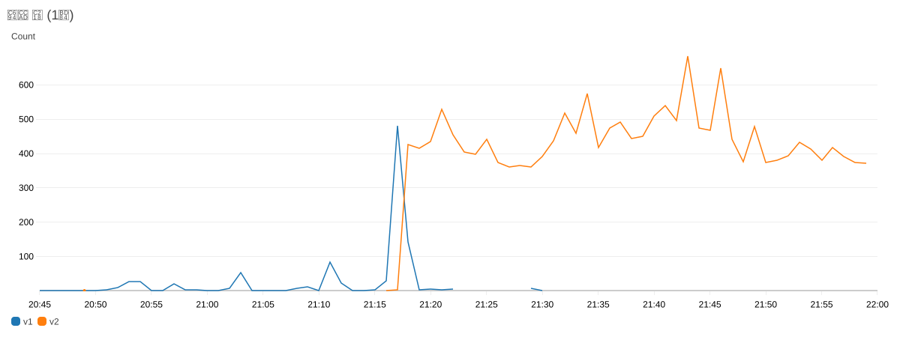
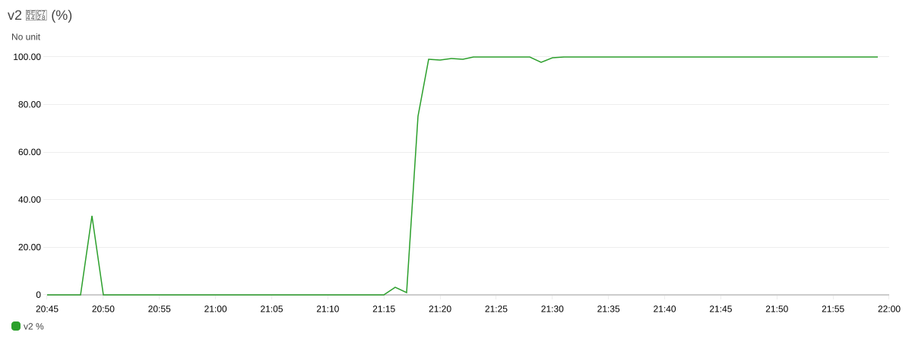
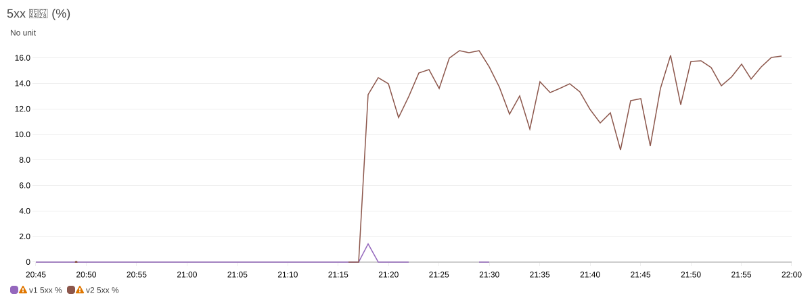
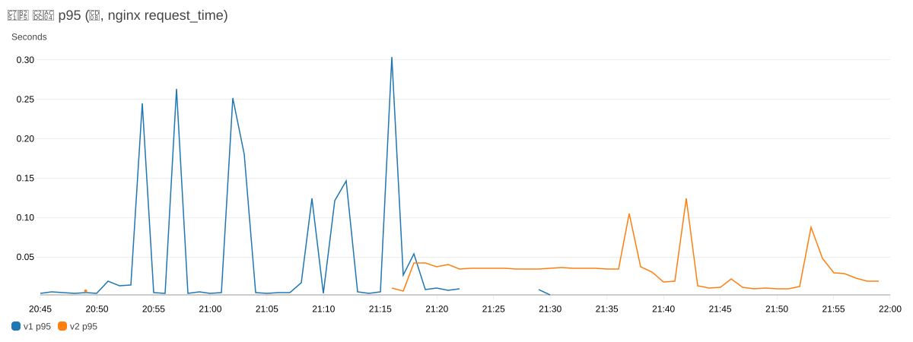
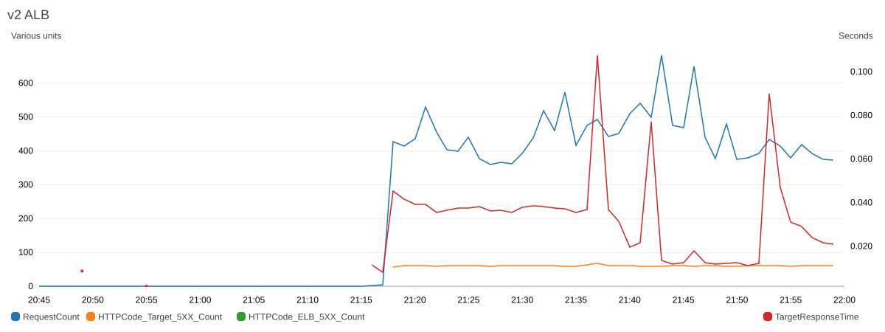

# v2 prod 전환 결과 — DNS 가중치 전환과 DB 쓰기 중단 이전

- 작성일: 2026-10-19
- 이슈·PR: #82·#83(v2 prod 스택), #86·#87(prod DB 설정), #88·#89(prod 승인 배포), #90·#91(prod Task Definition), #93·#94(prod ECS Service), #95·#97(DNS 가중치 전환·측정), #96·#98(DB 이전 준비·연결), #100·#101(인증서 `dameokja.com`), #103·#104(카테부 냉장고 ID), #105·#106(v2 prod 모니터링)
- 범위: 실제 사용자 트래픽 전환. 별도 부하 테스트는 하지 않았고, 측정은 실제 트래픽 기준이다.

## 1. 결과 요약

| 항목 | 결과 |
| --- | --- |
| 트래픽 전환 | 21:17 `dameokja.com` v1 0 / v2 100. 공용 DNS가 v2 ALB만 응답. 21:23 이후 v1 요청 0 |
| DB 이전 (DB 기준) | v1 DB 읽기 전용 → v2 승격 **78ms**, 미적용 트랜잭션 0, 직전 pt-table-checksum 18개 테이블 차이 0 |
| DB 이전 (사용자 기준) | 이전 BE Task가 트래픽을 받는 동안 쓰기가 v1 읽기 전용에 막힘. BE 로그 read-only 오류 21:35:28~21:40:37(약 5분), nginx 기준 쓰기 요청 5xx 5건 |
| 응답 시간 p95 (nginx) | 전환 전 v1 0.004~0.304초, 전환 뒤 v2 0.035~0.043초, DB 이전 구간 v2 0.011~0.124초 |
| 5xx | 전환 뒤 v2 5xx 분당 약 60건(약 13%). 거의 전부 `GET /api/v1/ingredients/341` 한 경로 (3.3절) |

## 2. 전환 순서

AWS Blue/Green 권장대로 DB를 환경 밖에 두고 v1·v2가 같이 쓰게 한 뒤, 앱 전환(DNS)과 DB 이전을 따로 했다(A안). ECS Blue/Green은 같은 ECS Service 안의 전환이라, ECS가 아닌 v1 EC2 → v2 전환에는 쓸 수 없어 Route 53 가중치를 썼다.

| 시각(KST) | 단계 |
| --- | --- |
| 19:55~20:00 | v1 DB GTID 온라인 활성화 (`enforce_gtid_consistency` WARN 4분 관찰, 경고 0 → ON, `gtid_mode` OFF → OFF_PERMISSIVE → ON_PERMISSIVE → ON) |
| 20:05 | v1 DB 이전용 계정 `repl`·`migadmin`·`dameokja` (v2 사설 서브넷 A 10.20.32.0/20만) |
| 20:05~20:40 | v2 BE를 v1 DB에 연결 (SSM `SPRING_DATASOURCE_URL`, Blue/Green 재배포) |
| 20:57 | DNS 가중치 v1 100 / v2 0 (단순 A 레코드 → 가중치 레코드, TTL 300 → 60) |
| 21:17 | DNS 가중치 v1 0 / v2 100 |
| 21:30~21:34 | v1 → v2 DB: preflight, mysqldump(460KB, 0.7초) → 복원(0.7초), GTID 복제, 스키마 비교, pt-table-checksum |
| 21:35:19 | v1 BE 컨테이너 정지 |
| 21:35:28.739 | v1 DB `super_read_only=ON` |
| 21:35:28.817 | v2 복제 해제·쓰기 가능 (78ms) |
| 21:35:52~21:45:13 | v2 BE DB 주소 → v2 DB, Blue/Green 재배포 완료 |

## 3. 측정

대시보드 `dameokja-prod-switch`(v1·v2 nginx 로그 지표 필터 + v2 ALB). 1분 값은 [`assets/v2-prod-switch-2026-10-19/전환_지표_1분.csv`](assets/v2-prod-switch-2026-10-19/전환_지표_1분.csv). 이미지 제목의 한글은 CloudWatch 렌더러 글꼴 문제로 깨져 보여 아래 제목을 따른다.

### 3.1 구간별 합계 (nginx 로그 기준)

| 구간(KST) | v1 요청 | v2 요청 | v1 5xx | v2 5xx | v1 p95(초) | v2 p95(초) |
| --- | --- | --- | --- | --- | --- | --- |
| 20:45~21:16 전환 전 | 349 | 2 | 0 | 0 | 0.004~0.304 | 0.007~0.011 |
| 21:18~21:34 DNS 전환 뒤 | 169 | 7,354 | 2 | 1,016 | 0.002~0.054 | 0.035~0.043 |
| 21:35~21:45 DB 이전 | 0 | 5,449 | 0 | 669 | - | 0.011~0.124 |
| 21:46~21:59 이전 뒤 | 0 | 5,877 | 0 | 837 | - | 0.010~0.088 |

### 3.2 그래프 (20:45~22:00)

요청 수 (v1·v2)

v2 비율(%)

5xx 비율(%)

응답 시간 p95 (nginx request_time, 초)

v2 ALB (요청 수, Target 5xx, ELB 5xx, TargetResponseTime p95)

### 3.3 v2 5xx 원인

- 전환 뒤 v2 5xx는 거의 전부 `GET /api/v1/ingredients/341`(PATCH 1건). 한 사용자 화면이 같은 재료를 계속 다시 요청
- v2 BE `Ingredient.getOwner()`가 null → NullPointerException
- v1 prod DB `ingredients.owner_id`는 NULL 허용이고, 전환 당일 v1 BE가 만든 재료 3개(339·340·341)가 owner_id NULL. 나머지 302개 정상
- 데이터 보정은 하지 않기로 했다(사용자 결정). BE 수정(owner 없음 처리 또는 NOT NULL·백필) 필요. DB 이전은 데이터를 그대로 옮겨 이 문제를 해결하지 않는다

## 4. 진행 중 생긴 문제와 조치

| 문제 | 원인 | 조치 |
| --- | --- | --- |
| prod 스택 첫 배포가 OIDC 역할을 못 받음 | CFN 배포 역할이 `environment:stage`만 신뢰 | `dameokja-github-oidc` 스택에 `environment:prod` 추가 |
| prod 스택 미리보기 실패 | 로그 그룹 `/dameokja/prod/*`를 v1 CloudWatch Agent가 이미 씀 | v2 로그 그룹을 `/dameokja/v2-prod/*`로 |
| prod DB `server_id=1`, `my.cnf` 기본 설정 빠짐 | DB 설정 Association이 UserData의 MySQL 설치보다 먼저 실행 | Association이 설치 완료를 기다리고 `my.cnf.rpmnew`를 되살리게 수정 (#87) |
| v1 DB에 SSM 명령이 안 감 | 사설 서브넷에 NAT·VPC 엔드포인트 없음 | v1 VPC에 SSM 엔드포인트 3개, `enableDnsHostnames` 켬 (#98). 명령 전달까지 약 1시간 걸림 |
| v2 BE가 v1 DB 접속 거부 (1차 배포 롤백) | Run Command의 `{{ssm-secure:…}}`가 풀리지 않고 글자 그대로 비밀번호가 됨 | v2 DB 서버에서 AWS CLI로 실제 SSM 값을 읽어 `ALTER USER` |
| DNS 전환 전 인증서 불일치 위험 | ALB 인증서가 `prod.dameokja.com`만 담음 | 인증서 `dameokja.com`, prod 서브도메인 제거 (#101) |
| 카테부 냉장고 참여 실패 (`REFRIGERATOR-400-004`) | prod Task Definition에 `KTB_REFRIGERATOR_ID` 누락 → 고정 코드를 5분 일반 코드로 검사 | prod `app.json`에 추가 (#104) |
| 사용자 기준 쓰기 실패 약 5분 | v2 BE의 DB 주소 변경이 ECS Blue/Green 재배포라 이전 Task가 트래픽을 받는 동안 v1(읽기 전용)에 씀 | 다음 이전 때는 BE가 주소 변경 없이 재연결하는 방식(내부 DNS 이름 등) 검토 |

## 5. 전환 뒤 상태

- `dameokja.com` → v2 prod ALB 100% (가중치 레코드 TTL 60)
- v2 prod: ECS app 2·ai 1, DB `i-0f1cc72a461d3e808`(쓰기 가능, 복제 없음), Redis `i-0fc62ff5cd7a70722`
- v1: BE 컨테이너 정지(nginx·FE 컨테이너는 실행 중), DB `i-0200cb7b53a4395cc` 읽기 전용(전환 시점 GTID `…:1-163`)
- 모니터링: v2 prod `dameokja-v2-prod-monitoring`(대시보드 `dameokja-v2-prod-infra`). v1 prod 모니터링 스택은 삭제, v1 로그는 보관 30일
- 되돌리기: v2에 새 쓰기가 쌓여 v1으로 바로 되돌릴 수 없음(v2 → v1 역방향 복제 필요)

## 6. 남은 작업

- BE: owner_id NULL 재료 처리
- 정리: 전환 측정 대시보드·지표 필터·알람(`dameokja-prod-switch`), 이전용 계정(v1 `repl`·`migadmin`·`dameokja`, v2 `migadmin`), v2 DB 서버 `/opt/migprod`, 피어링·v1 SSM 엔드포인트(#98), v1 앱·DB 서버, v1 가중치 레코드
- 부하 테스트를 건 전환 검증은 하지 않음 (실제 트래픽만 측정)
