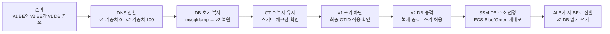
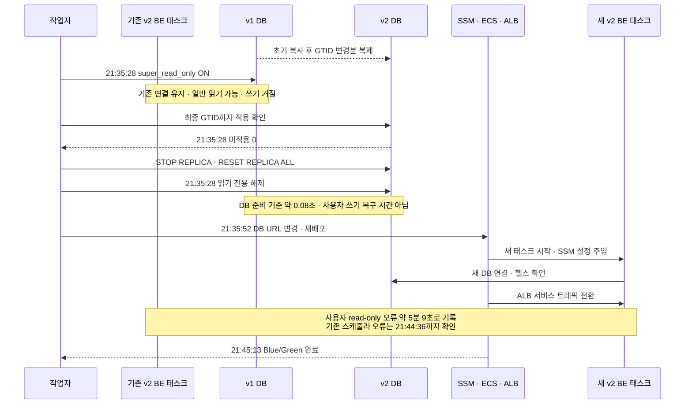
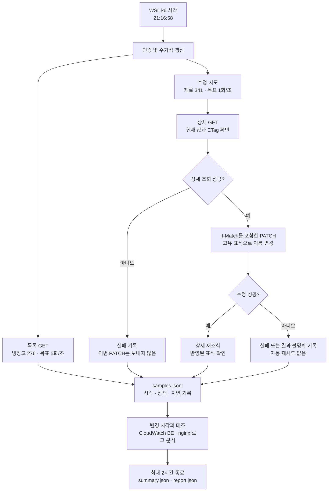
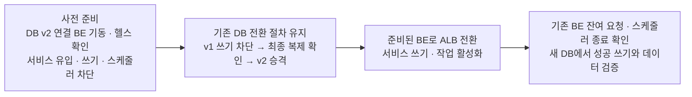

# v2 prod 전환 결과 — DNS 전환, 쓰기 중단 DB 이전, 연속 부하 관측

- 작업일: 2026-10-19 · 분석 보완일: 2026-10-20 · 모든 시각은 KST
- 대상: `dameokja.com`, v1 DB `10.0.0.22` → v2 DB `10.20.33.212`
- 근거: [전환 결과 PR #110](https://github.com/100-hours-a-week/KTB4-5th-CLOUD/pull/110), [DB 이전 이슈 #96](https://github.com/100-hours-a-week/KTB4-5th-CLOUD/issues/96), k6 원시 기록, CloudWatch BE·nginx 로그

## 1. 결론과 검증 범위

**이번 이전은 쓰기 중단 마이그레이션의 절차에 부합한다.** 초기 복사 후 GTID 복제를 유지하다가 원본 쓰기를 차단했고, 마지막 트랜잭션 적용을 확인한 뒤 v2를 승격했다. 이후 BE 연결 주소와 트래픽을 새 DB를 사용하는 태스크로 옮겼다.

그러나 **DB 승격 완료, 사용자 쓰기 복구, 부하 테스트 통과는 서로 다른 판단**이다. DB 준비 기준 전환은 약 0.08초였지만, 기존 BE가 읽기 전용 v1 DB에 연결된 동안 사용자 쓰기 오류가 발생했다. 또한 k6는 이전 시작 전부터 재료 상세 조회의 애플리케이션 오류에 막혀 실제 이전 구간에 PATCH를 보내지 못했다. 따라서 이번 관측으로 “지속적인 쓰기 부하에서도 이전 성공”이라고 결론 내릴 수 없다.

| 구분 | 확인 결과 | 근거·한계 |
| --- | --- | --- |
| 초기 복사·복제 검증 | 18개 테이블 체크섬 차이 0, 전환 시 미적용 GTID 0으로 기록 | 이전 실행 담당자가 남긴 #96 결과. 이 분석에서 체크섬을 재실행한 것은 아님 |
| DB 쓰기 차단 → v2 준비 | 약 0.08초 | 애플리케이션 재배포 시간 미포함 |
| 사용자 쓰기 영향 | read-only 오류 약 5분 9초로 기록 | #96의 사용자 요청 분석 범위. 전체 요청의 연속 실패 시간이라고 단정하지 않음 |
| 기존 태스크의 스케줄러 영향 | read-only 오류가 21:44:36까지 잔존 | 추가 CloudWatch 조회. 사용자 요청 중단 시간과 구분 |
| 이전 구간 목록 조회 | 2,925건 모두 HTTP 200 | 21:35:28~21:45:13, 테스트 냉장고 276 기준 |
| 이전 구간 수정 부하 | PATCH 0건 | 사전 상세 조회 582건이 모두 500이어서 수정 요청을 보내지 못함 |
| 전체 DB 유실·중복 검증 | k6로 증명하지 않음 | 단일 재료 갱신 관측과 DB 전체 정합성 검증은 별도 |

## 2. 전체 전환 흐름

앱 트래픽 전환과 DB 이전을 분리했다. DNS를 v2로 바꾼 직후에도 v2 BE는 v1 DB를 사용했다. DNS 변경만으로 DB 주소가 바뀌거나 DB 이전이 자동 시작되는 구조는 아니다.

| 시각 | 실제 작업 |
| --- | --- |
| 19:55~20:00 | v1 DB GTID 온라인 활성화 |
| 20:05~20:40 | 이전 계정·네트워크 준비, v2 BE를 v1 DB에 연결 |
| 20:57 | Route 53 가중치 레코드 구성, TTL 300 → 60 |
| 21:16:58 | 로컬 WSL k6 연속 측정 시작 |
| 21:17~21:18경 | DNS v1 0 / v2 100 전환. 실행 문서는 21:17, 사용자가 알려준 관측 기준은 21:18경 |
| 21:18:01 | 테스트 재료 갱신 첫 500 요청 시작 |
| 21:30~21:34 | 덤프·복원·GTID 복제·스키마 및 체크섬 검증 |
| 21:35:19 | v1 BE 컨테이너 정지 |
| 21:35:28 | v1 DB 쓰기 차단 |
| 21:35:28 | v2 최종 GTID 적용 확인 |
| 21:35:28 | v2 DB 승격 완료 |
| 21:35:52 | BE DB URL 변경 후 ECS 재배포 시작 |
| 21:45:13 | ECS Blue/Green 배포 완료 |
| 23:05~23:13 | 별도 DB 연결 풀 고갈 및 일부 API 타임아웃 관측 |
| 23:16:58 | 연속 측정 종료 |

## 3. DB 마이그레이션 흐름

### 초기 복사와 변경분 동기화

[이전 실행 1 기록](https://github.com/100-hours-a-week/KTB4-5th-CLOUD/issues/96#issuecomment-6267322651)에 따르면 v2 DB 서버의 `/opt/migprod`에서 `migrate.sh`와 Percona Toolkit 3.7.0으로 실행했다. 이 대화에서 별도로 준비한 DB 부하 스크립트를 실행한 결과와 혼동하지 않는다.

1. 버전 8.4.11, GTID·ROW, 서로 다른 server_id·UUID, InnoDB·PK 등 사전 조건 확인.
2. 사용하지 않던 v2의 빈 `app` 스키마 정리 후 v1 덤프 460KB 복원. 덤프·복원은 각각 약 0.7초로 기록.
3. `SOURCE_AUTO_POSITION=1`, `SOURCE_SSL=1`로 GTID 복제 시작. v2는 읽기 전용 복제본으로 v1 변경분을 따라감.
4. 스키마 비교: 테이블 18개, 컬럼 216개, 인덱스 77개, CHECK 48개, FK 19개 일치.
5. `pt-table-checksum`: 18개 테이블 오류·차이·건너뜀 0으로 기록.

복제 중 서비스 쓰기는 v1에만 들어갔다. 초기 복사 이후 변경분은 GTID 복제가 자동 반영했으며, 복사 작업만으로 동기화된 것은 아니다.

### 쓰기 차단과 BE 연결 전환

SSM `/dameokja-v2-prod/SPRING_DATASOURCE_URL`의 호스트를 `10.0.0.22`에서 `10.20.33.212`로 바꾸고 새 BE 태스크를 시작했다. 실행 중인 BE는 SSM 변경만으로 연결을 갱신하지 않으므로 ECS 재배포가 필요했다.

[이전 실행 2 기록](https://github.com/100-hours-a-week/KTB4-5th-CLOUD/issues/96#issuecomment-6267535875)에는 최종 원본 GTID `922d9b0c…:1-163`, v2의 동일 GTID 적용, 승격 후 새로운 v2 GTID 및 21:42 새 재료 생성이 남아 있다. v2에 새 쓰기가 생긴 이후에는 v1을 단순히 다시 쓰기 가능하게 열어 되돌릴 수 없다. 별도 역방향 동기화와 정합성 확인이 필요하다.

## 4. 연속 부하 테스트 흐름

### 목적과 대상

고정 5분짜리 독립 테스트가 아니라 **전환 전부터 전환 후까지 실제 API 요청을 계속 보내 장애 구간을 관측**했다. 로컬 WSL k6로 최대 2시간 실행했고 실제로 21:16:58~23:16:58 기록이 남았다.

- 주소: `https://dameokja.com`
- 테스트 회원의 개인 냉장고: **276**, 용량 **100 유지**. 카테부 공용 냉장고 274가 아님.
- 테스트 재료: **341 한 개**. 반복 생성 대신 이름을 고유 측정 표식으로 갱신.
- 목록 조회 목표: 5회/초. 수정 시도 목표: 1회/초, 작성자 VU 한 개.
- 수정 전 상세 조회와 수정 후 재조회가 추가되므로 HTTP 전체 요청률은 단순히 6회/초가 아님.
- 인증을 주기적으로 갱신하고, 시각·상태 코드·성공 여부·응답 시간을 저장. 비밀번호·쿠키는 결과에 저장하지 않음.
- DB 직접 100TPS 부하와 별도 `migtest` 원장 검증은 이 관측 실행에 포함하지 않았음.

동일 실행에서 직전 성공 표식이 사라지면 증거를 덮어쓰지 않도록 중단한다. 다만 한 재료를 계속 덮어쓰는 검사이므로 전체 DB의 모든 쓰기 유실·중복을 증명하지 않는다.

### 실제 실행 결과

| 항목 | 전체 2시간 | 실제 DB 전환 구간 21:35:28~21:45:13 |
| --- | ---: | ---: |
| 목록 GET | 35,805건 | 2,925건 |
| 목록 성공 | 35,586건 | 2,925건 |
| 목록 응답 미수신 | 219건, 약 0.612% | 0건 |
| 실제 PATCH | 61건: 성공 60, HTTP 500 1 | **0건** |
| 사전 상세 GET의 HTTP 500 | 7,001건 | 582건 |
| 인증 성공 | 139건 | 9건 |

전체 실패 표본은 7,241건으로, 목록·인증·수정·상세 사전 조회를 모두 합친 수치다. 실제 수정 실패 건수와 같지 않다. k6의 실행하지 못한 주기는 315회였으므로 목표 요청률을 모든 순간 정확히 유지했다고 해석하지 않는다.

## 5. 장애 분석: 서로 다른 세 구간

장애를 발생 시점과 사용자 영향으로 나눴다. 첫 번째 장애는 측정 종료까지 지속돼 두 번째·세 번째 장애와 시간이 겹친다.

| 번호 | 장애명 | 발생 시각 | 쉽게 풀어 쓴 원인 |
| --- | --- | --- | --- |
| 5.1 | 재료 상세 조회·수정 실패 | 21:18~측정 종료 | 기존 데이터에는 등록자가 없는데 새 앱은 등록자가 반드시 있다고 가정함 |
| 5.2 | DB 전환 중 쓰기 실패 | 사용자 요청 약 21:35~21:40, 기존 작업 약 21:44까지 | 이전 DB의 쓰기는 막았지만 기존 앱은 여전히 그 DB로 쓰기를 보냄 |
| 5.3 | 일부 조회의 응답 지연·실패 | 23:05~23:13 | 앱이 사용할 DB 연결이 모두 차 있어 새 요청이 기다리다 시간 초과됨 |

### 5.1. DNS 전환 후: 등록자 정보 누락으로 재료 상세 조회·수정 실패

> **어떤 문제가 있었나:** 테스트 재료 341은 이전 앱에서는 조회·수정할 수 있었지만, 새 앱으로 요청이 넘어간 뒤 상세 조회와 수정이 서버 오류로 실패했다.
>
> **왜 발생했나:** 이전 앱이 만든 일부 재료에는 누가 등록했는지 저장돼 있지 않았다. 새 앱은 등록자가 반드시 있다고 가정하고 이름이나 회원 정보를 읽으려다가 처리를 멈췄다. 서로 다른 버전의 앱과 기존 데이터가 맞지 않은 문제다.
>
> **영향은 무엇인가:** 수정은 처음 60건 성공한 뒤 1건이 실패했다. 이후에는 수정 전 상세 조회가 7,001건 실패해, 테스트 도구가 추가 수정 요청을 보내지 못했다. 서버 오류는 합계 7,002건이다. DB 이전이 시작되기 전부터 발생했으며 종료까지 복구가 관측되지 않았다.
>
> **무엇을 개선해야 하나:** 등록자 정보가 없는 기존 재료도 처리할 수 있도록 앱을 보완하거나, 승인된 기준으로 데이터를 보정해야 한다. 새 앱을 적용하기 전에 기존 데이터와의 호환성부터 확인해야 한다.
>
> > #### 5.1.1. 목록은 보이는데 상세 조회·수정만 실패한 이유
> >
> > 목록 화면은 재료 이름·수량·보관 상태만 읽어 등록자 정보가 없어도 표시할 수 있었다. 반면 상세 화면은 등록자 이름까지 보여 주고, 수정은 같은 등록자의 재료인지 확인하는 과정이 있어 문제가 드러났다.
> >
> > 재료를 DB에서 찾지 못했거나 접근 권한이 없었던 것이 아니다. 재료 조회와 권한 확인은 끝났지만, 응답을 만드는 과정에서 빠진 등록자 정보를 읽다가 실패했다. 코드·로그 원문은 문서 끝의 9.1절에 분리했다.

### 5.2. DB 이전 중: 이전 DB의 쓰기를 막은 뒤 앱 연결 전환을 기다리며 수정 실패

> **어떤 문제가 있었나:** DB 이전 중 사용자 요청에서 약 5분 9초 동안 쓰기 거절 오류가 관측됐다. 기존 앱이 실행하던 일부 예약 작업도 더 늦게까지 실패했다.
>
> **왜 발생했나:** 데이터를 안전하게 옮기려고 DB v1을 ‘조회는 가능하지만 저장·수정은 거절하는 상태’로 바꿨다. 그런데 요청을 받던 기존 v2 앱은 계속 DB v1에 연결돼 있었다. DB v2는 준비됐지만, 여기에 연결할 새 앱을 띄우고 정상 여부를 확인한 뒤 요청을 넘기는 데 시간이 걸렸다.
>
> **영향은 무엇인가:** 기존 앱으로 들어온 저장·수정 요청과 일부 예약 작업이 거절됐다. 다만 DB 접근 전체가 중단된 것은 아니다. 실제 DB 전환 구간의 테스트 목록 조회 2,925건은 모두 성공했다. 별도 운영 로그 분석에는 쓰기 요청의 서버 오류 5건이 기록돼 있다.
>
> **시간은 어떻게 해석해야 하나:** 사용자 요청의 쓰기 거절은 21:35:28~21:40:37에 기록됐다. 기존 앱의 예약 작업 오류는 21:44:36까지 남았다. 두 시간을 같은 장애 지속 시간으로 합치지 않는다. 약 5분 전체를 앱 기동 시간이나 Blue/Green의 전환 후 관찰 시간으로 단정하지 않는다.
>
> **무엇을 개선해야 하나:** DB 전환 절차는 유지하되, DB v2에 연결된 새 앱을 미리 준비해 둔다. DB 승격 후에는 준비된 앱으로 요청을 넘기고 기존 앱의 남은 요청·예약 작업까지 종료됐는지 확인한다. 구체적인 재발 방지책은 7절에 정리했다.
>
> **이번 테스트의 한계:** 첫 번째 장애 때문에 이 구간에는 실제 수정 요청이 전송되지 않았다. 따라서 약 5분의 쓰기 영향은 이 테스트의 수정 결과가 아니라 별도 운영 로그 분석을 근거로 한 값이다.

### 5.3. DB 이전 후: DB 연결 부족으로 일부 조회가 기다리다 실패

> **어떤 문제가 있었나:** DB 이전이 끝난 뒤인 23:05~23:13에 일부 조회가 제때 응답하지 못했다. 정상 응답도 섞여 있어 해당 시간 전체가 중단된 것은 아니다.
>
> **왜 발생했나:** 앱이 DB 작업에 사용할 수 있는 연결 10개가 모두 사용 중이었다. 연결을 받으려고 기다리는 요청은 최대 114건까지 확인됐다. 서버에서는 연결을 30초 동안 기다리다 실패한 기록이 남았고, 테스트 도구는 응답이 5초 안에 오지 않으면 기다리기를 중단했다.
>
> **영향은 무엇인가:** 목록 조회 219건과 수정 전 상세 조회 18건이 응답을 받지 못했다. 서버의 접속 기록에도 요청자가 기다리기를 중단한 흔적이 같은 건수로 남아 있다. 마지막 목록 조회 시간 초과 뒤인 23:13:54에는 정상 응답이 확인됐다. 첫 번째 상세 조회 오류는 이와 별개로 계속됐다.
>
> **아직 모르는 것은 무엇인가:** 왜 기존 DB 연결이 오래 반환되지 않았는지는 확정하지 못했다. 오래 걸린 조회, 잠금, 진행 중 작업 등을 DB 자료와 대조해야 한다. 연결 수를 늘리는 것만으로 원인이 해결됐다고 판단할 수는 없다.

## 6. DNS 관측과 지표 해석

전용 목록 URI의 마지막 v1 응답은 21:18:07, 상세 URI는 21:18:02이었다. v2에서는 21:18:02대부터 요청을 확인했다. 초기 DNS 캐시·요청 진행 시점 때문에 두 환경의 요청이 잠시 겹쳤다. 이는 **테스트 트래픽 기준**이며 전체 사용자·배치의 v1 종료를 증명하지 않는다.

기존 PR #110의 CloudWatch 대시보드·CSV는 사용자 요청과 k6 요청이 섞인 서비스 전체 집계다. “부하 테스트를 하지 않았다”, “한 사용자 화면이 재료 341을 계속 조회했다”는 기존 해석을 정정한다. 해당 반복 상세 조회는 k6의 수정 전 사전 조회였으며, 분당 약 60건의 오류에 직접 영향을 주었다. 전체 5xx 비율을 일반 사용자 오류율로 그대로 해석하면 안 된다.

기존 그래프와 1분 지표 원본은 [PR #110의 보관 자료](https://github.com/100-hours-a-week/KTB4-5th-CLOUD/tree/main/docs/implementation/assets/v2-prod-switch-2026-10-19)에서 확인한다. 기본 5xx·p95 집계와 함께 URI별 오류·타임아웃·미실행 주기를 봐야 한다.

## 7. 회고: BE 트래픽 전환의 준비 대기로 쓰기 중단이 길어진 문제

### 발생한 문제

DB v2는 약 0.08초 만에 쓰기를 받을 준비가 됐지만, DB v2에 연결된 새 BE 태스크는 원본 쓰기를 차단한 뒤에야 배포하기 시작했다. 새 태스크의 기동·헬스 체크와 트래픽 전환을 기다리는 동안, 기존 v2 BE 태스크는 계속 읽기 전용 DB v1에 쓰기를 시도했다.

오류를 낸 주체는 v1 BE가 아니라 **DB v1에 연결돼 있던 기존 v2 BE 태스크**였다. CloudWatch에서 read-only 오류를 낸 두 태스크는 DNS 전환 직후인 21:18에도 이미 실행 중이던 태스크와 일치한다. 새로 배포한 BE가 DB v2에 연결되기 전까지의 공백을 기존 태스크가 메우면서 쓰기 실패가 발생했다.

| 시점 | DB 상태 | BE·트래픽 상태 | 영향 |
| --- | --- | --- | --- |
| 전환 준비 | DB v1 쓰기 가능, DB v2는 복제본 | 기존 v2 BE가 DB v1 사용 | 서비스 처리 |
| 원본 쓰기 차단·대상 승격 | DB v1 읽기 전용, DB v2 쓰기 가능 | 새 BE 준비 전, 기존 BE가 트래픽 처리 | 기존 BE의 쓰기 실패 |
| 새 BE 배포 중 | DB v2 준비 완료 | 기동·헬스 체크·ALB 전환 대기 | 쓰기 실패 구간 지속 |
| 트래픽 전환 후 | DB v2 쓰기 가능 | 새 BE가 DB v2 사용 | 새 경로로 처리, 기존 작업은 별도 종료 확인 |

약 5분 9초는 사용자 요청에서 관측한 read-only 오류 구간이다. 전부 컨테이너 기동에만 걸린 시간이라고 볼 수 없으며, 기동·헬스 체크·트래픽 전환 대기가 함께 포함된다. 스케줄러 오류가 21:44:36까지 남은 사실도 사용자 요청과 구분한다. 재료 소유자 NULL에 따른 500은 이 문제와 별개의 오류다.

### 원인과 배운 점

- **새 BE를 사전 준비하지 않았다.** DB 전환 후 BE 배포를 시작해, 태스크를 준비하는 시간이 사용자 쓰기 중단 구간에 포함됐다.
- **DB 준비 완료와 서비스 준비 완료를 같은 시점으로 보았다.** DB 승격이 빨라도 앱 연결과 트래픽이 기존 DB에 남아 있으면 사용자의 쓰기는 복구되지 않는다.
- **SSM 값 변경을 연결 전환으로 취급했다.** 주소를 바꿔도 실행 중인 태스크의 기존 연결은 유지됐다. 새 태스크와 기존 태스크가 어느 DB에 연결돼 있는지를 각각 확인해야 했다.
- **새 경로 활성화와 기존 작업 종료를 따로 확인해야 한다.** ALB 전환 이후에도 기존 태스크의 스케줄러·진행 중 요청은 남을 수 있다.

### 다음 이전의 방지책: 새 BE 사전 준비

**덤프 → GTID 복제 → 최종 쓰기 차단 → 복제 적용 확인 → DB 승격이라는 DB 절차는 유지한다.** 대신 초기 복사·복제가 진행되는 준비 단계에서 DB v2에 연결된 새 BE의 기동·읽기 기반 헬스 체크를 끝내 둔다. DB 승격 후에는 BE 준비를 기다리지 않고 준비된 태스크로 트래픽을 넘긴다.

이는 DB 마이그레이션 방식을 바꾸는 것이 아니라 **새 BE의 준비를 사전 작업으로 옮기는 개선**이다. 이렇게 하면 기존 약 5분 중 BE 준비 대기를 쓰기 중단 구간에서 제외할 수 있다. 다만 ALB 전환·진행 중 요청·연결 정리 시간까지 없어지는 것은 아니므로, 중단 0이나 특정 초 이내를 아직 보장하지 않는다.

### stage 리허설에서 확인할 완료 조건

| 단계 | 확인할 내용 |
| --- | --- |
| 새 BE 준비 | 실제 DB v2 연결과 헬스 확인. 읽기 전용 복제본에서도 기동 가능한지 확인 |
| 전환 전 격리 | 새 태스크 준비가 운영 트래픽의 조기 전환을 유발하지 않도록 준비와 전환을 분리. 스케줄러·기동 시 쓰기·외부 작업도 실행하지 않음 |
| DB 승격 | 기존 절차대로 원본 쓰기 차단·최종 GTID 적용·대상 쓰기 허용 확인 |
| 트래픽 전환 | 준비된 BE로 전환하고 실제 수정 요청·성공 응답·DB 반영을 확인. 기존 태스크의 연결과 작업도 정리 |
| 결과 판정 | DB 준비 시간, 첫 쓰기 실패~성공 복구, 마지막 성공~다음 성공 간격을 별도 기록. 데이터 유실·중복 및 미전송 표본 확인 |

이번에는 상세 조회 오류로 이전 구간 PATCH가 0건이었다. 다음 리허설은 그 오류를 먼저 해소하고 실제 쓰기 요청이 전환 전후 계속 전송되는 것을 확인해야 한다. DB 연결 주소 같은 비밀이 아닌 설정과 전환 대상도 IaC·승인 기록으로 재현할 수 있게 관리한다. 이 회고는 개선안이며, 새 BE 사전 준비나 전환 제어를 실제 인프라에 구현·검증한 결과는 아니다.

## 8. 후속 조치와 최종 판단

1. **BE 호환성 수정:** NULL 소유자 처리 또는 데이터 제약·백필 방안을 BE 담당자가 결정한다. 이 문서 작업에서 기능 코드나 데이터는 변경하지 않는다.
2. **쓰기 검증 재설계:** 사전 조회 실패로 PATCH가 사라지는 경우를 별도 관측하고, 쓰기 차단·복구를 실제로 확인할 수 있는 전용 테스트 경로와 원장을 준비한다. 이번 결과를 지속 쓰기 부하 검증 성공으로 대체하지 않는다.
3. **쓰기 중단 시간 단축:** 7절의 회고에 따라 DB v2 연결 BE를 사전 준비한다. DB 절차는 유지하고, BE 준비 완료와 ALB 트래픽 전환을 분리해 stage에서 검증한다. 고정 DB 접속점·연결 풀 재연결 등은 별도 대안으로 비교한다.
4. **연결 풀 장애 분석:** 23:05~23:14 DB 작업·슬로 쿼리·잠금·장기 트랜잭션 자료를 대조한다. 풀 크기를 늘리는 것만으로 원인이 해결됐다고 판단하지 않는다.
5. **정합성 근거 보존:** 체크섬 차이 0과 최종 GTID 일치라는 실행 기록, k6 관측의 한계를 함께 보존한다. 측정 종료 후 복구 여부는 별도 확인한다.

**최종 판단:** 이전 절차는 쓰기 중단 방식에 부합한다. 읽기는 실제 이전 구간에도 유지됐고 원본 쓰기는 제한됐다. 초기 정합성 검증과 최종 복제 적용 완료는 실행 기록에서 확인된다. 다만 애플리케이션 오류로 이전 중 k6 쓰기 부하가 중단됐으므로, 부하를 유지한 종단 간 쓰기 검증은 미완료다.

## 9. 근거 자료

- [초기 복사·체크섬 실행 기록](https://github.com/100-hours-a-week/KTB4-5th-CLOUD/issues/96#issuecomment-6267322651)
- [쓰기 차단·승격·BE 재배포 실행 기록](https://github.com/100-hours-a-week/KTB4-5th-CLOUD/issues/96#issuecomment-6267535875)
- [기존 전환 결과 PR #110](https://github.com/100-hours-a-week/KTB4-5th-CLOUD/pull/110)
- [nginx 테스트 URI별 집계](assets/v2-prod-switch-2026-10-19/analysis/cloudwatch-test-endpoints.json)
- [첫 소유자 null 예외](assets/v2-prod-switch-2026-10-19/analysis/cloudwatch-first-exception.json)
- [DB 전환 중 읽기 전용 오류](assets/v2-prod-switch-2026-10-19/analysis/cloudwatch-migration-readonly.json)
- [연결 풀 고갈 로그](assets/v2-prod-switch-2026-10-19/analysis/cloudwatch-timeout-errors.json)
- [k6 종료 집계](assets/v2-prod-switch-2026-10-19/analysis/summary.json), [단계별·분별 분석](assets/v2-prod-switch-2026-10-19/analysis/report.json), [변경 시점 기록](assets/v2-prod-switch-2026-10-19/analysis/events.jsonl)
- 요청별 원시 표본은 로컬 `.worktrees/cloud-95-prod-switch-load/tests/prod-switch/results/switch20261019live-continuous/samples.jsonl`에 보관한다. 로그인 계정 파일·비밀번호·쿠키는 문서 자료에 포함하지 않는다.

### 9.1. 상세 조회·수정 오류의 코드와 데이터 근거

2026-10-20에 확인한 BE main `f5dc1ed54732f7601ed3e9865d6dbeb26dccb166`의 코드와 당시 예외 스택을 대조했다.

1. `IngredientDetailService.getDetail()`은 `findById(341)`로 재료를 조회한다. 없다면 NOT_FOUND로 종료되지만 실제 스택은 다음 단계까지 도달했다.
2. 냉장고 ID를 얻고 `validateReadAccess()`로 접근 권한을 확인한다.
3. 응답을 만들면서 `ingredient.getOwner().getNickname()`을 실행한다. 등록자 객체가 null이어서 NullPointerException이 발생하고 500으로 반환된다.

이 접근은 [상세 응답에 등록자 닉네임을 추가한 커밋 22787ae](https://github.com/100-hours-a-week/KTB4-5th-BE/commit/22787aed070dea9eba726a1b96b4a3642a1bad77)에서 추가됐다. [등록자 모델 도입 커밋 e5088be](https://github.com/100-hours-a-week/KTB4-5th-BE/commit/e5088be26d2ed6e1074014e4d3e7eccf5842a587)는 신규 생성 시 사용자 객체를 owner로 설정하고 엔티티·스키마에 필수 관계를 선언하지만, 이미 저장된 NULL을 조회 경로에서 처리하지는 않는다.

[당시 DB 조회 기록](https://github.com/100-hours-a-week/KTB4-5th-CLOUD/issues/95#issuecomment-6267176995)에는 운영 v1 테이블이 owner_id NULL을 허용했고 v1에서 생성한 339·340·341이 NULL이었다고 명시돼 있다. 즉, 구버전이 생성한 데이터와 신버전의 필수 등록자 가정이 호환되지 않았다. 코드에 필수 관계를 선언한 것만으로 기존 데이터가 보정되는 것은 아니다.

목록 응답 `IngredientListItemResponse.of()`는 이름·수량·보관 상태 등만 읽고 owner를 참조하지 않아서 같은 재료를 포함한 목록은 반환할 수 있었다. 수정 경로는 이름 변경 후 합산 대상을 찾을 때 `owner.getId()`를 호출하므로 같은 NULL 데이터에서 실패했다.

수정 방향은 BE 담당자가 구버전 데이터의 등록자 처리 정책을 정하고, 상세·수정·알림 등 owner 참조 경로에 일관되게 적용하는 것이다. 데이터 보정이 필요하면 실제 등록자 또는 승인된 대체 기준을 확인한 뒤 별도 승인해야 한다. 임의 사용자를 등록자로 채우거나 NULL 행을 삭제하지 않는다. BE 기능 코드·운영 데이터는 이번 분석에서 수정하지 않았다.
