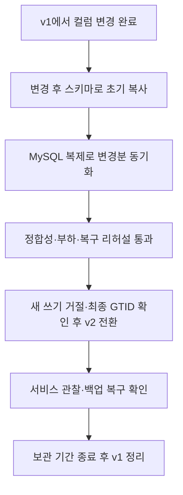
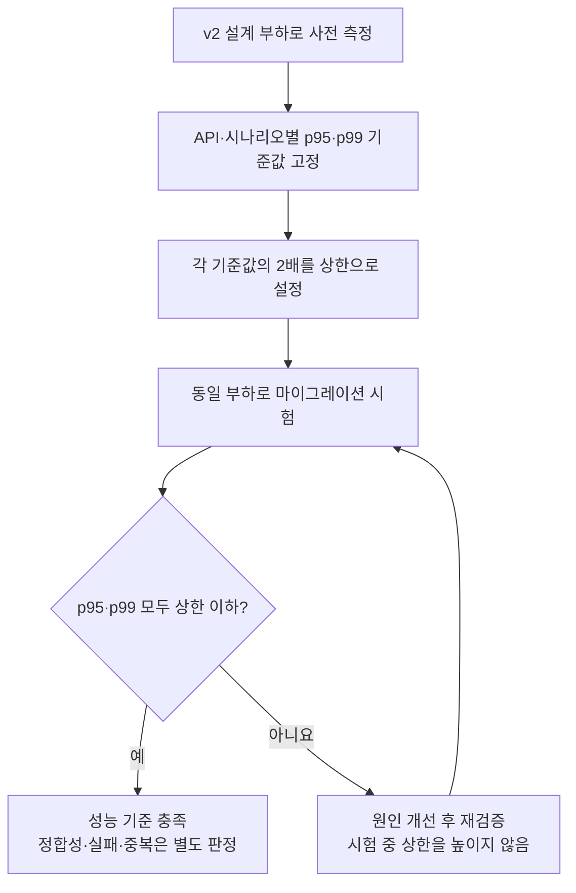
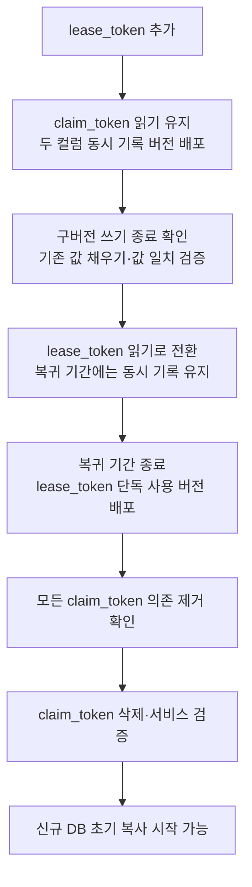
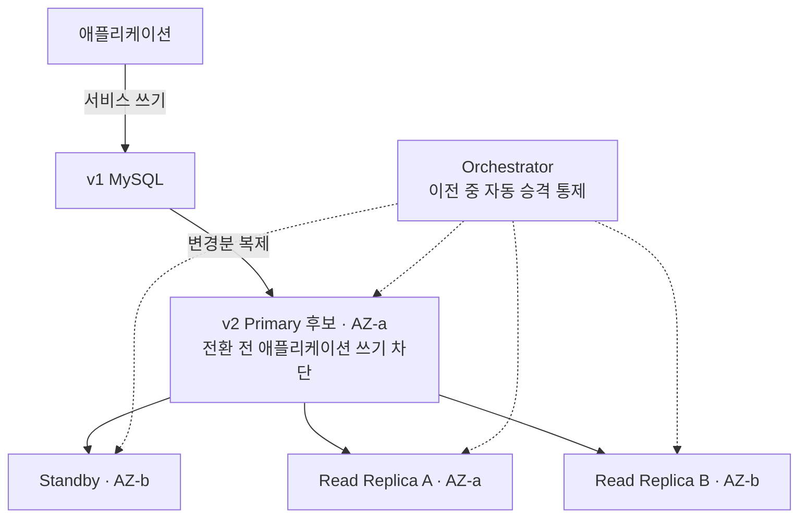
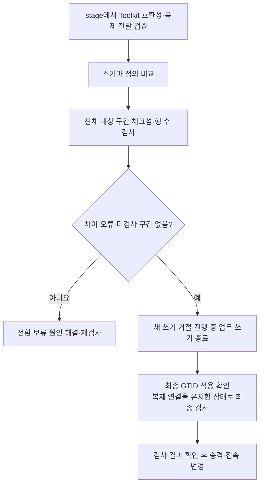
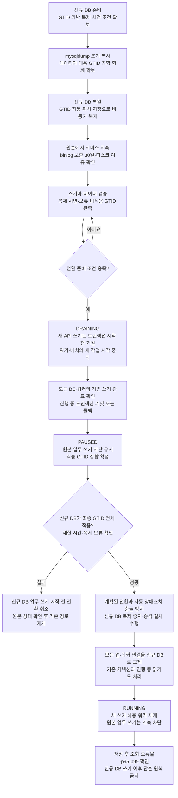
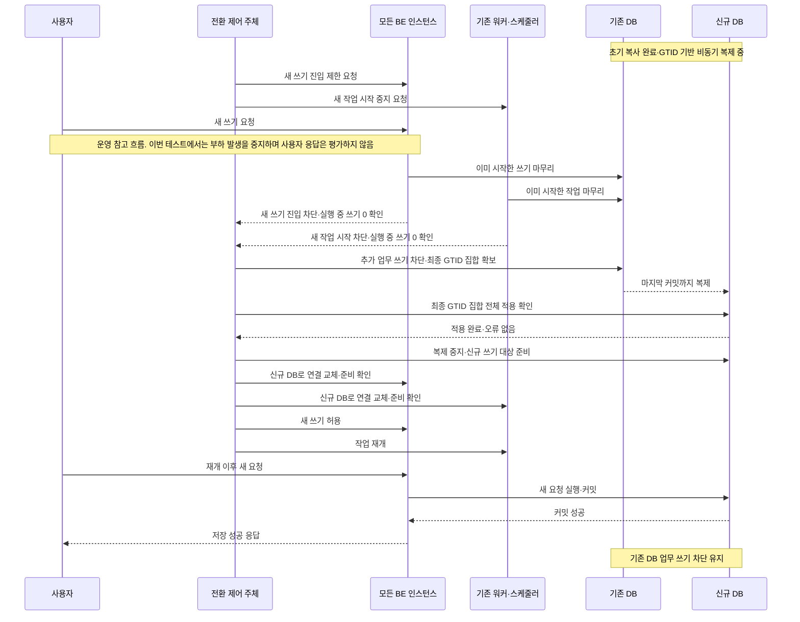
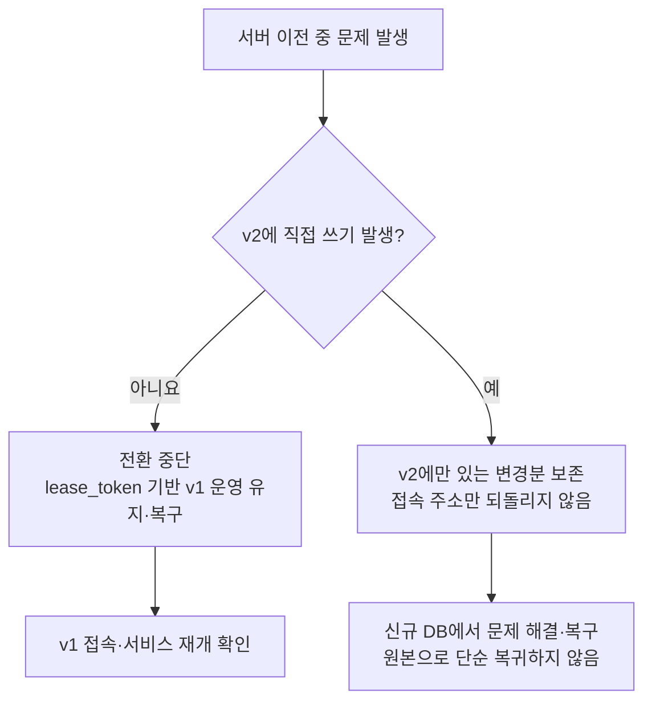
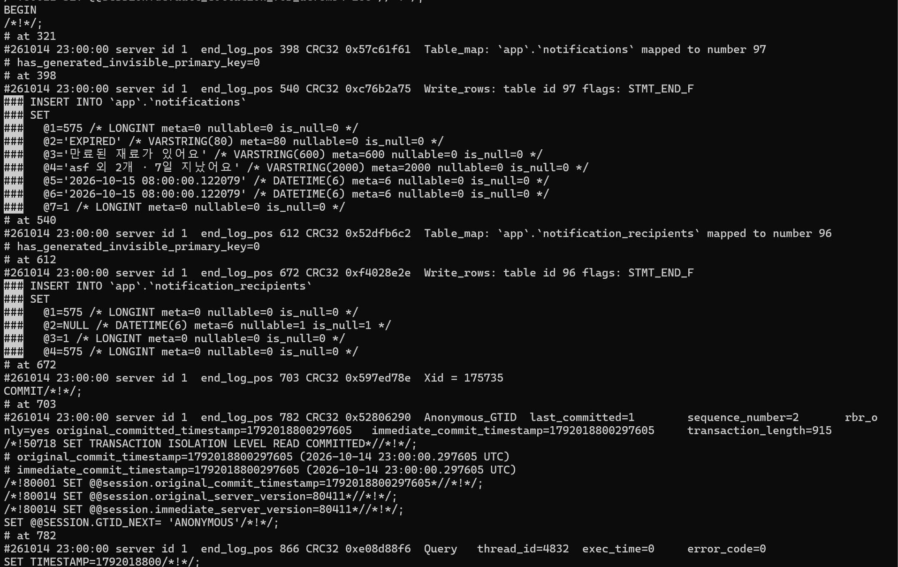

# v2 데이터베이스 쓰기 중단 마이그레이션 계획

- 작성일: 2026-10-09 / 수정일: 2026-10-16
- 상태: 쓰기 중단 방식의 마이그레이션 테스트. 사용자 응답 처리 제외, 중단 상한 1초, 연결 전환 방법 보류
- 목적: v1의 변경된 스키마와 데이터를 v2로 이전한다. 운영 중 초기 복사·변경분 동기화를 수행하고 최종 전환 시 짧게 쓰기를 중단한다. 이번 테스트에서는 사용자 응답을 정의하지 않고 시험 쓰기 발생을 제어한다. DB 쓰기 무중단으로 표현하지 않는다.

## 1. 요구사항과 진행 순서

**2026-10-15 결정**: 초기 복사는 mysqldump, 변경분 동기화는 GTID 기반 MySQL 기본 비동기 복제를 사용한다. binlog 보존 기간은 기존 30일을 유지한다. 사전 스키마·데이터 검증 후 새 쓰기를 점검 응답으로 거절하고 진행 중 트랜잭션을 마무리한다. 원본의 최종 GTID 전체 적용을 확인한 뒤 조회·쓰기 연결을 신규 DB로 전환한다. Kafka·Outbox·Redis 큐를 추가하지 않으며 기존 워커의 쓰기를 제어한다. 자체 검증기 대신 pt-table-checksum과 스키마 비교를 사용한다. 쓰기 거절·워커 제어는 구현으로 검증하고 연결 교체 방식은 보류한다.



컬럼 변경과 서버 이전을 다음 순서로 수행한다.

1. **기존 DB에서 컬럼 변경 완료**: v1에서 `push_notifications.lease_token`을 추가하고, 호환 배포·기존 값 채우기·읽기 전환을 진행한다. 구버전 복귀 기간 종료와 모든 의존 제거를 확인한 뒤 `claim_token`을 삭제한다.
2. **변경된 스키마로 서버 이전**: `lease_token`만 남은 v1을 기준으로 v2 초기 복사와 MySQL 복제를 수행하고, 정합성 검증 후 접속 대상을 전환한다.

컬럼 변경과 서버 접속 전환을 동시에 수행하지 않아 각 단계의 검증과 장애 원인 구분을 명확히 한다. 서버 이전을 시작할 때는 양쪽 DB가 같은 컬럼 이름을 사용하므로 복제 과정의 컬럼 변환이나 두 컬럼 동기화를 요구하지 않는다.

초기 복사는 `mysqldump`, 변경분 동기화는 GTID 기반 MySQL 기본 복제로 확정한다. 복제 접속은 `SOURCE_AUTO_POSITION=1`을 사용하며 별도 Kafka·Outbox는 도입하지 않는다. 도구·방식의 선택은 완료됐고, 실제 설정 적용과 리허설 검증은 진행 전이다.

### 쓰기 중단 방식 선택 근거

현재 MySQL 서버 이전에는 GTID 기반 기본 복제를 활용하고 최종 전환 시 시험 쓰기를 중지하는 방식을 선택한다. 데이터 단위별 라우팅·쓰기 소유권 이전 구조를 추가하는 비용과 위험을 줄이기 위한 선택이다. 무중단 비교안과 학습 용어는 [무중단 마이그레이션 검토](v2%20데이터베이스%20무중단%20마이그레이션%20검토.md)로 분리했다.

본 문서는 실제 적용할 쓰기 중단 테스트 절차를 다룬다. 허용 중단 상한은 1초이며 달성 여부는 검증 전이다. 2026-10-16 테스트 범위 조정에 따라 사용자 응답 처리는 제외한다.

### 2026-10-16 실행 정책 결정

| 항목 | 결정 |
| --- | --- |
| 사용자 쓰기 요청 | 전환 중 점검 응답으로 거절. 요청 대기·큐 적재는 하지 않음 |
| DB 연결 전환 방법 | 보류. BE 재시작·실행 중 풀 교체 중 어느 것도 확정하지 않음 |
| 최대 쓰기 중단 시간 | 1초. 최초 쓰기 진입 제한부터 모든 대상 인스턴스의 쓰기 재개까지 측정 |
| 신규 DB 쓰기 시작 후 장애 | 신규 DB에서 복구. 역방향 복제로 원본 복귀하는 구현은 제외 |

1초는 확정된 허용 상한이며 달성이 검증된 수치가 아니다. 기존 트랜잭션 종료, 원본 쓰기 차단, 최종 GTID 적용, 연결 교체와 재개를 포함한다. 신규 업무 쓰기 전 전환 취소 시 원본에서 쓰기를 재개하는 데 걸린 시간도 포함한다. 잔여 시간 내 안전한 전환·취소가 불가능하면 상한 미충족으로 기록하고, 안전 조건을 생략하거나 기존 DB를 동시에 쓰기 가능하게 만들어 시간을 맞추지 않는다. 연결 교체 방식은 이 상한을 기준으로 선정·검증해야 한다.

### 2026-10-16 테스트 범위 조정 — 사용자 응답 처리 제외

이번 구현은 DB 마이그레이션 테스트를 대상으로 한다. 실제 사용자가 점검 응답을 받거나 요청을 대기·재시도하는 시나리오는 구현·판정 범위에서 제외한다. 본 절은 앞서 기록한 사용자 점검 응답·요청 실패 방지 조건보다 우선한다. 앞선 비교안과 운영 고려사항은 참고용으로 보존한다.

| 구분 | 테스트 적용 기준 |
| --- | --- |
| 유지 | mysqldump 초기 복사, GTID 비동기 복제, binlog 30일 보존, 스키마·데이터 검증 |
| 쓰기 제어 | 테스트 부하 발생기와 DB에 쓰는 배치·워커의 새 작업 발생 중지, 실행 중 트랜잭션 완료 확인, 원본 추가 쓰기 차단 |
| 연결 전환 | 방식은 보류. 테스트 클라이언트·BE 중 실제 부하를 생성하는 주체의 연결을 신규 DB로 전환 |
| 시간 기준 | 새 쓰기 발생을 중지한 시점부터 신규 DB에서 시험 쓰기를 재개할 수 있음을 확인한 시점까지 1초 이내. 실제 시험 쓰기의 성공 시각도 별도 기록 |
| 복구 | 신규 DB에 업무에 해당하는 시험 쓰기를 시작한 이후에는 신규 DB에서 복구 |
| 제외 | 점검 HTTP 상태 코드·오류 본문, FE 안내·입력 보존, 사용자 요청 대기 큐, 사용자 자동 재시도와 UX 구현 |
| 오류 판정 | 전환 중 연결 오류·실패는 관측 결과로 기록하되 사용자 응답 기준으로 합격·불합격을 정하지 않음. 커밋된 시험 데이터의 유실·중복과 복제 오류는 별도로 검증 |

테스트 순서는 초기 복사·복제·사전 검증 → 부하 발생기의 새 쓰기 중지 → 진행 중 쓰기 완료·원본 쓰기 차단 → 최종 GTID 확보·대상 적용 확인 → 연결 전환 → 신규 DB 시험 쓰기 재개 → 시간·데이터 검증이다. 부하 중지부터 계산하므로 진행 중 작업이 끝나는 시간을 중단 측정에서 제외하지 않는다. 1초는 목표이며 달성된 결과가 아니다.

전환 전후 정상 부하 구간의 p95·p99는 기존 기준으로 측정한다. 부하를 중지한 구간은 요청이 없다는 이유로 지연 0이나 성능 통과로 판정하지 않고 쓰기 중단 시간으로 평가한다. 데이터 유실 여부는 응답을 받지 못한 요청까지 무조건 실패로 간주하지 않고 원본 커밋 이력과 신규 DB 결과로 확인한다.

사용자 요청용 BE 점검 모드·대기 기능과 FE 변경은 이번 테스트의 필수 의존성에서 제외한다. 기존 BE를 부하 대상으로 사용한다면 쓰기 경로·워커 목록, 기존 종료·재시작 방법 및 DB 연결 설정 정보는 필요하다. DB 직접 부하 테스트와 실제 BE를 포함한 테스트의 범위를 결과에 명시하고, 전자의 성공을 실제 서비스 전환 검증 완료로 표현하지 않는다. 운영 적용 전에는 사용자 응답·읽기 영향·재시도 정책을 별도로 설계한다.

### 시험 부하와 응답 시간 상한

성능 기준은 정상 업무 요청에 적용한다. 점검 거절 응답은 정상 처리 응답 시간 표본과 분리하여 건수·비율을 기록한다. 쓰기 중단은 최초 진입 제한 시작부터 전체 서비스 쓰기 재개까지 1초 이내여야 한다.

**2026-10-14 결정**: 시험 부하는 [v2 설계 위키](../design/wiki/ktb4-cloud-wiki-v2.md)의 트래픽 가정을 기준으로 구성하고, 사전 측정한 응답 시간의 2배를 마이그레이션 중 허용 상한으로 사용한다.

| 시나리오 | 설계 기준 |
| --- | --- |
| 평시 | 8~14 RPS |
| 저녁 피크 | 약 95 RPS, 설계 범위 약 91~99 RPS. 저녁 요리 준비 시간대 1시간의 패턴 |
| 아침 알림 버스트 | 알림 직후 10분 구간의 CCU 약 7,200명. 저녁 RPS 피크와 별도 시나리오로 구성 |



CCU는 동시 사용자 수이므로 이를 같은 수의 RPS로 바꾸지 않는다. API 구성·호출 비율·사용자 대기·연결 유지 패턴은 v2 설계에 맞춰 시험 스크립트에 기록한다. 설계에 없는 세부 값과 부하 증가·안정화 구간은 실행 전에 고정한다.

1. stage에서 마이그레이션 작업 없이 위 부하를 적용해 기준 응답 시간을 측정한다. 데이터량·API별 읽기/쓰기 비율·애플리케이션 및 인프라 구성·측정 구간을 함께 기록한다.
2. API·시나리오별로 `p95 상한 = 기준 p95 × 2`, `p99 상한 = 기준 p99 × 2`를 각각 산출한다. 작업 중 p95와 p99가 각 상한 이하여야 통과하며, 어느 하나라도 초과하면 성능 기준 미충족으로 판정한다. 실제 기준값과 상한은 측정 후 기록한다.
3. 같은 부하와 측정 방식으로 서비스 운영 구간의 컬럼 변경·초기 복사·지속 복제·정합성 검사 및 전환 후 성능을 평가한다. 점검 거절 응답은 별도 집계하고 쓰기 중단 시간 1초 상한을 측정한다.
4. 판정 지표는 p95와 p99 모두를 사용한다. 기준값과 작업 중 값은 동일한 집계 구간에서 p95끼리, p99끼리 비교하며, 백분위 기준 통과를 모든 요청의 상한 준수로 표현하지 않는다. 전환 구간도 별도로 집계하며, 오류·타임아웃을 성공 표본에서 제외했다는 이유로 요청 실패 방지 목표를 달성했다고 판정하지 않는다.
5. 기준 측정부터 오류·타임아웃·지속적인 적체가 발생하면 유효한 기준값으로 채택하지 않는다. 상한은 시험 도중 느려진 응답값에 맞춰 높이지 않으며, 초과하면 해당 단계의 성능 기준 미충족으로 기록하고 원인을 해결한 뒤 재검증한다.

예정된 점검 거절은 허용하되 DB에 저장하지 않고 명확히 응답한다. 점검 외 오류·타임아웃과 데이터 유실·중복은 허용하지 않는다. 거절 응답이 빠르다는 이유로 성능 목표를 충족했다고 판정하지 않는다. SSE 등 장기 연결은 별도 지표로 평가한다.

## 2. 이전 대상과 책임 범위

| 항목 | 계획 |
| --- | --- |
| 원본 | EC2 MySQL 8.4.11, 설치 패키지 `8.4.11-0ubuntu0.26.04.1`. t4g.small 수준의 ARM64 환경이며 실제 인스턴스 사양 확인 필요 |
| 대상 | EC2 MySQL 8.4, M7i·AMD64. 인스턴스 크기 미확정 |
| DB 구성 | Primary 1대(AZ-a), Standby 1대(AZ-b), Read Replica 2대(AZ별 1대) |
| 장애조치 | Orchestrator 사용. 이전 중 자동 복구와 수동 전환의 충돌을 방지 |
| 스키마 변경 | `push_notifications`의 실제 컬럼명 `claim_token` → `lease_token` |
| IaC | 새 인스턴스·네트워크·디스크 및 필요한 접근 권한 구성 |
| 이전 작업 | 데이터 복사·복제·접속 전환·정합성 검증 |
| BE 대응 | 컬럼 호환성 확인, 새 쓰기 거절, 기존 워커·배치 제어, 진행 중 작업 집계, 커넥션 교체와 안전한 재개 |

구성 선택 이유와 비용·가용성의 트레이드오프는 [v2 설계 위키](../design/wiki/ktb4-cloud-wiki-v2.md)와 [의사결정 근거](../design/인프라%20설계%20의사결정%20근거.md)에 기록한다. 전체 AZ 장애·장기 HA 운영 시험은 별도 DB 가용성 검증에서 관리하고, 여기서는 이전에 필요한 연결·복제·승격을 확인한다.

## 3. 실행 전 확정할 항목

| 항목 | 확인·결정할 내용 |
| --- | --- |
| 원본 구성 | 원본 패키지 버전은 `8.4.11-0ubuntu0.26.04.1`로 확인됨. 스토리지 엔진, 데이터량·쓰기량, 실제 인스턴스·디스크 사양 확인 |
| 이전 범위 | DB·테이블 목록, 계정·권한·뷰·트리거·프로시저·이벤트 스케줄러의 이전 방법 |
| 대상 설정 | AMD64 AMI·MySQL 설치, 문자 집합·콜레이션·시간대·sql_mode, 디스크 용량 |
| 초기 복사 | `mysqldump` 사용 확정. 이전 DB 목록, 실행 옵션·권한·저장 경로, 백업과 GTID 기준의 일치, 복원 절차·원본 부하 검증 |
| 복제 | GTID 기반 MySQL 복제 사용 확정. GTID 활성화 상태, 고유 서버 식별자, binlog 보존 30일 유지·용량 검증, 중계 복제 및 자동 위치 지정 설정·검증 |
| 접속 전환 | 점검 거절 적용 위치·쓰기 중단 상한 1초, 모든 인스턴스의 쓰기 종료 확인, 워커·배치 제어, 커넥션 교체, 최종 GTID 확인 및 실패 복구 |
| 컬럼 변경 | 실제 DDL, 타입·NULL·기본값·인덱스·제약, 토큰을 사용하는 모든 BE·배치·SQL |
| 운영 기준 | 담당자, 작업 일정, v2 설계 부하의 시험 스크립트, p95·p99의 집계 구간·기준 실측값 및 각각의 2배 상한, 관찰·백업 보관 기간 |

점검 거절을 포함한 전환·복구 절차를 리허설로 검증한다. VIP/DNS 변경이나 Orchestrator 승격만으로 기존 커넥션이 교체되지는 않는다.

## 4. 기존 DB에서 컬럼 이름 변경

v2 초기 복사·복제를 시작하기 전에 v1에서 완료한다. 기존 코드가 실행 중일 때 바로 `RENAME COLUMN`을 적용하면 기존 쿼리가 실패할 수 있으므로, 두 컬럼을 일시적으로 유지하는 호환 배포를 사용한다. 최종 상태는 `lease_token`만 존재하는 스키마다.



| 단계 | 작업 | 확인 조건 |
| --- | --- | --- |
| 1 | 백업·복구 확인 및 `lease_token` 추가 | 실제 DDL 기준으로 타입·NULL·기본값·인덱스·제약을 확인하고, stage에서 DDL 잠금·대기·서비스 영향을 검증 |
| 2 | 호환 BE·배치 배포 | 읽기는 `claim_token` 유지. 모든 토큰 변경은 같은 트랜잭션에서 두 컬럼에 반영하고, 구버전 인스턴스·워커·배치 종료 확인 |
| 3 | 기존 값 채우기 | `claim_token`을 기준으로 구간별 반영. 동시 갱신을 오래된 값으로 덮어쓰지 않도록 처리하고 NULL을 포함한 값 일치 검증 |
| 4 | 읽기 기준을 `lease_token`으로 전환 | 알림 처리 검증. 구버전 복귀 기간에는 두 컬럼 동시 기록 유지 |
| 5 | `lease_token`만 사용하는 버전 배포 | 복귀 기간 종료 후 동시 기록과 `claim_token` 참조를 제거. 모든 인스턴스·워커·배치에 배포 완료 및 진행 중 작업 종료 확인 |
| 6 | 기존 컬럼 삭제 | 코드·관리자 SQL·뷰·트리거·인덱스·제약의 의존 제거 또는 대체 완료. 삭제 DDL의 잠금 영향을 검증한 후 `claim_token` 삭제 |
| 7 | 컬럼 변경 완료 판정 | `lease_token`만으로 조회·쓰기·토큰 처리 정상, 응답 시간 기준 충족. 변경 후 스키마·백업과 검증 결과를 기록하고 서버 이전 시작 |

등록뿐 아니라 토큰 획득·갱신·해제와 NULL 초기화도 동기화 대상이다. 알림 작업의 중복 실행과 처리 누락을 검증한다. 실행 SQL과 BE 변경은 실제 스키마·사용 위치 확인 후 작성하며, BE·배치 수정은 애플리케이션 담당 작업으로 진행한다.

**서버 이전 시작 조건**: v1에서 `claim_token` 삭제와 후속 서비스 검증을 완료하고, 모든 실행 코드가 `lease_token`만 사용해야 한다. 이 시점 이후 서버 이전의 복귀 대상은 변경된 스키마를 가진 v1이다. `claim_token`을 사용하는 구버전 애플리케이션으로 단순 복귀할 수는 없다.

## 5. 서버 이전 준비와 데이터 동기화

- [ ] v1에서 컬럼 변경·구컬럼 삭제·서비스 검증 완료를 확인한다.
- [ ] 컬럼 변경 후 원본 백업을 확보하고 별도 환경에서 복구를 확인한다.
- [ ] IaC로 원본을 유지한 채 v2 DB 리소스를 별도 생성한다.
- [ ] `lease_token`만 존재하는 원본과 동일한 스키마 및 필요한 계정·설정을 준비한다.
- [ ] 복제용 네트워크·계정과 binlog 보관 용량을 확인한다.
- [ ] API·배치·관리자 SQL 등 모든 쓰기 경로를 목록화한다.
- [ ] 대상 DB에 애플리케이션이 조기에 쓰지 않도록 통제한다.

이전 중 복제 구조는 아래 안을 검증한다.



중계 복제를 위해 복제된 변경의 바이너리 로그 재기록과 로그 보관 조건을 확인한다. v1에서의 초기 복사 시점과 변경분 시작 위치를 연결한 뒤 지속 복제한다. 이전 기간에는 대상 토폴로지의 Orchestrator 자동 승격을 통제하며, 이전 완료 후 정상 정책으로 복귀한다.

### DB 저장소 관측과 binlog 보관

CloudWatch로 원본·대상 DB의 저장소 사용률·사용량·여유 공간과 시간에 따른 증가량을 관측한다. 기존 CloudWatch 구성 문서는 DB 서버 지표를 수집하지 않는 것으로 명시하고 있으므로, DB 서버용 Agent 설정·IAM 권한·대시보드·알람을 별도 구현해야 한다. 현재는 설계 단계이며 서버 적용은 완료되지 않았다.

| 관측 항목 | 수집·표시 계획 |
| --- | --- |
| 파일시스템 용량 | CloudWatch Agent로 `disk_used_percent`, `disk_used`, `disk_free`, `disk_total`을 60초 간격으로 수집 |
| 대상 경로 | 원본·대상의 MySQL 데이터·binlog·덤프 저장 경로가 속한 실제 마운트 지점. 동일 파일시스템이면 중복 집계하지 않음 |
| 증가량 | 같은 InstanceId·마운트 지점의 사용량 추이 및 시간 구간별 순증감량 표시. 로그 만료·파일 삭제로 감소할 수 있으므로 순증가량을 binlog 생성량으로 해석하지 않음 |
| MySQL 용량 구분 | 필요 시 별도 수집기로 데이터 디렉터리 사용량과 `SHOW BINARY LOGS`의 파일 크기 합계를 사용자 지정 지표로 전송. Agent의 disk 지표는 디렉터리별 용량을 제공하지 않음 |
| 알람 | 사용률 상승과 절대 여유 공간 부족을 함께 감시. 수치·평가 기간은 리허설의 생성량과 작업 공간 측정 후 확정하고 지표 수집 중단도 감지 |

첨부된 원본 서버 화면은 루트 파일시스템 6.8GB 중 4.5GB 사용, 2.3GB 여유, 사용률 67%를 나타낸다. 단일 시점이며 OS 파일도 포함하므로 3주간 DB 또는 binlog 증가량을 계산하는 근거로 사용하지 않는다. 과거 binlog 자동 삭제가 있었다면 현재 사용량만으로 누적 생성량을 추정할 수 없다.

binlog 보존 기간은 기존 30일을 유지한다. 초기 덤프·전송·복원·복제 추격·재시도가 이 기간 안에 완료되는지 확인한다. 필요한 공간은 해당 기간의 binlog 생성량, 일반 데이터 증가량, 같은 디스크에 저장하는 덤프·임시 파일, 안전 여유를 합산해 산정한다. 대상은 relay log와 자체 binlog 공간도 포함한다. 공간 또는 응답 시간 기준 초과 시 복사·검증 부하를 줄이거나 작업을 중단하며, 미반영 변경에 필요한 binlog를 삭제해 공간을 확보하지 않는다.

- [CloudWatch Agent 수집 지표](https://docs.aws.amazon.com/AmazonCloudWatch/latest/monitoring/metrics-collected-by-CloudWatch-agent.html)

### 정합성 검증 방식

**2026-10-15 결정**: 검증기 직접 구현과 자체 CDC 수집은 범위에서 제외한다. 데이터 검증은 Percona Toolkit의 `pt-table-checksum`을 사용하고, 스키마는 `SHOW CREATE TABLE` 및 스키마 덤프를 기존 diff 도구로 비교한다. 기존의 일정 초과 시 Toolkit으로 전환하는 조건은 폐기한다. 도구 설치·실행과 결과 검증은 아직 완료되지 않았다.



| 검증 | 방법 | 통과 기준 |
| --- | --- | --- |
| 스키마 | 테이블·컬럼·자료형·NULL·기본값·인덱스·제약 및 필요한 뷰·트리거 등의 정의 비교 | 환경별 허용 차이를 제외한 정의 일치 |
| 데이터 | `pt-table-checksum`으로 전체 대상 구간의 체크섬·행 수 비교 | 불일치·오류·미검사·건너뛴 구간 없음 |
| 최종 변경분 | 모든 업무 쓰기 종료 후 원본 GTID 집합과 대상 적용 상태 확인 | 원본의 마지막 업무 트랜잭션까지 적용 |
| 서비스 | 재개 전 핵심 기능 확인, 재개 후 오류·성능 관찰 | 기능 정상, 예정된 점검 거절 외 오류 및 유실·중복 없음 |

체크섬 일치는 모든 값을 직접 대조한 것과 동일한 보장이 아니며, GTID 적용 확인도 초기 데이터 검증을 대신하지 않는다. 자동 데이터 수정은 범위에 포함하지 않고 불일치는 원인을 확인한 뒤 조치한다.

- MySQL 8.4.11과 선택한 Toolkit 버전의 호환성·권한을 stage에서 확인한다.
- 검사 SQL이 복제되는 방식이므로 binlog 형식·복제 필터·중계 복제 전달 조건을 확인한다. v2 하위 Standby·Replica까지 실제 검사됐는지 각각 확인한다.
- 사전 데이터 검사 중에는 검사 테이블 쓰기와 복제 적용을 유지한다. 최종 전환에서는 애플리케이션·배치·이벤트 등 원본 업무 쓰기를 차단한다. 검사 완료 전에 복제를 끊거나 신규 Primary로 전환하지 않는다.
- 구간 크기·실행 시간·복제 지연·DB 부하 제한을 설정하고, API p95·p99는 별도 모니터링한다.
- 전체 데이터 검사는 전환 전에 완료한다. 최종 GTID 확인과 필요한 최종 검증 시간은 1초 쓰기 중단 예산에 포함한다. 허용 시간을 넘으면 검사를 생략하지 않고 전환을 보류한다.
- 결과·검사 대상·제외 범위·시각·GTID·도구 버전을 기록한다. 호환성 문제가 발생해도 자체 검증기 개발로 자동 전환하지 않고 기존 도구 대안을 검토한다.

## 6. 쓰기 제어와 최종 동기화를 통한 접속 전환

쓰기 대상을 Blue-Green 방식처럼 한 번에 전환한다. 단방향 복제 상태에서 양쪽 DB로 쓰기를 나누지 않는다. 전환 중 새 API 쓰기는 트랜잭션 시작 전에 점검 응답으로 거절하고 기존 워커·배치의 새 작업 시작을 중지한다. 진행 중 쓰기가 모두 완료된 뒤 원본의 최종 GTID를 확정한다. 신규 DB 적용 완료 후 연결을 교체하고 처리를 재개한다.

점검 거절·워커 제어는 구현·검증 전이며 연결 교체 방식은 보류한다. 전체 쓰기 중단 상한은 1초다. 정상 업무 요청의 p95·p99와 점검 거절 건수, 실제 중단 시간을 구분해 평가한다.

#### 전체 마이그레이션 흐름



#### API·워커·DB의 전환 시퀀스

전환 제어 주체는 배포 자동화 또는 내부 관리 기능으로 구현하며 구체 수단은 미확정이다. Redis 큐나 새로운 워커를 필수 구성으로 추가하지 않는다.



- 새 쓰기 진입 차단과 진행 중 작업 집계는 경쟁 조건 없이 동작해야 한다. 상태 플래그 조회만으로 전환 준비 완료를 판단하지 않는다.
- 워커는 DB 전환용 임시 전달자가 아니라 기존 백그라운드 실행 주체다. DB에 쓰는 스케줄러·배치와 별도 운영 작업까지 제어 대상에 포함한다.
- 최종 GTID 확인 전에는 신규 DB로 업무 조회를 넘기지 않는다. 전환 후 저장 직후 조회는 신규 Primary를 사용하며 비동기 Replica의 지연과 구분한다.
- 요청을 큐나 BE 메모리에 대기시키지 않는다. 거절된 요청은 처리되지 않았음을 알리고, 결과가 불명확한 기존 요청은 무조건 재실행하지 않는다.
- 기존 연결은 DNS나 환경변수 변경만으로 교체되지 않는다. 연결 교체 방식은 보류하며, 기존 읽기 요청의 처리와 조회 중단 허용 여부도 해당 방식 선정 시 확인한다.
- 신규 DB에서 쓰기가 시작된 이후 실패하면 원본으로 주소만 되돌리지 않는다. 대상에만 존재하는 변경분을 보존하는 복구 절차를 적용한다.

## 7. 리허설과 완료 기준

- [ ] v1에서 호환 배포·값 채우기·읽기 전환·동시 기록 제거·구컬럼 삭제를 순서대로 검증했다.
- [ ] `claim_token` 삭제 후 서비스가 정상이며, 변경된 스키마로 초기 복사와 지속 복제를 수행할 수 있다.
- [ ] 시험 쓰기 발생 중지부터 신규 DB 쓰기 재개 가능 확인까지 1초 이내이며, 커밋된 시험 데이터 유실·중복이 없다. 정상 부하 구간의 p95·p99 기준을 충족하고 전환 중 오류는 별도 기록했다.
- [ ] 이전 대상 DB 스키마가 일치하고, 의도한 환경별 차이를 기록했다.
- [ ] Toolkit의 전체 대상 구간 검사에서 체크섬·행 수 차이, 오류와 미검사 구간이 없다.
- [ ] 비교 시점과 결과를 기록하고 최종 GTID 반영을 확인했다.
- [ ] 기존 커넥션·배치가 원본에 쓰지 않고 대상 DB를 사용한다.
- [ ] 결과가 불명확한 쓰기의 재처리와 전환 중단 절차를 검증했다.
- [ ] 대상에서 Standby·Replica 복제를 유지하고 계획된 전환이 Orchestrator와 충돌하지 않는다.
- [ ] 컬럼 변경의 각 단계에서 구·신 코드 호환성과 알림 토큰 처리가 정상이다.
- [ ] v2 설계 부하에서 API·시나리오별 기준 p95·p99를 사전 측정하고, 서비스 운영 구간의 동일 집계 구간에서 p95와 p99가 각각 기준값의 2배 이내임을 모두 확인했다.
- [ ] 복제 지연·원본 및 대상 부하가 사전에 정한 기준을 충족한다.

## 8. 복구와 기존 DB 정리

서버 이전 실패 시 복구 경로는 **v2에 직접 쓰기가 발생했는지**로 구분한다. 컬럼 변경 단계의 복구 조건은 아래에 별도로 정리한다.



### 컬럼 변경 중과 삭제 이후

기존 컬럼과 동시 기록이 유지되는 동안에는 검증된 호환 버전으로 복귀한다. `lease_token` 단독 기록을 시작한 이후에는 기존 컬럼이 남아 있어도 값이 최신 상태라는 보장이 없으므로 구버전으로 바로 복귀하지 않는다.

`claim_token` 삭제 이후에는 `lease_token`을 사용하는 버전으로 서비스를 유지하며 수정하는 것을 우선한다. 구컬럼이 필요한 복구에는 컬럼·데이터·관련 의존 재구성과 검증이 필요하다. 과거 백업을 단순 복원하면 이후 쓰기가 유실될 수 있으므로 최신 변경분 보존 방법까지 준비한다.

### 대상에 직접 쓰기 시작 전

복제 오류·정합성 불일치·전환 조건 미충족 시 전환을 중단한다. 대상의 직접 쓰기가 없음을 확인하고 `lease_token`을 사용하는 v1 운영 경로를 유지·복구한다. 새 쓰기와 워커를 재개하기 전에 원본 접속 및 쓰기 허용 상태를 확인한다.

### 대상에 직접 쓰기 시작 후

신규 DB에서 복구한다. 대상에만 반영된 변경분을 보존하고, 원본으로 주소만 되돌리지 않는다. 역방향 복제를 통한 원본 복귀는 이번 실행 범위에서 제외한다. 복구 중 추가 장애 시간은 별도로 기록하며 상세 복구 명령은 구현 단계에서 검증한다.

예정된 쓰기 중단 구간과 예상 외 요청 실패·장애 시간을 구분하여 기록한다. 정상 전환 후 오류율·응답 시간·연결·데이터·알림 처리 결과를 관찰하고, 정해진 보관 기간 이후 원본 DB를 정리한다. 대상 DB의 백업·복구도 확인한다.

## 9. 실행 기록

| 항목 | 결과 |
| --- | --- |
| 초기 복사 도구 | `mysqldump --single-transaction --source-data=2 --set-gtid-purged=ON` 부하 중 실행·복원 검증 (DB 직접 테스트, 2026-10-16) |
| 변경분 동기화 | GTID 비동기 복제 `SOURCE_AUTO_POSITION=1` 부하 중 적용·오류 0 확인 (DB 직접 테스트) |
| 요청 전환 방식 | 테스트 부하의 새 쓰기 중지, 기존 쓰기 완료·최종 GTID 확인 후 일괄 전환. 사용자 응답 제외, 중단 상한 1초. DB 직접 테스트는 테스트 클라이언트 재연결로 검증, BE 연결 교체 방식은 보류 |
| 정합성 검증 | pt-table-checksum 3.7.0(`--recursion-method=processlist`)과 information_schema 정의 비교로 차이 0 확인 |
| 관련 이슈·PR·커밋 | 미작성 |
| 리허설 (2026-10-16) | **dev1 → stage DB** DB 직접 테스트: 쓰기 중단 33.9ms, 유실·중복 0, 체크섬 차이 0, p95·p99 2배 이내. 이전 구성(stage DB 사본 → 별도 신규 DB): 정상 전환 3회 18.5~26.3ms, 실패 취소 2회(6.9ms, 2,001.9ms 기준 미충족). [테스트 결과](v2%20데이터베이스%20마이그레이션%20테스트%20결과.md), 이슈 #66 |
| 운영 전환 일시 | 미실행 |
| 시험 부하 스크립트·측정 조건·판정 지표·집계 구간 | DB 직접 부하(쓰기 100/초·읽기 200/초) `tests/db-migration/migtest.py`. v2 설계 부하의 API 시나리오는 BE 포함 테스트에서 적용 예정 |
| API·시나리오별 기준 p95 / p95의 2배 상한 / 작업 중 p95 | DB 직접 테스트만 측정. 모든 실행 충족. API 기준 미측정 |
| API·시나리오별 기준 p99 / p99의 2배 상한 / 작업 중 p99 | DB 직접 테스트만 측정. 반복 실행 일부 구간 미충족(최대 4.2배). API 기준 미측정 |
| 요청 성공·응답 시간·정합성 검증 근거 | DB 직접 테스트에서 커밋 확인 쓰기 유실·중복 0. BE 포함 미검증 |
| 컬럼 전환·구컬럼 삭제 상태 | 원본 binlog에서 이름 변경 DDL 확인. stage DB는 `claim_token` 상태(2026-10-16 확인). 호환 배포 완료 여부는 별도 확인 필요 |
| 복구 시험·관찰 결과 | 신규 DB 쓰기 전 취소·원본 재개 검증. 신규 DB 쓰기 후 복구는 미검증 |

접속 비밀번호·토큰·개인정보는 기록하지 않는다.

### 2026-10-15 원본 DB binlog 관찰 및 분석

마이그레이션 전 변경 기록의 구조와 검증에 활용할 수 있는 범위를 확인하기 위해 원본 DB의 설정 조회 결과와 `mysqlbinlog --base64-output=DECODE-ROWS -vv` 출력을 분석했다. 아래 내용은 제공된 출력에 대한 관찰 결과이며, 신규 DB의 복제 적용이나 데이터 일치 검증을 완료했다는 의미는 아니다.



#### 확인된 설정과 트랜잭션 경계

| 항목 | 관찰 결과 |
| --- | --- |
| `log_bin` | `1`: binlog 활성화 |
| `gtid_mode` | `OFF`: GTID 미사용 |
| `gtid_executed` | 빈 값: 실행된 GTID 집합 없음 |
| 사진의 데이터 변경 | `app.notifications`와 `app.notification_recipients`에 각각 행 1개 삽입 |
| 커밋 | 두 INSERT가 동일한 `BEGIN`과 `COMMIT` 범위에 포함됨 |
| 커밋 이벤트 | 위치 `672`에서 시작하여 `703`에서 종료, `Xid = 175735` |
| 다음 트랜잭션 | 위치 `703`에서 별도의 `Anonymous_GTID` 이벤트 시작 |
| 사진의 binlog 파일명 | 화면에 표시되지 않아 미확인. 위치만으로 다른 파일의 이벤트와 식별하지 않음 |

앞서 별도로 확인한 `binlog.000183`은 546바이트이며 `push_notifications`의 CHECK 제약조건 재정의와 `claim_token → lease_token` 이름 변경 기록을 포함했다. 이 사진의 트랜잭션은 위치 703 이후까지 이어지므로 해당 파일의 기록으로 간주하지 않는다. DDL 기록은 확인됐으나 현재 스키마와 전체 애플리케이션 호환 배포 완료 여부는 별도 확인이 필요하다.

#### 이벤트별 해석

| 위치 | 이벤트 | 해석 |
| --- | --- | --- |
| `321 → 398` | `Table_map`, 테이블 번호 97 | `app.notifications`와 행 이벤트의 테이블 번호 연결 |
| `398 → 540` | `Write_rows` | 알림 행 삽입. 첫 번째 컬럼 값은 `575`, 두 번째는 `EXPIRED` |
| `540 → 612` | `Table_map`, 테이블 번호 96 | `app.notification_recipients`와 행 이벤트의 테이블 번호 연결 |
| `612 → 672` | `Write_rows` | 수신자 관련 행 삽입. 컬럼 값은 순서대로 `575`, `NULL`, `1`, `575` |
| `672 → 703` | `Xid` 및 `COMMIT` | 두 삽입을 포함한 트랜잭션 커밋 |
| `703 → 782` | `Anonymous_GTID` | 다음 트랜잭션의 시작 정보. 앞선 두 INSERT에 속하지 않음 |

- `### INSERT`와 `### SET`은 행 이벤트를 읽기 쉽게 해석한 주석이며 원래 실행한 SQL 원문이 아니다.
- `@1`, `@2` 등은 이벤트 생성 당시 컬럼 순서다. 정확한 컬럼명·PK·외래 키 관계는 당시 스키마와 대조해야 한다.
- `nullable`은 컬럼의 NULL 허용 여부이고, `is_null`은 기록된 값이 실제 NULL인지 나타낸다.
- `STMT_END_F`는 문장의 마지막 행 이벤트를 나타내며 트랜잭션 커밋을 뜻하지 않는다.
- `Xid`와 `sequence_number`는 GTID가 아니다. GTID 활성화 후에는 원본에서 생성한 트랜잭션 전체에 `서버 UUID:순번` 형태의 GTID 하나가 부여된다.
- 사진 아래쪽의 `Anonymous_GTID`, `GTID_NEXT='ANONYMOUS'`, `sequence_number=2` 및 커밋 시각 메타데이터는 위치 703에서 시작한 다음 트랜잭션의 정보다.
- 이벤트의 CRC32는 로그 이벤트의 손상 확인용 체크섬이며 원본·신규 DB 테이블 값의 일치 검증을 대체하지 않는다.

#### 마이그레이션 검증에 활용하는 범위

1. **변경 추적:** binlog에서 테이블, 행 변경 내용, 트랜잭션 경계를 확인하여 불일치가 발견된 데이터의 변경 이력을 조사한다.
2. **복제 진행 확인:** 현재는 파일명과 위치를 함께 사용한다. GTID 기반 복제 도입 전에는 원본의 GTID 활성화 절차를 검증해야 하며, 활성화 이전 트랜잭션에 GTID가 소급 부여되지는 않는다.
3. **실제 데이터 비교:** GTID 적용 완료는 실행 이력 확인이다. 초기 복사 누락이나 대상의 별도 변경까지 배제하지 못하므로 스키마·데이터 비교를 별도로 수행한다.
4. **비교 기준 시점:** 특정 INSERT의 값과 현재 대상 값을 바로 비교하지 않는다. 이후 UPDATE·DELETE가 적용되면 정상 상태도 불일치로 판단할 수 있다. GTID 대기 완료 역시 대상 DB를 그 시점에 정지시키지 않으므로 비교 시점 확보가 필요하다.

이번 관찰로 원본에 행 기반 변경 기록과 다중 테이블 트랜잭션 경계가 존재함을 확인했다. 복제 설정·초기 복사·대상 적용·정합성 검증의 실행 완료를 의미하지 않으며, binlog 파서나 자체 검증기의 신규 구현을 확정하는 기록도 아니다.

### Xid와 GTID의 차이 및 복제 방식 결정

**변경분 동기화에는 GTID 기반 MySQL 기본 복제를 사용한다.** Xid와 GTID는 동일한 목적의 대체 식별자가 아니며, GTID를 활성화해도 일반적인 InnoDB 트랜잭션의 Xid 커밋 이벤트는 함께 사용된다.

| 구분 | binlog의 Xid | GTID |
| --- | --- | --- |
| 목적 | MySQL 내부에서 스토리지 엔진과 binlog의 트랜잭션 커밋·복구를 조정하는 식별 정보 | 여러 MySQL 서버 사이에서 같은 트랜잭션을 식별하고 복제 실행 이력을 추적 |
| 예시 | `175735` | `원본 서버 UUID:101` |
| 고유성 범위 | 서버 간 전역 고유성을 보장하는 식별자로 사용하지 않음 | 원본 서버 UUID와 트랜잭션 순번을 조합해 전역 식별 |
| binlog에서의 위치 | 일반적인 트랜잭션 끝의 Xid 이벤트. `mysqlbinlog`에서 `COMMIT`으로 표시 | 트랜잭션 앞의 GTID 이벤트 |
| 복제에서의 용도 | 복제 시작 지점이나 실행 완료 집합을 지정하는 기준으로 사용하지 않음 | 실행한 GTID 집합과 자동 위치 지정을 통해 필요한 트랜잭션을 식별 |
| GTID 비활성화 시 | 사용 가능. 관찰한 로그에서도 확인됨 | 고유 GTID 없이 `Anonymous_GTID`로 기록 |

여기서 여러 서버란 한 MySQL 인스턴스 안의 `app`, `test` 같은 논리 데이터베이스가 아니라 원본·복제본처럼 별도로 실행되는 MySQL 서버를 뜻한다. 복제하지 않는 단일 서버 운영에는 GTID가 필수는 아니다. GTID 없이도 binlog 파일명과 위치를 사용하는 복제가 가능하며, 이 경우에도 Xid가 파일명·위치를 대체하지 않는다.

#### 원본 서버 UUID가 필요한 이유

서버 A와 B가 독립적으로 생성한 트랜잭션의 숫자 식별자는 겹칠 수 있다. GTID는 `UUID-A:101`과 `UUID-B:101`을 구분한다. A에서 생성한 트랜잭션이 B와 C로 복제되어도 원본 GTID인 `UUID-A:101`을 유지하므로, 복제 원본을 바꾸더라도 이미 실행한 트랜잭션을 식별할 수 있다.

```text
서버 A에서 생성: UUID-A:101
  → 서버 B에서 복제 실행: UUID-A:101 유지
  → 서버 C에서 복제 실행: UUID-A:101 유지

서버 B가 자체 생성한 별도 트랜잭션: UUID-B:101
```

GTID의 목적은 단순한 출처 표시가 아니라 복제 경로가 달라져도 동일한 트랜잭션을 식별하는 것이다. 자동 위치 지정은 필요한 binlog가 복제 원본에 남아 있다는 전제에서 동작하므로 보존 기간과 초기 복사 기준점도 함께 관리해야 한다.

#### 이번 마이그레이션에 적용하는 결정

- 원본에서 신규 DB로의 이전과 이후 Primary·Standby·Replica 운영에서 실행 이력을 일관되게 추적하기 위해 GTID 기반 복제를 유지한다.
- `SOURCE_AUTO_POSITION=1`을 사용하는 복제를 계획하며, Xid를 비교해 복제 진행을 판단하는 방식은 사용하지 않는다.
- 관찰 시점 원본은 `gtid_mode=OFF`이므로 GTID 활성화는 아직 적용 완료된 설정이 아니다. 초기 복사·복제 전에 활성화 절차와 백업의 GTID 이력 처리 방식을 검증한다.
- GTID는 복제 이력 식별 수단이며 실제 데이터 비교를 대체하지 않는다. 이 구분은 BE 업무 로직의 정확성과는 별개의 문제다.

근거: [MySQL 8.4 GTID 형식과 저장](https://dev.mysql.com/doc/refman/8.4/en/replication-gtids-concepts.html), [GTID 자동 위치 지정](https://dev.mysql.com/doc/refman/8.4/en/replication-gtids-auto-positioning.html), [mysqlbinlog 출력 설명](https://dev.mysql.com/doc/refman/8.4/en/mysqlbinlog.html).

## 10. 참고 자료

- [v2 설계 위키](../design/wiki/ktb4-cloud-wiki-v2.md)
- [설계 의사결정 근거](../design/인프라%20설계%20의사결정%20근거.md)
- [AWS M7i 사양](https://aws.amazon.com/ec2/instance-types/m7i/)
- [MySQL 8.4 복제](https://dev.mysql.com/doc/refman/8.4/en/replication.html)
- [MySQL 8.4 준동기 복제](https://dev.mysql.com/doc/refman/8.4/en/replication-semisync.html)
- [Percona Toolkit pt-table-checksum](https://docs.percona.com/percona-toolkit/pt-table-checksum.html)
- [Orchestrator 원본 저장소](https://github.com/openark/orchestrator)

이 문서는 실행 전 계획이며, 도구·버전별 명령과 검증 결과는 상세 절차 확정 시 추가한다.
