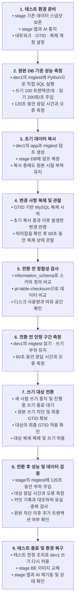
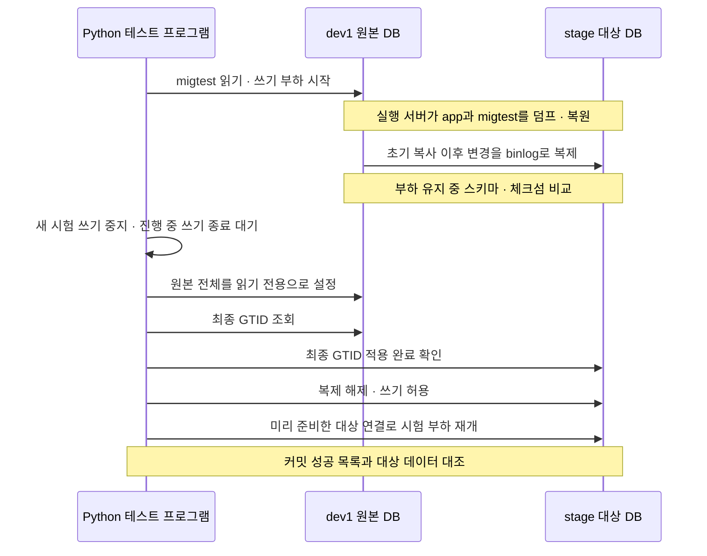
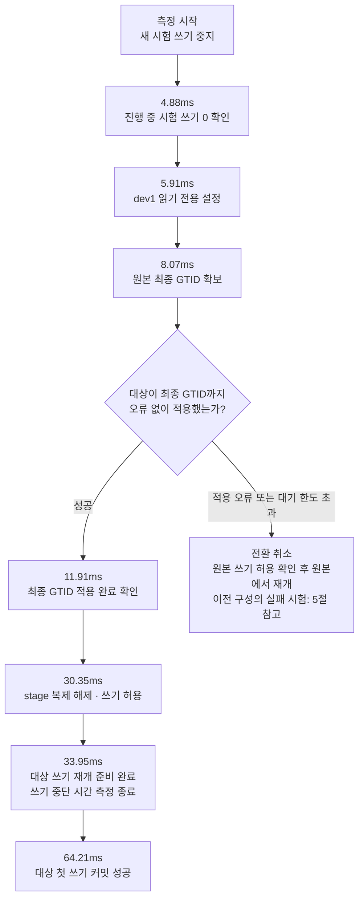

# v2 데이터베이스 마이그레이션 테스트 결과 — 쓰기 중단 전환

- 작성일: 2026-10-16
- 기준 문서: [v2 데이터베이스 마이그레이션 계획](https://github.com/100-hours-a-week/KTB4-5th-wiki/wiki/Cloud-4%EB%8B%A8%EA%B3%84-DB-%EB%AC%B4%EC%A4%91%EB%8B%A8-%EB%A7%88%EC%9D%B4%EA%B7%B8%EB%A0%88%EC%9D%B4%EC%85%98-%EC%84%A4%EA%B3%84). 2026-10-16 테스트 범위 조정 절이 앞선 비교안보다 우선한다.
- 이슈·PR: CLOUD #66(stage DB 마이그레이션 테스트), #67(stage DB 복제본 설정·BE 푸시 끄기·ECS 배포 직접 실행, 머지), #68(테스트 스택·절차 스크립트, 미머지)
- 범위: **DB 직접 부하 테스트**. 테스트 클라이언트가 원본·대상 DB에 직접 SQL을 보낸다. 사용자 요청(ALB·BE·FE)을 거친 서비스 전환은 수행하지 않았으며, 이 결과를 BE 포함 전환 성공으로 해석하지 않는다.

설계 문서와 다르게 적용한 점: 1·6절의 "새 쓰기를 점검 응답으로 거절"은 테스트 범위 조정 절에 따라 부하 발생기의 새 쓰기 중지로 대신했다. 실행 정책 표의 측정 종료 "모든 대상 인스턴스의 쓰기 재개"는 "신규 DB에서 시험 쓰기를 재개할 준비 확인"으로 측정하고, 첫 신규 DB 쓰기 성공 시각을 따로 기록했다.

## 1. 결과 요약

### 본 테스트: dev1 → stage DB (2026-10-16 17:29~17:36 KST)

| 판정 항목 | 기준 | 결과 | 판정 |
| --- | --- | --- | --- |
| 쓰기 중단 시간 | 새 쓰기 중지 → 대상 재개 준비 1초 이내 | **33.9ms** | 충족 |
| 첫 대상 DB 쓰기 성공 | 별도 기록 | 64.2ms | 기록 |
| 커밋 데이터 반영 | 유실·중복 0 | 커밋 확인 37,928건 전부 1건씩, 원본 커밋 25,896건 전부 반영 | 충족 |
| 원본 추가 쓰기 차단 | 차단 후 원본 트랜잭션 0 | 0 | 충족 |
| 스키마 | 정의 일치 | information_schema 기준 19개 테이블 일치 | 충족 |
| 데이터 검사 | 차이·오류·미검사 0 | pt-table-checksum 19개 테이블 0 | 충족 |
| 복제 | 오류 0 | 오류 0, 지연 최대 1초, 미적용 최대 6 트랜잭션 | 충족 |
| 응답 시간 | 정상 부하 구간 p95·p99 각각 기준의 2배 이내 | 모든 구간 충족 (4절) | 충족 |

### 이전 구성: stage DB 사본 → 별도 신규 DB (같은 날 앞서 실행, 참고)

| 실행 | 내용 | 쓰기 중단 | 1초 기준 | 데이터 |
| --- | --- | --- | --- | --- |
| aws1~3 | 정상 전환 3회 | 26.3 / 25.6 / 18.5ms | 충족 | 유실·중복·체크섬 차이 0 |
| aws4 | 실패 분기: 승격 직전 취소 → 원본 재개 | 6.9ms | 충족 | 유실 0 |
| aws5 | 실패 분기: 대상 적용 중지 상태 → 대기 한도 2초 초과로 취소 → 원본 재개 | 2,001.9ms | **미충족** | 유실 0 |

반복 실행(aws2~4)에서 일부 구간 쓰기 p99가 기준의 2배를 넘었다(최대 4.2배, 약 30ms 이하). 기준 구간이 60초로 짧아 기준값이 실행마다 달랐으며 원인은 확인하지 않았다.

## 2. 환경

| 구분 | 내용 |
| --- | --- |
| 원본 dev1 | `i-0111bde7fc68be69c`, 172.31.4.192, t4g.small ARM64, Ubuntu 26.04, MySQL `8.4.11-0ubuntu0.26.04.1`, server_id=1, ROW, binlog 30일, 루트 디스크 6.8GB. dev v2 BE가 실제로 사용 중 |
| 대상 stage DB | `i-0daa6ac3cc3176c79`, 10.10.41.4, m7i.large AMD64, AL2023, MySQL 8.4.11, server_id=2(#67), 디스크 30GB |
| 실행 서버 | `i-0dac881198afa8a52`, 10.10.37.132, t3.small, stage private 서브넷 A. mysql·mysqldump 8.4.11, Percona Toolkit 3.7.0(DBD::mysql 4.050), Python 3.9 + PyMySQL 1.1.1 |
| 네트워크 | 테스트 스택 `dameokja-migtest`: dev VPC(172.31) ↔ stage VPC(10.10) Peering `pcx-053681bb241b7a9ad`. 경로는 stage → 172.31.4.192/32, dev → 10.10.32.0/20만. dev1·stage DB 보안그룹 3306 규칙 |
| 이전 대상 데이터 | stage DB 기존 데이터는 EBS 스냅샷 `snap-0fe3b0bb371024968`(2026-10-16)로 보존 후 삭제 |
| 부하 | 쓰기 100 트랜잭션/초(알림 INSERT + 수신자 INSERT + 수신자 UPDATE), 읽기 200/초(냉장고별 알림 20건), 작업자 각 8. dev `app`을 건드리지 않도록 dev1의 별도 `migtest` 스키마(app 테이블 4개 구조 복사)에 기록 |
| 데이터 | `app` 15개 테이블(약 1.3MB, `lease_token` 반영) + `migtest`(회원·냉장고 1,000쌍, 알림·수신자 각 약 12만 건) |
| 함께 흐른 트래픽 | dev v2 BE(172.31.19.21)의 실제 요청. 측정 대상 아님 |
| 스크립트 | #68 브랜치 `feat/66-migtest-stack` 6863744를 실행 서버 `/opt/migtest`에 올려 실행. sha256: migrate.sh `526e0a46…`, migtest.py `54350523…`, rehearse.sh `18233d17…` |

## 3. 실행 절차

1. **stage 데이터 보존**: stage DB EBS 스냅샷 `snap-0fe3b0bb371024968`
2. **stage DB 복제본 설정 (IaC, #67)**: SSM Association으로 `!includedir /etc/my.cnf.d`와 `zz-replica.cnf`(`server_id=2`, `log_replica_updates`, `skip_replica_start`, `relay_log_recovery`) 적용 → MySQL 재시작, `gtid_mode=ON` 확인
3. **네트워크 (IaC, #68)**: `dameokja-migtest` 스택 갱신 — Peering·경로·보안그룹 규칙·실행 서버
4. **dev1 준비**: `migadmin`·`repl` 계정(10.10.%만), `migtest` 스키마 생성. GTID 온라인 활성화 — `enforce_gtid_consistency=WARN` 4분 관찰(경고 0) → `ON`, `gtid_mode` OFF → OFF_PERMISSIVE → ON_PERMISSIVE → (진행 중 익명 트랜잭션 0 확인) → ON, 모두 `SET PERSIST`. 서비스 중단 없음
5. **stage DB 준비**: stage 앱·AI 0개로 내림. 관리 계정은 사용자가 root로 생성. 기존 `app` 삭제, `RESET BINARY LOGS AND GTIDS`, `super_read_only=ON`
6. **리허설** (`rehearse.sh`, 실행 서버)
   1. preflight: 양쪽 8.4.11, GTID·enforce ON, ROW, server_id 1·2, server_uuid 상이, binlog 30일, 대상 `super_read_only=1`, InnoDB·PK 확인
   2. seed → 기준 부하 120초
   3. 부하 중 `mysqldump --single-transaction --source-data=2 --set-gtid-purged=ON --routines --events --triggers --databases app migtest` → 대상 복원
   4. `CHANGE REPLICATION SOURCE TO … SOURCE_AUTO_POSITION=1, SOURCE_SSL=1` → 따라잡음 확인 → 60초 관찰
   5. information_schema 스키마 비교, `pt-table-checksum --recursion-method=processlist`
   6. 안정 구간 60초 → 전환 → 대상 부하 120초 → 검증
7. **dev1 원복**: `SET GLOBAL super_read_only=OFF, read_only=OFF` (17:35:51), `(0, 0)` 확인
8. **stage 복구**: "v2 ECS 배포" 직접 실행으로 BE를 GHCR `ktb4-5th-be:11c624e8a220e727b411002074dbed047e8d0de2`로 교체(`dameokja-stage-app:3`) → 앱 2·AI 1개, 오토스케일링 최소 2·최대 4 → `/nginx-health` 200

### 테스트 흐름 다이어그램

이번 테스트는 실제 MySQL에서 수행한 **DB 수준 전환 리허설**이다. 기존 서비스의 `app` 스키마(15개 테이블)와 시험용 `migtest` 스키마(4개 테이블)를 함께 이전했다. 부하 발생기는 `app`의 일부 테이블 구조를 복사한 `migtest`에 직접 SQL을 보냈으며, 실제 `app` 워크로드와 BE의 DB 연결 전환은 검증하지 않았다.



초기 복사는 특정 시점의 데이터를 옮기고, 복제는 그동안 원본에서 발생한 추가 변경을 따라잡는다. GTID는 대상이 원본의 어느 트랜잭션까지 적용했는지 확인하는 식별자다.



### 쓰기 전환 구간과 실패 분기

아래 시간은 본 테스트의 전환 시작부터 누적 경과 시간이다. 대상 DB 연결은 측정 전에 미리 열었으므로 연결 생성 시간은 포함하지 않는다.



**33.95ms는 시험 클라이언트가 대상에서 쓰기를 재개할 준비를 마친 시간이며, 서비스 전체 중단 시간이 아니다.** 실제 dev BE의 연결은 원본에 남아 있었고, dev1이 읽기 전용이었던 약 2분 동안 BE 쓰기는 실패했다. 시험 클라이언트의 짧은 전환 시간과 이 구간은 구분해야 한다.

```text
시험 클라이언트: dev1 → 약 34ms 쓰기 중단 → stage 사용
실제 dev BE:    dev1 → 원본 읽기 전용 동안 쓰기 실패 → 원복 후 dev1 사용
```

전환 후 dev1을 다시 쓰기 가능으로 만든 것은 테스트 한정 복구 조치다. 대상에서 쓰기를 시작한 뒤 원본으로 단순 복귀할 수 있다는 의미가 아니며, 이후 두 DB는 서로 다른 쓰기를 받아 일치하지 않는다.

## 4. 측정 상세 (dev1 → stage DB)

전환 단계 (실행 서버 단조 시계, 측정 시작 17:33:48.721 기준):

| 단계 | 경과 (ms) |
| --- | --- |
| 1 새 쓰기 진입 차단 (측정 시작) | 0.05 |
| 2 진행 중 쓰기 0 확인 | 4.88 |
| 3 dev1 `super_read_only=ON` | 5.91 |
| 4 최종 GTID 확보 | 8.07 |
| 5 stage 적용 완료·적용 오류 0·미적용 0 확인 | 11.91 |
| 6 stage 복제 해제·쓰기 허용 | 30.35 |
| 7 재개 준비 확인 (측정 종료) | **33.95** |
| 첫 stage DB 쓰기 커밋 | 64.21 |

측정 전에 16개 작업자 모두 대상 연결을 미리 열었다(측정 구간 밖). 원본 차단 직후 변경을 가진 열린 트랜잭션은 0이었다.

단계별 응답 시간 (성공 표본, ms, 오류 0건):

| 구간 | 대상 | 쓰기 p95 / p99 | 읽기 p95 / p99 | 기준 2배 이내 |
| --- | --- | --- | --- | --- |
| 기준 (120초) | dev1 | 27.1 / 124.7 | 12.0 / 59.9 | — |
| 복사 (5초) | dev1 | 22.4 / 42.8 | 4.6 / 8.4 | 예 |
| 복제·관찰 (64초) | dev1 | 22.8 / 57.3 | 8.7 / 27.9 | 예 |
| 검사 (10초) | dev1 | 25.2 / 41.4 | 12.0 / 22.3 | 예 |
| 안정 (60초) | dev1 | 26.6 / 79.2 | 12.2 / 46.1 | 예 |
| 전환 후 (120초) | stage | 27.5 / 97.8 | 13.4 / 55.6 | 예 |

전환 구간(쓰기 중지~재개)은 요청이 없으므로 응답 시간 표본으로 계산하지 않고 쓰기 중단 시간으로 평가했다. 기준 p99가 높은 이유는 dev1(t4g.small)이 dev BE 요청을 함께 처리했기 때문으로 보이며 확인하지 않았다.

| 관측 | 결과 |
| --- | --- |
| 초기 복사 | 덤프 26MB 0.9초, 복원 4.2초, `GTID_PURGED …:1-12022`, 복원 후 대상 `gtid_executed` 일치 |
| 복제 | 연결 직후 미적용 최대 5, 이후 최대 6 트랜잭션, `Seconds_Behind_Source` 최대 1초, IO·SQL 스레드 오류 0 |
| 스키마 | information_schema 값 일치. SHOW CREATE 문자열 차이 276줄은 표기 차이로 참고 |
| 자원 dev1 (5초 표본) | CPU 최대 57%(기준 구간)·평균 25~31%(작업 중), 여유 메모리 최소 742MB, **디스크 여유 2.2GB** |
| 자원 stage DB | CPU 최대 53%(복원 중), 평상 10~15%, 여유 메모리 6.7GB, 디스크 여유 28GB |
| dev1 읽기 전용 구간 | 17:33:48.7 ~ 17:35:51 (약 2분, 전환 후 측정·검증 포함). 이 동안 dev BE 쓰기는 실패 |

binlog 30일 보존: dev1 디스크 여유가 2.2GB(6.8GB 중)라 30일분 binlog와 덤프 공간을 함께 두기에 빠듯하다. dev1의 평소 binlog 생성량은 측정하지 않았다.

## 5. 실패 분기와 복구 절차

이전 구성에서 시험한 결과 (같은 스크립트):

| 실행 | 조건 | 처리 | 결과 |
| --- | --- | --- | --- |
| aws4 | 대상이 최종 GTID를 모두 적용한 뒤 승격 직전 취소 | 원본 `super_read_only`·`read_only` OFF 확인 → 원본 재개 | 6.9ms, 유실 0 |
| aws5 | 전환 직전 대상 `STOP REPLICA SQL_THREAD`, 대기 한도 2초 | `WAIT_FOR_EXECUTED_GTID_SET` 시간 초과 → 원본 재개 | **2,001.9ms, 1초 미충족**, 유실 0 |

대상이 따라잡지 못하면 대기 한도만큼 쓰기가 멈춘다. 한도를 줄이면 정상 전환도 취소될 수 있어 바꾸지 않았다. 전환 직전에 미적용 GTID 0과 적용 스레드 정상을 확인하고 시작한다.

| 시점 | 조건 | 처리 (●는 스크립트 자동) |
| --- | --- | --- |
| 전환 전 | 사전 확인·복제 오류·스키마 차이·체크섬 차이 | `rehearse.sh`가 해당 단계에서 중단. 원인 해결 후 재검사 |
| 대상 쓰기 전 | 진행 중 쓰기 미종료, GTID 미적용·적용 오류, 승격 후 쓰기 불가 | ● 원본 쓰기 허용 후 값 확인 → 원본 재개, 실제 중단 시간 기록. 대상은 복제본 유지 |
| 대상 쓰기 후 | 대상 장애 | 원본으로 주소를 되돌리지 않는다. 대상에서 원인 해결·재시작, 필요 시 대상 백업으로 복구 (시험하지 않음) |

이번 테스트는 사용자 지시에 따라 대상 쓰기 후에도 dev1을 쓰기 가능으로 되돌렸다. 테스트 한정 조치이며 운영 원칙(대상 쓰기 후 원본 복귀 금지)과 다르다. 원복 후 dev1과 stage DB는 서로 다른 쓰기를 받아 일치하지 않는다.

## 6. 찾고 고친 문제

| 문제 | 조치 |
| --- | --- |
| stage DB `gtid_mode=OFF`·`time_zone=SYSTEM`: AL2023 MySQL RPM의 `/etc/my.cnf`가 `my.cnf.d`를 읽지 않음 | #67 SSM Association으로 `!includedir` 추가 |
| dev1·stage DB 모두 `server_id=1` | #67 `zz-replica.cnf`로 stage `server_id=2` |
| dev1 `gtid_mode=OFF` | 온라인 단계적 활성화 (3절 4) |
| SSM `/dameokja-v2-stage/MYSQL_ROOT_PASSWORD`가 stage DB 실제 root와 다름 | 관리 계정은 사용자가 root로 직접 생성. SSM 값 정리 필요 |
| pt-table-checksum 3.7.0 dsn 표 방식이 복제본 대기 단계에서 로컬 소켓 접속 시도 | `--recursion-method=processlist` |
| 3.7.0 결과 표 컬럼명 `source_crc`·`source_cnt` | 차이 조회 쿼리 수정 |
| SHOW CREATE 문자열은 같은 정의도 표기가 다름 | information_schema 값으로 판정 |
| MySQL RPM validate_password, AL2023 perl Sys::Hostname 부재 | 비밀번호 규칙·패키지 반영 |
| stage BE 이미지 8bdc9c1이 `claim_token` 사용 | `lease_token` 반영 dev 이미지로 교체 |

## 7. CLI·SSM 작업 기록 (2026-10-16, KST, 시각은 명령 결과 기준 근사값)

| 시각 | 대상 | 작업 |
| --- | --- | --- |
| 13:24 | stage DB `i-0daa6ac3cc3176c79` | 인스턴스 시작, EBS 스냅샷 `snap-0fe3b0bb371024968` |
| 13:25~13:31 | SSM | `/dameokja-migtest/MIG_PASSWORD`·`REPL_PASSWORD` 생성(이후 비밀번호 규칙으로 덮어씀) |
| 13:28~14:00 | CloudFormation `dameokja-migtest` | 생성 → 갱신 → 삭제 → 재생성 (이전 구성: 원본·신규 DB·실행 서버) |
| 13:39 | stage DB | stage 앱 계정으로 덤프(읽기만) 후 인스턴스 정지 |
| 13:41~14:15 | 실행 서버 | 이전 구성 리허설 aws1~aws5 |
| 15:13 | `dameokja-stage` | change set 미리보기 생성 후 삭제(적용 안 함) |
| 15:23 | stage 전체 | 이 작업이 아닌 다른 경로로 stage가 켜짐(DB·Redis·앱). 확인만 함 |
| 16:28 | CloudFormation `dameokja-migtest` | dev1 → stage 구성으로 갱신 (이전 DB 서버 2대 삭제, Peering·규칙 추가, 실행 서버 t3.small) |
| 16:30~16:35 | dev1 | 테스트 계정·`migtest` 스키마 생성, GTID 활성화 |
| 17:07 | stage DB | #67 반영(Association), MySQL 재시작 |
| 17:16 | stage ECS | 앱·AI 0개, 앱 오토스케일링 0/0 |
| 17:20~17:22 | stage DB | `init_file` 방식 계정 생성 시도(실패, MySQL 재시작 2회, 파일 삭제) |
| 17:28 | stage DB | `app` 삭제, `RESET BINARY LOGS AND GTIDS`, `super_read_only=ON` |
| 17:29~17:36 | 실행 서버·dev1·stage DB | 리허설, 자원 표본 수집, dev1 원복 |
| 17:41~17:50 | stage | BE 이미지 교체(GitHub Actions 직접 실행), 앱 2·AI 1개 재기동 |

## 8. DB 연결 전환 방식 — 결정 필요

현재 BE는 단일 `spring.datasource`이고 실행 중 연결 교체 기능이 없다(origin/dev 11c624e 재확인). 이번 결과는 A에만 해당한다.

| 후보 | 코드 수정 | 1초 기준 | 영향 |
| --- | --- | --- | --- |
| A. 테스트 클라이언트 재연결 | 불필요 | DB 직접 테스트 18~34ms 측정 | BE 전환 검증 아님 |
| B. BE 재시작·재배포 | 불필요 | 미충족 예상 (미측정) | BE에 새 쓰기 중지 수단이 없어 앞단에서 막아야 함 |
| C. 미리 띄운 대상 Task로 ALB 가중치 전환 | 불필요 | 미충족 가능성 높음 (미측정) | 전환 전 읽기 전용 DB에 붙은 워커 쓰기 오류 |
| D. 별도 연결 계층 (ProxySQL 등) | 불필요, 접속 주소 1회 변경 | 충족 가능성 있음 (미측정) | 운영할 구성 요소 추가 |
| E. BE 실행 중 풀 교체·쓰기 진입 제어 | 필요 (BE 담당) | 충족 가능성 가장 높음 | 이 저장소에서 수정하지 않음 |

## 9. 현재 상태와 남은 일

현재 상태:
- stage DB: dev1 데이터(`app`) + `migtest`, 복제 해제·쓰기 가능. stage 앱(BE `11c624e8…`)·AI 실행 중
- dev1: GTID ON 유지, 쓰기 가능. 테스트 계정 `migadmin`·`repl`과 `migtest` 스키마 남아 있음
- 테스트 스택 `dameokja-migtest`(Peering·실행 서버)와 SSM `/dameokja-migtest/*`

남은 일:
- DB 연결 전환 방식 결정 후 BE 포함 테스트
- dev1 테스트 계정·`migtest` 스키마 삭제, stage DB `migtest` 삭제
- 테스트 스택·SSM 파라미터 정리, #68 머지
- 테스트 후 #67의 푸시 끄기 설정 원복 PR
- dev1 binlog 생성량 측정과 30일 보존 디스크 용량 검증
- 대상 쓰기 후 장애 복구 절차 시험, Standby·Replica·Orchestrator 포함 토폴로지
- SSM `/dameokja-v2-stage/MYSQL_ROOT_PASSWORD` 값 정리
