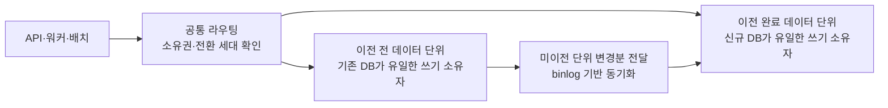

# v2 데이터베이스 무중단 마이그레이션 검토

- 작성일: 2026-10-16
- 상태: 학습·비교용 개념 설계. 구현·검증 완료 또는 실제 적용 확정 상태가 아님
- 실제 적용안: [쓰기 중단 마이그레이션 계획](https://github.com/100-hours-a-week/KTB4-5th-wiki/wiki/Cloud-4%EB%8B%A8%EA%B3%84-DB-%EB%AC%B4%EC%A4%91%EB%8B%A8-%EB%A7%88%EC%9D%B4%EA%B7%B8%EB%A0%88%EC%9D%B4%EC%85%98-%EC%84%A4%EA%B3%84)

## 1. 검토 범위와 용어

본 문서는 서비스 전체의 쓰기를 일괄 정지하지 않는 이전 구조를 검토한다. 개별 데이터 단위의 인계·잠금·재시도에 따른 대기를 모두 제거한다는 의미는 아니다. 서비스 요청 실패 여부와 DB 쓰기 중지 여부를 구분하여 요구사항을 정의한다.

무중단은 양방향 복제와 동의어가 아니다. 양방향 복제, 이중 쓰기, CDC, 메시지 큐 각각은 구성 요소이며 그 자체로 안전한 전환을 보장하지 않는다. 원본과 대상의 데이터 검증, 쓰기 소유권, 진행 중 트랜잭션, 연결 전환과 복구를 함께 설계해야 한다.

## 2. 데이터 소유권 단위의 점진적 이전안

검토 아키텍처는 사용자·가구 등 독립적으로 이전 가능한 데이터 단위에 쓰기 소유권을 부여하고, 공통 라우팅 계층이 요청을 해당 소유 DB로 보내는 방식이다. 실제 분할 키는 확정되지 않았다. 냉장고 공유, 알림 수신자, 공통 데이터 및 다중 테이블 트랜잭션의 관계를 분석해 단위 간 쓰기를 안전하게 분리할 수 있는지 먼저 검증해야 한다.

1. 원본에서 초기 복사와 변경분 동기화를 수행한다. 모든 API·워커의 접근이 공통 라우팅을 통과하도록 한다.
2. 데이터 단위별로 초기 데이터와 변경분을 검증하고 소유권 이전 후보를 선택한다. 다른 단위의 업무 쓰기는 계속 처리한다.
3. 대상 단위의 기존 트랜잭션을 마무리하고 최종 변경분을 반영한다. 소유권 변경은 세대 번호와 DB 측 쓰기 방어 등으로 보호하여, 오래된 라우팅 정보를 가진 요청이 이전 소유 DB에 커밋하지 못하도록 한다.
4. 소유권 경계에 걸린 요청은 내부 대기·재시도하고, 멱등 키와 커밋 결과 조회로 중복·유실을 방지한다. 대상 단위의 소유권을 신규 DB로 옮긴 후 읽기·쓰기 모두 신규 DB로 라우팅한다.
5. 다른 단위로 반복한다. 단위별 이전 이후에는 원본의 해당 단위 변경을 신규 DB에 무조건 재적용하지 않도록 동기화 범위와 종료 기준을 관리한다.

이 안은 전체 서비스 쓰기 중단을 피하는 설계 후보이나 단위별 인계에는 조정 구간이 있다. **모든 데이터 단위에서 단 한 순간의 쓰기 대기도 허용하지 않는 요구에는 이 안도 충족을 보장하지 않는다.** 분산 트랜잭션을 추가하더라도 잠금·장애 복구에 따른 대기가 없어지는 것은 아니다. 허용 지연과 장애 조건을 먼저 정의해야 한다.

일반적인 GTID 기반 전체 DB 단방향 복제만으로 위 소유권 이전은 구현되지 않는다. 행 단위 동기화 제어, 라우팅·소유권 저장소, 오래된 쓰기 차단, 단위 간 트랜잭션 처리, 복구 기능이 추가로 필요하다. Kafka나 Outbox 도입만으로 해결되지 않으며, 양쪽 DB에 단순히 이중 쓰기하면 부분 성공 문제가 발생한다. 신규 DB에 쓰기 시작한 단위는 원본으로 주소만 되돌릴 수 없다.

## 3. 쓰기 중단안과 비교·미채택 근거

| 판단 항목 | A안: 무중단 | B안: 쓰기 중단 |
| --- | --- | --- |
| 쓰기 경로 | 데이터 단위별 라우팅·소유권 이전 필요 | 최종 전환 전후에 하나의 DB 사용 |
| BE 변경 | 전체 접근 경로·단위 간 트랜잭션·멱등성·이전 상태 처리 | 쓰기 진입 제어·작업 완료 확인·연결 교체·재개 |
| 동기화 | 단위별 이전과 신규 쓰기를 고려한 별도 제어 | GTID 기반 MySQL 기본 복제 활용 |
| 주요 위험 | 잘못된 소유권, 교차 단위 불일치, 부분 성공, 복구 복잡도 | 1초 중단 상한 초과, 기존 연결 잔존, 전환 후 복구 |
| 서비스 비용 | 지속적인 구현·운영 복잡도 증가 | 제한된 전환 구간의 지연 또는 쓰기 불가 |

현재 변경 범위는 같은 MySQL 계열의 서버 이전과 사전 컬럼명 변경이다. 이를 위해 데이터 소유권 분할과 전체 접근 경로를 재설계하는 비용·위험보다, 통제 가능한 짧은 쓰기 중단을 검증하는 방식이 적절하다고 판단하여 **B안을 선택한다**. 쓰기 중단 상한은 2026-10-16에 1초로 확정했으며, 실제 사용자 영향이 작다는 측정 결과가 확보된 것은 아니다.

A안은 기술적으로 불가능해서 제외한 것이 아니라 현재 이전 범위에 비해 애플리케이션·운영 복잡도가 크므로 채택하지 않는다. 쓰기 중단이 허용되지 않는 서비스 요구가 생기거나 데이터 단위별 이전이 반복적으로 필요해지면 재검토한다. A안은 비교를 위한 개념 설계이며 상세 구현·부하·장애 검증 완료 상태가 아니다.

## 4. 추가로 논의한 대안의 상태

| 대안 | 역할 | 남은 검토 |
| --- | --- | --- |
| 애플리케이션 이중 쓰기 | 같은 변경을 양쪽 DB에 반영 | 부분 성공, 변경 순서, 공통 ID 생성, 재시도·복구, 읽기 기준 |
| XA·2PC 기반 이중 쓰기 | 조정자가 양쪽 DB의 커밋 결정을 관리 | 조정자 장애·미결 트랜잭션·잠금·가용성·복구. 무중단이나 동시 가시성을 자동 보장하지 않음 |
| 양방향 비동기 복제 | 양쪽 변경을 서로 전달 | 동시 수정 충돌, 복제 루프, 쓰기 소유권과 읽기 일관성 |
| Outbox + SQS FIFO 또는 Kafka | 업무 데이터와 이벤트를 함께 기록하고 비동기로 대상에 전달 | DB와 큐 사이 전달 재시도, 적용 멱등성·순서·지연, 최종 쓰기 소유권 이전 |

위 대안은 대화에서 조사한 후보를 기록한 것이며, 상세 실행 설계로 채택한 것이 아니다. 기존 MySQL 기본 복제에 큐를 단순 추가하는 변경으로 취급하지 않는다.

## 5. 학습 용어와 권장 순서

### 1단계: 현재 복제 방식 이해

| 용어 | 이해해야 할 내용 |
| --- | --- |
| 일관된 스냅샷·초기 복사 | 복사한 데이터가 어느 시점의 상태인지 |
| CDC·binlog·relay log | 변경의 수집·전달·적용 역할 구분 |
| GTID·자동 위치 지정 | 같은 트랜잭션 식별과 미적용 이력 추적 |
| 복제 지연·체크포인트 | 어디까지 수신했고 어디까지 적용했는지 |
| Cutover·Drain | 접속 대상 전환과 진행 중 작업 마무리 |

### 2단계: 전환 중 데이터 안전성

| 용어 | 이해해야 할 내용 |
| --- | --- |
| 단일 쓰기 소유자·Source of Truth | 어느 DB가 해당 데이터의 쓰기 기준인지 |
| Read-your-writes | 저장 성공한 값을 다음 조회에서 볼 수 있는 조건 |
| 최종적 일관성·강한 일관성 | 복제 지연을 허용하는 범위와 관측 가능한 결과 |
| 멱등성·중복 제거 | 재시도해도 같은 변경을 중복 반영하지 않는 방법 |
| 순서 보장·버전 번호 | 오래된 이벤트가 최신 값을 덮어쓰지 않게 하는 방법 |
| Fencing·Epoch | 오래된 소유자나 연결이 다시 쓰지 못하게 차단하는 방법 |
| Split-brain·충돌 해결 | 서로 자신을 쓰기 기준으로 판단하는 상태와 충돌 처리 |
| 샤딩·테넌트 라우팅 | 데이터 단위별 이전과 단위 간 트랜잭션의 제약 |

### 3단계: 이중 쓰기와 메시징

| 용어 | 이해해야 할 내용 |
| --- | --- |
| Dual Write·부분 실패 | 두 DB 중 한쪽만 성공한 경우의 처리 |
| XA·2PC·트랜잭션 조정자 | prepare·commit과 미결 트랜잭션 복구 |
| Transactional Outbox | 같은 로컬 트랜잭션에 업무 데이터와 이벤트를 기록하는 패턴 |
| At-least-once·Exactly-once 범위 | 전송 중복 제거와 외부 DB 효과의 정확히 한 번 처리가 다른 이유 |
| Consumer·ACK·Offset | 소비 완료와 재처리 시작 위치 관리 |
| SQS Visibility Timeout·DLQ | 처리 중 재노출과 실패 메시지 격리. DLQ 이동 시 순서 영향 |
| Kafka Partition·SQS MessageGroupId | 순서 보장이 적용되는 단위 |
| Replay·보존 기간 | 장애 후 변경을 다시 적용할 수 있는 범위 |

### 4단계: 스키마·검증·복구

| 용어 | 이해해야 할 내용 |
| --- | --- |
| Expand–Migrate–Contract | 구·신 스키마 호환 유지 후 이전 구조 제거 |
| Backfill·Watermark | 기존 데이터 채우기와 지속 변경 적용의 경계 |
| Shadow Read·Checksum | 업무 결과에 영향 없이 비교하기와 검사 범위·충돌 한계 |
| Rollback·Roll-forward | 원본 복귀와 신규 환경에서의 문제 해결 차이 |
| RPO·RTO | 허용 데이터 손실과 복구 시간의 목표 |

처음에는 1·2단계에 집중한다. 큐나 분산 트랜잭션을 실제 대안으로 검토할 때 3단계로 확장한다. 모든 용어에 해당하는 기술을 도입해야 하는 것은 아니다.

## 6. 참고 자료

- [MySQL GTID](https://dev.mysql.com/doc/refman/8.4/en/replication-gtids-concepts.html)
- [MySQL 복제 FAQ](https://dev.mysql.com/doc/refman/8.4/en/faqs-replication.html)
- [Shopify 데이터 단위별 이전 사례](https://shopify.engineering/mysql-database-shard-balancing-terabyte-scale)
- [AWS 미들웨어 이중 쓰기 이전 사례](https://aws.amazon.com/blogs/architecture/middleware-assisted-zero-downtime-live-database-migration-to-aws/)
- [SQS FIFO 중복 제거](https://docs.aws.amazon.com/AWSSimpleQueueService/latest/SQSDeveloperGuide/FIFO-queues-exactly-once-processing.html)
- [Kafka 설계](https://kafka.apache.org/35/design/design/)