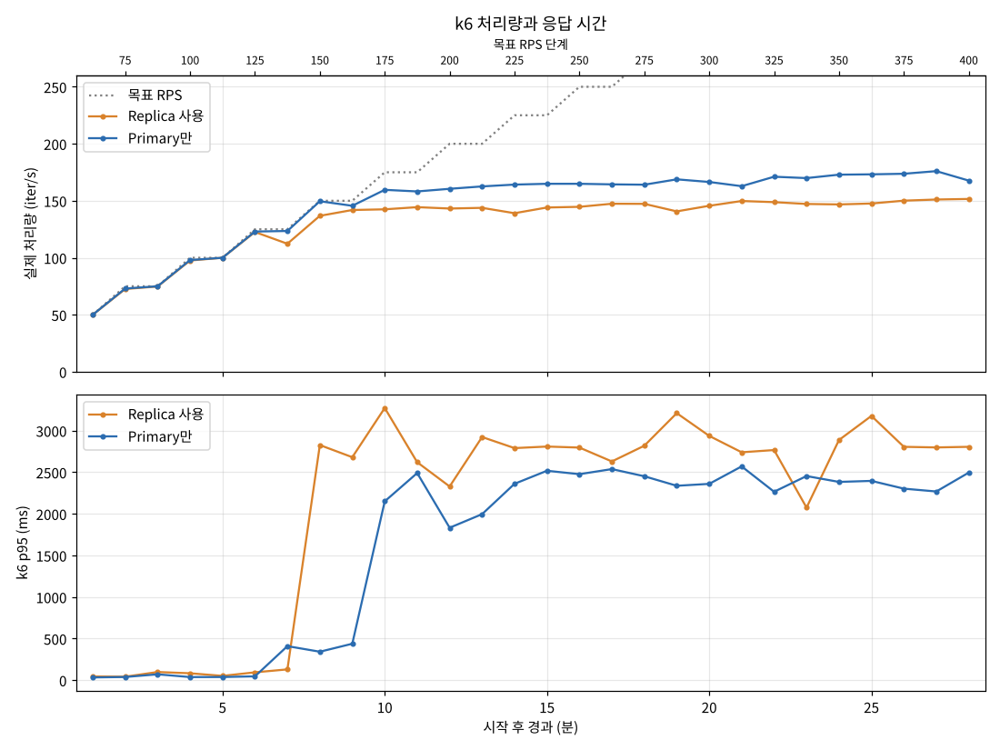
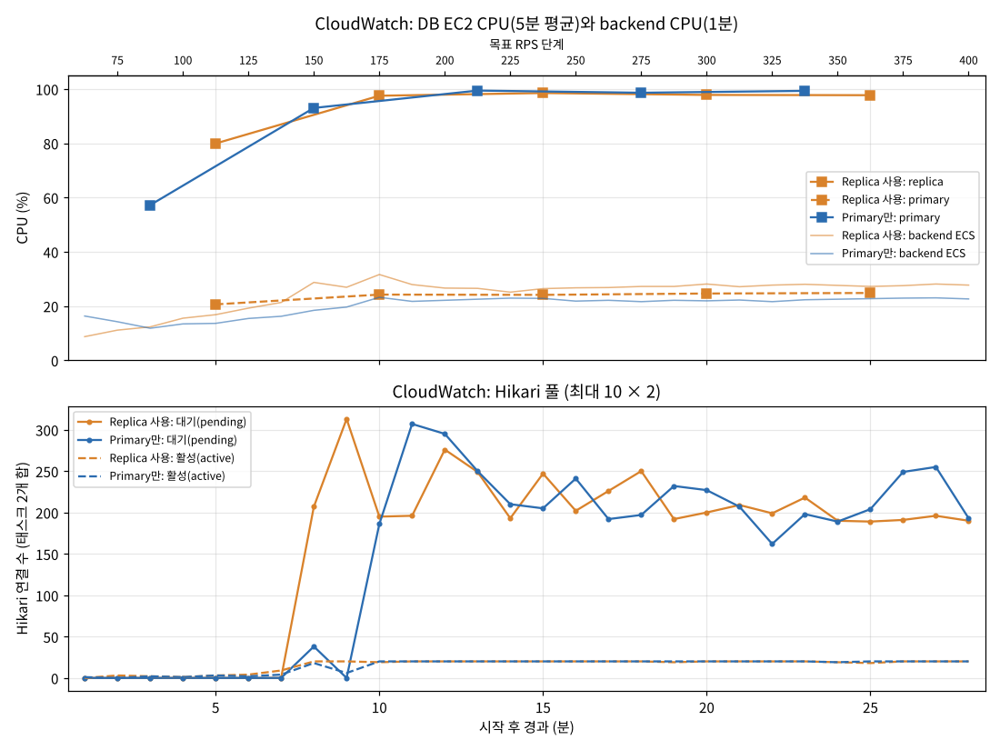
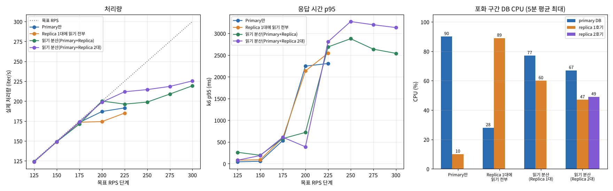
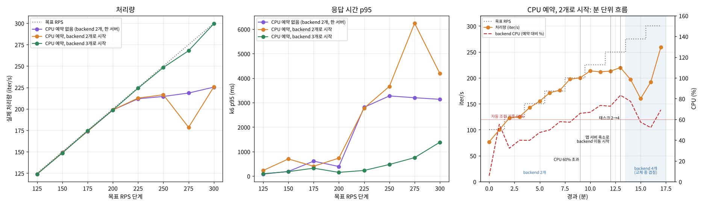

# DB HA 테스트 결과

관련 이슈: #120. 설계는 [README.md](README.md).

## 종합 요약 (#120 고도화 전 한계 부하)

같은 부하(`db-stress.js`: 읽기 45% / 쓰기 55%, 측정 전 `db-reset.js`로 시험 데이터 맞춤)에서 DB·앱 구성만 바꿔 처리 한계를 쟀다. 자세한 수치는 아래 각 절에 있다.

### 같은 조건 비교 (10/29, 100→300 RPS·VU 500·초기화 후·backend 2개 한 서버로 시작)

| 측정 (KST) | 구성 | 처리 한계 (iter/s) | 포화 시작 | 병목 |
| --- | --- | ---: | ---: | --- |
| 10/29 09:34~09:52 | 조회 분산 (Primary + Replica 1대), CPU 예약 없음 | 약 200~220 | 225 | 앱 서버 CPU 85~94% (DB 77%·60%) |
| 10/29 11:35~11:53 | 조회 분산 (Primary + Replica 2대), CPU 예약 없음 | 약 211~232 | 225 | 앱 서버 CPU 97% (DB 67%·47%·49%) |
| 10/29 14:08~14:26 | 조회 분산 (Primary + Replica 2대) + backend CPU 예약 1024 | 약 213, 13분에 4개로 늘어난 뒤 259 | 225 | 증설 전까지 앱 서버 CPU |

- 09:34 측정은 초기화 로그가 없어 checks를 확인하지 못했다(ALB 기준 정상 처리만 확인).
- 14:08 측정은 앱 서버 3대로 시작했고, 측정 중(12분) ASG 축소가 끼어들어 backend가 다른 서버로 옮겨졌다.

### 조건이 다른 측정

| 측정 (KST) | 조건 | 구성 | 처리 한계 (iter/s) | 포화 시작 | 병목 |
| --- | --- | --- | ---: | ---: | --- |
| 10/28 23:34~23:46 | 100→225 RPS·VU 300·초기화 후 | Primary만 | 약 187~192 | 200 | Primary CPU 90% |
| 10/29 00:51~01:03 | 100→225 RPS·VU 300·초기화 후 | Replica 1대가 조회 전부 | 약 174~185 | 200 | Replica CPU 89%, 요청당 비용 증가 |
| 10/29 13:17~13:35 (참고) | 100→300 RPS·VU 500, backend 3개로 시작, 초기화 94% | 조회 분산 (Primary + Replica 2대) + backend CPU 예약 1024 | **약 299 (300까지 처리)** | - | 다음 후보는 Primary CPU 79% |

- 위 두 줄(10/28 23:34, 10/29 00:51)끼리는 같은 조건이다. 같은 조건 비교 표와는 RPS 범위·VU 상한이 달라 수치를 직접 비교하지 않는다.

- **Replica를 붙이기만 하면 이득이 없다.** 조회가 Replica 한 대로 옮겨 갈 뿐 같은 사양이라 한계가 그대로이고, 드라이버가 연결을 바꾸는 비용으로 오히려 4~7% 낮다(10/28 23:34 vs 10/29 00:51).
- **조회를 여러 대에 나누면 DB 병목은 풀린다.** 그다음은 DB가 아니라 앱 서버 CPU에서 막혔다. 같은 조건에서 Replica를 1대 → 2대로 늘려도 +3~8%였다(09:34 vs 11:35).
- **앱 서버 병목의 원인은 backend CPU 예약이 없던 것이다.** 자동 조정 지표가 서버 전체 대비로 계산돼 60%에 닿지 않았고, 배치도 backend 2개를 한 서버에 몰았다. 예약을 넣자(#171) 자동 조정이 증설·축소 모두 동작했다. backend가 처음부터 서버 2대에 나뉜 참고 측정(13:17)에서는 한계가 300까지 올랐다.
- **남은 문제**
  - 증설이 느리다. 60%를 넘고 약 4분 뒤에 늘어서, 그 사이 225~250 구간은 포화된다.
  - 앱 서버 종료 보호(managed termination protection)가 꺼져 있다. 부하 중 ASG가 backend가 돌던 서버를 줄여 약 3분간 p95가 4~6초로 튀었다.
  - 300 RPS에서 Primary CPU가 79%다. 앱을 더 늘리면 다음 병목은 Primary(쓰기)다.
- 측정용 Replica 1·2호기와 읽기 분산 URL은 측정 후 제거했다(#173). Primary 쪽 복제 준비는 #120용으로 남겼다.
- 각 구성은 한 번씩만 쟀다. 5% 안쪽 차이는 오차로 본다.
- k6 응답 시간에는 PC↔AWS 네트워크 지연이 섞인다. 낮은 부하의 수십 ms 차이는 오차로 보고, 서버 성능 비교는 ALB `TargetResponseTime` 기준으로 본다. 포화 구간의 수 초 차이는 이 오차보다 훨씬 커서 결론에 영향이 없다.

## T1-DB 읽기·쓰기 혼합: Replica 사용 / Primary만 (Primary만 10/28 23:34~23:46, Replica 10/29 00:51~01:03 KST)

- 스크립트 `db-stress.js`: 읽기 45%(목록 35, 마이페이지 10) / 쓰기 55%(등록 17.5, 소비 17.5, 수정 20). 쓰기는 실제로 INSERT·DELETE·UPDATE를 한다. 100→225 RPS, 2분마다 +25(6단계, 12분), VU 상한 300
- 측정마다 같은 조건에서 시작했다. 측정 직전에 `db-reset.js`로 시험 냉장고 50개를 모두 같은 항목 1,000개로 맞추고 개수를 확인했다. 등록과 소비 비율이 같아 측정 중에도 항목 수가 거의 그대로다
  - 처음에는 초기화 없이 쟀는데, 측정마다 항목이 약 1만 개씩 줄어 나중에 잰 쪽이 약 15% 유리하게 나왔다. 그래서 초기화를 넣고 다시 쟀다
- BE 접속 URL만 바꿔 두 번 쟀다. Replica 사용 = `jdbc:mysql:replication://`(조회 전용 트랜잭션 → Replica), Primary만 = Primary 단일 URL. 두 DB 서버는 같은 사양(t3.medium, 같은 AMI·디스크·AZ)이다
- 두 번 모두 끝까지 돌았다. 5xx와 backend ERROR는 0건이다. 실패율 0.07~0.08%는 VU끼리 같은 항목을 먼저 지우거나 바꿔 생긴 404다





그래프 가로축은 시작 후 경과 분이다. 시작 직후 로그인이 몰린 0분은 뺐다. DB EC2 CPU는 기본 모니터링이라 5분 평균 값만 있다.

### 단계별 결과 (k6)

| 목표 RPS | 처리량 (iter/s) Primary만 / Replica | p50 (ms) Primary만 / Replica | p95 (ms) Primary만 / Replica |
| ---: | ---: | ---: | ---: |
| 125 | 124.0 / 123.8 | 23 / 30 | 43 / 81 |
| 150 | 149.0 / 148.8 | 25 / 34 | 55 / 90 |
| 175 | 173.2 / 173.5 | 31 / 83 | 534 / 593 |
| 200 | **187.0 / 174.3** | 276 / 681 | 2,246 / 2,135 |
| 225 | **191.5 / 185.0** | 294 / 422 | 2,307 / 2,544 |

### 비교

| 항목 | Primary만 | Replica 사용 |
| --- | ---: | ---: |
| 처리 한계 (iter/s) | 약 187~192 | 약 174~185 |
| 포화 시작 | 200 RPS | 200 RPS |
| 낮은 부하 p50 (125·150 단계) | 23~25ms | 30~34ms (+30%) |
| 조회를 받는 DB CPU | primary 90% | replica 89% |
| 다른 DB CPU | replica 4~10% | primary 25~28% |
| backend CPU (125·150 단계 / 최대) | 12~18% / 24% | 20~25% / 33% |
| Hikari (태스크 2개 합, 포화 후) | 활성 20/20, 대기 약 170~190 | 활성 20/20, 대기 약 200~300 |
| 실제 쓰기 (등록 / 소비 / 수정) | 19,084 / 19,185 / 21,790 | 18,813 / 18,466 / 21,196 |
| 5xx, backend ERROR | 0 | 0 |

12분 측정이라 포화 구간이 4분뿐이어서 DB CPU 5분 평균은 90%까지만 올라갔다(30분 측정 때는 98~99%).

### 해석

- **두 경우 모두 조회를 받는 DB 한 대의 CPU가 한계다.** Replica를 쓰면 조회가 Replica로 통째로 옮겨 가고 Primary는 25~28%에 머문다. 같은 사양 한 대로 병목만 옮긴 셈이라 한계가 늘지 않았다.
- **Replica 사용은 요청당 비용이 더 든다.** 낮은 부하에서 p50이 약 30% 길고, backend CPU가 약 1.5배다. replication 드라이버가 트랜잭션마다 연결(Primary·Replica)을 바꾸는 비용으로 본다. 그래서 한계도 4~7% 낮다. 측정 초기화(요청을 차례로 보내는 VU 50개)도 Replica 설정에서 약 1.7배 오래 걸렸다(분당 약 3.4만 → 1.3~2.5만 요청, DB CPU 여유 상태).
- Replica는 쓰기 복제도 함께 처리한다. 같은 사양이면 그만큼 조회에 쓸 CPU가 줄어든다.
- DB는 죽지 않았다. CPU 포화 후 응답이 2~2.5초로 느려지고, 앱 커넥션 풀 대기열이 요청을 붙잡아 오류 없이 버틴다. backend CPU는 33% 이하이고 스케일 아웃은 없었다.
- 측정은 한 번씩이라 몇 % 차이는 오차일 수 있다. 다만 "Replica를 붙여도 이득이 없다"는 방향은 초기화 전·후 측정이 같다.
- 한계를 올리려면 조회를 Primary와 Replica에 나누거나, Replica를 늘리거나 사양을 올리거나, 목록 쿼리(앞뒤 % LIKE + count)를 손봐야 한다.
- DB 인스턴스에 CloudWatch Agent 지표가 없어 메모리·디스크는 보지 못했다.

## T1-DB 읽기 분산: Primary와 Replica가 조회를 나눠 받기 (10/29 09:34~09:52 KST)

- 위 결과에서 Replica 1대가 조회를 전부 받아 Primary는 25% 안팎으로 놀았다. 그래서 BE 코드 수정 없이 접속 URL의 replica 목록에 Primary도 넣었다. 드라이버(Connector/J)는 replica 목록 안에서 트랜잭션마다 무작위로 서버를 고르므로 조회가 두 대에 나뉜다

  ```
  jdbc:mysql:replication://address=(type=source)(host=<primary>)(port=3306),address=(type=replica)(host=<replica>)(port=3306),address=(type=replica)(host=<primary>)(port=3306)/app?...&readFromSourceWhenNoReplicas=true
  ```
- 측정은 같은 방식(초기화 후 `db-stress.js`)이다. 한계가 오를 것을 대비해 300 RPS까지(9단계, 18분), VU 상한 500으로 넓혔다. 125~225 단계는 위 두 측정과 같은 조건이다
- 끝까지 돌았고 실패율 0.20%(대부분 404·412 경합), backend ERROR 0건, 5xx 1건(ELB 502)이다



| 목표 RPS | 처리량 (iter/s) Primary만 / Replica 1대 / 읽기 분산 | p95 (ms) Primary만 / Replica 1대 / 읽기 분산 |
| ---: | ---: | ---: |
| 125 | 124.0 / 123.8 / 124.0 | 43 / 81 / 262 |
| 150 | 149.0 / 148.8 / 148.9 | 55 / 90 / 194 |
| 175 | 173.2 / 173.5 / 171.2 | 534 / 593 / 578 |
| 200 | 187.0 / 174.3 / **200.1** | 2,246 / 2,135 / **720** |
| 225 | 191.5 / 185.0 / 196.3 | 2,307 / 2,544 / 2,688 |
| 250~300 | - | 199~219 / 2,541~2,878 (읽기 분산) |

| 항목 | Primary만 | Replica 1대 | 읽기 분산 |
| --- | ---: | ---: | ---: |
| 처리 한계 (iter/s) | 약 187~192 | 약 174~185 | 약 200~220 |
| 포화 시작 | 200 RPS | 200 RPS | 225 RPS |
| 포화 구간 DB CPU (primary / replica) | 90% / 10% | 28% / 89% | 77% / 60% |
| backend CPU 최대 | 24% | 33% | 36% |
| Hikari (태스크 2개 합, 포화 후) | 20/20, 대기 약 190 | 20/20, 대기 약 200~300 | 20/20, 대기 약 180~380 |

### 해석

- **조회가 실제로 두 대에 나뉘었다.** 두 DB CPU가 함께 올랐고(primary 49→77%, replica 37→60%), 조회 결과 전송량(NetworkOut)도 두 대 모두 컸다.
- **처리 한계가 약 190 → 200~220 iter/s(약 +10~15%)로 올랐다.** 200 RPS 단계에서 다른 두 구성은 막혔지만 읽기 분산은 200을 그대로 처리했다(p95 720ms).
- **다음 병목은 앱 서버 CPU다.** 225 단계부터 Hikari 활성 연결이 20/20(태스크당 10)으로 차고 대기가 쌓였지만, DB CPU는 60~77%로 여유가 있다. 이때 backend 태스크 2개가 binpack 배치로 같은 앱 EC2(m7i.large, frontend 2개도 같이 있음) 한 대에 몰려 있었고, 그 서버 CPU가 85~94%였다. 다른 앱 서버는 1%대였다. Hikari 대기는 서버 CPU가 차서 요청 처리가 느려진 결과로 본다. (표의 backend CPU는 ECS 서비스 지표라 태스크에 CPU 예약이 없으면 서버 사용률을 제대로 보여 주지 않는다)
- 낮은 부하(125~150 단계)에서는 p50이 53~70ms로 다른 두 구성(23~34ms)보다 높았다. 원인은 확인하지 못했다. 후보는 직전 초기화와 시작 직후 로그인 500건의 여파, Primary가 쓰기와 조회를 같이 받아 이미 50% 안팎이던 점이다. 측정이 한 번뿐이라 다시 재 봐야 한다.
- 225 단계 이후는 VU 상한(300 → 500)이 달라 다른 두 구성과 직접 비교하지 않는다.
- Primary 서버에는 AI용 PostgreSQL도 같이 있다. 조회를 Primary에 더 보내면 AI에도 영향이 간다. 비율은 URL에 같은 주소를 여러 번 넣어 조정할 수 있다(예: replica 2번 + primary 1번이면 약 2:1).

## T1-DB 읽기 분산: Replica 2대 + Primary (10/29 11:35~11:53 KST)

- Replica 2호기를 IaC로 추가했다(#169, 1호기와 같은 사양·AZ). 접속 URL의 replica 목록을 1호기, 2호기, Primary 3대로 늘려 조회를 세 대에 나눴다
- 측정은 바로 위 읽기 분산과 같은 옵션이다(초기화 후 100→300 RPS, VU 상한 500). 위 그래프의 보라색이 이 측정이다
- 끝까지 돌았고 실패율 0.16%(대부분 404·412 경합), 5xx와 backend ERROR는 0건이다

| 목표 RPS | 처리량 (iter/s) Replica 1대 분산 / 2대 분산 | p50 (ms) 1대 / 2대 | p95 (ms) 1대 / 2대 |
| ---: | ---: | ---: | ---: |
| 125 | 124.0 / 123.9 | 70 / 35 | 262 / 79 |
| 150 | 148.9 / 149.0 | 53 / 38 | 194 / 188 |
| 175 | 171.2 / 173.8 | 128 / 47 | 578 / 609 |
| 200 | 200.1 / 198.7 | 215 / 81 | 720 / 389 |
| 225 | 196.3 / **211.8** | 1,171 / 938 | 2,688 / 2,808 |
| 250 | 198.8 / 214.5 | 1,189 / 906 | 2,878 / 3,273 |
| 300 | 219.3 / 225.4 | 1,173 / 491 | 2,541 / 3,134 |

| 항목 | Replica 1대 분산 | Replica 2대 분산 |
| --- | ---: | ---: |
| 처리 한계 (iter/s) | 약 200~220 | 약 211~232 |
| 포화 시작 | 225 RPS | 225 RPS |
| 포화 구간 DB CPU | primary 77%, replica 60% | primary 67%, replica 47%·49% |
| backend CPU 최대 | 36% | 37% |
| Hikari (태스크 2개 합, 포화 후) | 20/20, 대기 약 180~380 | 20/20, 대기 약 200~380 |
| ALB 요청 (포화 후) | 분당 약 2.2~2.4만 | 분당 약 2.4만 |

### 해석

- **조회가 세 대에 고르게 나뉘었다.** 세 DB CPU가 함께 올랐고, 두 Replica의 CPU(47%, 49%)와 NetworkOut이 거의 같다.
- **포화 전(125~200 RPS) 응답은 빨라졌다.** p50이 절반 정도로 줄어 Primary만(23~25ms)에 가까워졌다.
- **처리 한계는 약 3~5%만 올랐다.** 포화 시작도 225 RPS로 같다. DB 세 대가 모두 47~67%로 여유가 있는데 처리량이 멈췄다.
- **병목은 DB가 아니라 앱 서버 CPU다.** backend 태스크 2개가 같은 앱 EC2(m7i.large 2 vCPU, frontend 2개 포함)에 몰려 있었고, 포화 구간에서 그 서버 CPU가 90~97%(최대 98.7%)였다. 다른 앱 서버는 1%대로 놀았다. Hikari 활성 20/20, 대기 200~380은 서버 CPU가 차서 요청 처리가 느려진 결과다. (Primary만 측정 때는 DB가 먼저 막혀 이 서버가 64%였다)
- 다음 단계는 backend를 여러 서버에 나눠 띄우는 것이다(태스크 수 늘리기, 배치를 spread로). 그 뒤에도 풀이 막히면 Hikari `maximumPoolSize`(BE 설정, DB `max_connections` 확인 필요)를 본다.
- 지금 부하에서는 Replica 2호기를 더해도 처리량 이득이 작다. 2호기의 쓸모는 처리량보다 장애 대비(#120)와 앱 쪽 병목을 푼 뒤의 여유에 있다.

## T1-DB 앱 서버 확장: backend CPU 예약 후 (10/29 13:17~13:35 3개로 시작, 14:08~14:26 2개로 시작 KST)

- Replica 2대 분산 측정에서 앱 서버 CPU가 막혔는데도 backend 자동 조정(서비스 CPU 평균 60%, 2~4개)이 한 번도 동작하지 않았다
- 원인은 backend 태스크 정의에 CPU 예약이 없던 것이다. 서비스 CPU 지표가 서버 전체 CPU 대비로 계산돼, 서버가 97%일 때도 37%로 보였다. 배치도 메모리만 보고 backend 2개를 한 서버에 몰았다
- backend 컨테이너에 CPU 1024를 예약했다(#171). 태스크 단위 cpu는 상한이라 컨테이너 단위로 넣었다. 남는 CPU는 더 쓸 수 있다
- DB 구성과 측정 옵션은 위 Replica 2대 분산과 같다(초기화 후 100→300 RPS, VU 상한 500). 두 번 쟀다
  - 3개로 시작: 초기화 부하로 자동 조정이 먼저 걸려 backend 3개(서버 2대에 2+1)로 시작했다. 초기화는 50개 중 47개만 맞았다(데이터 양 차이 약 0.2%)
  - 2개로 시작: 초기화 100% 후 backend가 2개로 줄어든 것을 확인하고 시작했다. 위 측정과 시작 상태가 같다(앱 서버만 3대)
- 두 번 모두 5xx와 backend ERROR는 0건이다. 실패율은 3개로 시작 0.05%, 2개로 시작 0.18%(대부분 404·412 경합)



| 목표 RPS | 처리량 (iter/s) 예약 없음 / 예약·2개 시작 / 예약·3개 시작 | p95 (ms) 예약 없음 / 2개 시작 / 3개 시작 |
| ---: | ---: | ---: |
| 125 | 123.9 / 123.9 / 124.0 | 79 / 226 / 96 |
| 150 | 149.0 / 148.9 / 148.5 | 188 / 697 / 180 |
| 175 | 173.8 / 173.9 / 174.4 | 609 / 399 / 321 |
| 200 | 198.7 / 198.8 / 198.7 | 389 / 733 / 150 |
| 225 | 211.8 / 212.6 / **224.2** | 2,808 / 2,774 / 228 |
| 250 | 214.5 / 216.5 / **248.3** | 3,273 / 3,662 / 472 |
| 275 | 218.5 / 178.5 / **267.9** | 3,199 / 6,243 / 752 |
| 300 | 225.4 / 225.7 / **299.4** | 3,134 / 4,187 / 1,382 |

2개로 시작한 측정의 흐름 (경과 분):

| 시점 | 일어난 일 |
| --- | --- |
| 9분 (200 단계) | 서비스 CPU(예약 대비)가 처음 60%를 넘음 (65.8%) |
| 10~13분 (225~250) | 태스크 2개 그대로, 처리량 약 213에서 멈춤 |
| 12분 (250) | 앱 서버 ASG가 3→2대로 축소. backend 2개가 돌던 서버(CPU 85%)가 종료 대상으로 골라져 backend가 다른 서버로 옮겨 감 |
| 13분 (275 시작) | 자동 조정이 태스크 2→4. 60%를 넘은 뒤 약 4분 20초 |
| 14~16분 (275~300) | 교체·증설이 겹쳐 처리량 160~197, p95 4~6초 |
| 17분 (300 후반) | backend 4개가 서버 2대에 2+2로 자리 잡고 259 iter/s로 회복 |

### 해석

- **backend가 서버 2대에 나뉘면 처리 한계가 크게 오른다.** 3개로 시작한 측정은 300 RPS까지 거의 다 처리했다(225 → 299). 그때 앱 서버 CPU는 81%·37%, DB는 primary 79%, replica 54~56%였다. 앞 측정들의 병목이 앱 서버 CPU였다는 것이 확인됐다.
- **CPU 예약은 용량이 아니라 늘어나게 하는 장치다.** 2개로 시작하면 늘어나기 전까지는 예약 없을 때와 같다(225에서 포화).
- **자동 조정이 이제 양방향으로 동작한다.** 지표가 예약 대비로 30%→80%대까지 오르고, 증설(2→3→4)과 축소(4→3→2)가 모두 기록됐다. 다만 증설이 느리다. 60%를 넘은 뒤 태스크가 늘기까지 약 4분 걸렸고, 그동안 225~250 구간은 이미 포화였다.
- **새 문제: ASG가 일하는 서버를 줄였다.** capacity provider의 managed termination protection이 꺼져 있어, 부하 중에 backend가 돌던 서버가 축소 대상이 됐다. 오류는 없었지만 약 3분간 p95가 4~6초로 튀었다.
- 300 RPS에서 primary CPU가 79%라, 앱을 더 늘리면 다음 병목은 primary(쓰기)다.
- **낮은 부하(125~200)의 k6 응답 차이는 측정 환경 오차다.** 2개로 시작한 측정의 p50·p95가 예약 없을 때보다 높지만, ALB가 잰 backend 응답 p50은 21~23ms → 24~30ms로 거의 같다. k6 시간에서 서버 시간을 뺀 값(PC↔AWS 구간)이 약 12ms → 30ms로 늘었고, 모든 요청 종류가 고르게 느려졌다. PC·회선 지연 기록이 없어 원인은 확인하지 못했다(측정 중 같은 PC에서 30초마다 AWS 조회를 돌렸다).

### 후속 제안

- capacity provider managed termination protection 켜기(ASG `NewInstancesProtectedFromScaleIn`과 함께). Task가 있는 서버는 축소 대상에서 빠진다
- 증설을 빠르게: 요청 수 기준 정책(`ALBRequestCountPerTarget`) 추가 또는 목표값 낮추기. 트래픽이 몰리는 시간대에는 최소 태스크 3개도 검토
- frontend·AI는 CPU 예약이 0이라 backend가 붐비면 밀릴 수 있다. 필요하면 frontend에 작은 예약(예: 256)

## 이전 측정 (10/27, ramp.js·이전 구성, 비교하지 않음)

- 이 절은 `ramp.js`(조회 80% / 등록 20%, 초기화 없음)와 이전 앱 구성(nginx 포함 app 서비스)으로 쟀다. 위 측정들과 스크립트·구성이 달라 수치를 비교하지 않는다

### T1 점진 부하 (ramp.js, 10/27) – 1차 (08:12~08:27 KST)

- 시각: 08:12:42~08:27:42 KST, prod(`https://dameokja.com`), 사용자 PC(WSL) k6
- 설정: `STEP=30`, `STEP_SECONDS=90`, 10 → 280 RPS(10단계), 조회 80% / 재고 등록 20%, 시험 계정 50개
- 원본: `private/ramp-1027.*`, CloudWatch 조회 결과 `private/cw-1027/` (Git 제외)

#### 단계별 결과 (k6)

| 목표 RPS | 처리 RPS | p95 | p99 | 최대 | 실패 |
| ---: | ---: | ---: | ---: | ---: | ---: |
| 10 | 10 | 43ms | 85ms | 156ms | 0 |
| 40 | 38 | 44ms | 976ms | 2.1s | 0 |
| 70 | 68 | 34ms | 51ms | 124ms | 0 |
| 100 | 98 | 39ms | 112ms | 229ms | 0 |
| 130 | 128 | 48ms | 119ms | 327ms | 0 |
| 160 | 158 | 37ms | 75ms | 252ms | 0 |
| 190 | 188 | 39ms | 65ms | 127ms | 0 |
| **220** | **194** | **5.3s** | **9.3s** | **22.4s** | 0 |
| 250 | 248 | 44ms | 132ms | 347ms | 0 |
| 280 | 278 | 42ms | 121ms | 298ms | 0 |

- 전체 128,960건, HTTP 실패·5xx 0건. 4xx는 테스트 시작 때 1건(ALB 기준).
- **08:24:03~08:24:28(약 25초) 정지**: 응답이 최대 22초까지 밀렸고 k6 VU가 한도(1,000)에 닿아 2,183건을 보내지 못했다. 이후 스스로 회복.
- 40 RPS 단계 초반(08:15:14)에도 약 2초 지연이 1초 동안 있었다.

#### 서버 지표 (CloudWatch, 1분 단위)

| 시각(KST) | ALB p99 / 최대 | ECS CPU 평균 / 최대 | Hikari active / pending(최대) | ECS 태스크 |
| --- | --- | --- | --- | --- |
| 08:23 | 0.03s / 0.09s | 13.6% / 16.3% | 2 / 0 | 2 |
| **08:24** | **12.7s / 22.4s** | **45.6% / 89.7%** | **10 / 190** | 2 |
| 08:25 | 0.11s / 0.34s | 15.9% / 18.4% | 9 / 0 | 2 |
| 08:27 | 0.10s / 0.29s | 16.8% / 20.2% | 10 / 7 | 2 |

- DB EC2 CPU 최대 39.8%(5분 단위). ALB 대상 2개 모두 계속 healthy.
- Hikari `connections_max`는 10(기본값), `timeout_total`은 0(30초 안에는 모두 커넥션을 받음).
- ECS 서비스·ASG 스케일 활동 없음(태스크 2개 유지). CPU 평균이 목표 60%에 닿은 적이 없다.

#### 해석

- **처리량 한계는 280 RPS 위**다. 설계 목표 Peak 약 95 RPS의 약 3배까지 오류 없이 처리했다.
- **약한 고리는 BE 커넥션 풀(10)**이다. 08:24에 태스크 하나의 CPU가 약 90%로 튀면서 풀 10개가 모두 차고 대기 요청이 190개까지 쌓였다. 사용자에게는 5xx 대신 최대 22초 지연으로 보인다. 280 RPS 단계에서도 대기 7이 다시 보였다.
- CPU가 튄 직접 계기는 확인하지 못했다(1분 지표·로그 일부만 있음). GC 정지, 요청 몰림 등은 추정이다.
- 오토스케일링은 이 지연에 반응하지 않았다. 지연이 25초로 짧고, CPU 평균 지표 기준이라 풀 고갈을 잡지 못한다.
- BE 로그에 Hibernate SQL이 모두 찍히고 있다(`Hibernate: select ...`). 부하가 클수록 CPU와 CloudWatch Logs 비용이 같이 늘어난다.

#### 후속 제안

- BE: Hikari `maximumPoolSize` 상향(DB `max_connections`와 태스크 수 고려), SQL 로그 끄기, `open-in-view=false` (BE 팀 범위)
- 인프라: 요청 수(`ALBRequestCountPerTarget`) 기반 스케일링 추가 검토, Hikari pending 알람
- T1'(고도화 후)와 비교할 때 같은 설정으로 다시 측정

#### 시험 데이터

- 시험 계정 50개(`vu0fe8`로 시작)의 냉장고에 `hatest` 항목이 남아 있다. 고도화 후 T1'에서 다시 쓰고, 테스트가 끝나면 지운다.

### T1 점진 부하 (ramp.js, 10/27) – 2차 (09:35~09:53 KST)

- 설정: `START=130`, `STEP=30`, `STEP_SECONDS=180`, `MAX=280`. Container Insights(#143) 적용 후
- 결과: 실패·5xx 0건. 정지 2회 더(09:35:19~42 시작 직후, 09:50:27~51 280 RPS 단계), 최대 약 22초
- **세 번의 정지 모두 k6 로그인 폭주와 겹친다.** 20~30초 동안 로그인 약 1,000건(초당 최대 60~70건)

| 정지 | 로그인 | 기간 | 초당 최대 |
| --- | ---: | --- | ---: |
| 08:24 | 약 940 | 25초 | 70 |
| 09:35 | 1,000 | 25초 | 69 |
| 09:50 | 약 1,000 | 30초 | 60 |

- 09:50: access token(15분)이 모든 VU에서 동시에 만료돼 401 1,000건 → 일제 재로그인. 초당 약 30건까지는 로그인 0.5초 이내, 35건 안팎부터 1초를 넘고 전체 요청이 밀림
- 08:24·09:35: 느려지면 k6가 VU를 늘리고 새 VU마다 로그인해 부하가 더 커지는 악순환

#### 해석

- **스크립트가 실제보다 로그인을 크게 과장했다.** 계정 50개에 VU 1,000개가 각자 로그인했고, 토큰 만료 때 모두 동시에 다시 로그인했다. 실제 사용자는 refresh token(2일)으로 갱신한다.
- 그래도 BE 약점은 드러났다: `UserAuthenticationService.authenticate`가 `@Transactional` 안에서 BCrypt 검사를 해 CPU를 쓰는 동안 DB 커넥션(풀 10)을 쥔다. 로그인이 초당 30건을 넘으면 다른 API까지 커넥션을 기다린다(BE main b3dc437 기준, 컨테이너별 CPU로는 미확인).
- 스크립트 수정: VU마다 로그인 1회 + refresh token 갱신(10~14분 임의 시각), `MAX_VUS` 300. 다음 측정부터 적용

### T1 점진 부하 (ramp.js, 10/27) – 3차, 수정 스크립트 (10:22~10:40 KST)

- 설정: 위와 같음(`130→280`, 3분 단계) + 수정한 ramp.js(VU당 로그인 1회, refresh 갱신)
- 결과: 요청 221,128건, 실패·5xx 0건, 280 RPS 완주. p95 112ms, 최대 5.0초. 미전송 352건
- 로그인 300건(VU 수와 같음), 갱신 231건(초당 최대 4건), 401 0건

| 구간 | 내용 | p95 최대 | 최대 |
| --- | --- | ---: | ---: |
| 10:22:08~13 | 시작 직후 첫 로그인(초당 최대 95건) | 2.9초 | 4.5초 |
| 10:30:26~38 (190 RPS) | 로그인 없이 먼저 느려짐 → VU 300 한도 → 새 VU 로그인(초당 최대 69건) | 3.6초 | 5.0초 |
| 10:24:02, 10:30:02, 10:36:02 | 6분 간격 1~2초 짧은 지연 | 0.9초 | 1.1초 |

#### 해석

- 로그인 폭주를 없애자 정지가 약 25초·22초에서 약 12초·5초로 줄었고, 처리량은 280 RPS 이상이다.
- 10:30:26 지연은 서버 쪽 원인이 아니다. 두 태스크의 nginx 처리 건수가 같은 초(10:30:27, :35)에 함께 0건이 됐고, 그 사이 BE는 정상이었다. 5xx·태스크 교체·스케일링 없음, ALB 새 연결 수만 305로 튐(평소 2~94). 부하 발생기(사용자 PC) ↔ ALB 구간 문제로 본다. ALB 액세스 로그가 꺼져 있어 더 좁히지 못했다.
- 매분 :00~:02에 짧은 지연이 있고 10:24·10:30·10:36에 가장 컸다(최대 약 1초). Hikari :02 표본만 10/10 포화(pending 10·19·51). 스케줄러 로그·새 쿼리·AWS 예약 작업은 없었다. DB에 CWAgent·슬로 로그가 없어 DB 쪽은 확인 못 함. 원인 미확인.
- 자원 포화는 없었다: backend 컨테이너 CPU 최대 약 21%, 앱 EC2 5분 평균 최대 34%, DB EC2 최대 39.7%.
- 부하 중 BE 로그가 분당 최대 약 268만 줄(전부 Hibernate show_sql).
