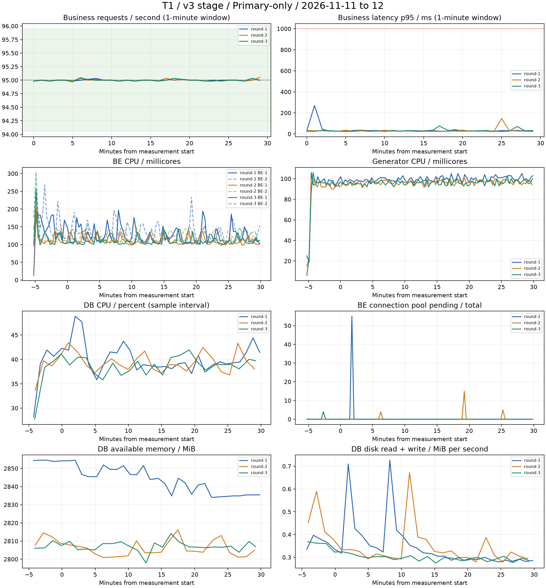

# T1 검증 결과 — v3 stage Primary 단독

**최종 판정: 명세에 고정한 재고 목록·수정 시나리오에서 T1 통과.** 5분 예열 후 30분씩 3회 측정했으며 업무 요청 총 512,998건, HTTP·인증·정합성 오류 및 미전송 0건, API별 p95 17~33ms였다. 독립 재집계와 원본 해시 검증도 세 회차 모두 통과했다.

이 보고서는 [이슈 #329](https://github.com/100-hours-a-week/KTB4-5th-CLOUD/issues/329)의 실행 결과다. 구체적인 시나리오와 판정 기준은 [시험 명세](../../README.md)에 고정했다.

| 회차 | 업무 전송 | 시작 요청의 완료 | 실제 RPS | 미전송 iteration | HTTP 오류 | 정합성 오류 | 최대 API p95 | 판정 |
|---|---:|---:|---:|---:|---:|---:|---:|---|
| round-1 | 170,999 | 170,999 | 94.999 | 0 | 0 | 0 | 33ms | 기준 충족 |
| round-2 | 171,000 | 171,000 | 95.000 | 0 | 0 | 0 | 31ms | 기준 충족 |
| round-3 | 170,999 | 170,999 | 94.999 | 0 | 0 | 0 | 31ms | 기준 충족 |

## API별 지연

| 회차 | API | 표본 수 | p95 | p99 | 최대 |
|---|---|---:|---:|---:|---:|
| round-1 | list-next | 69,954 | 32ms | 165ms | 1218ms |
| round-1 | list | 69,954 | 31ms | 198ms | 1522ms |
| round-1 | write-pick | 7,773 | 33ms | 206ms | 1204ms |
| round-1 | detail | 7,773 | 19ms | 63ms | 1263ms |
| round-1 | update | 7,773 | 25ms | 77ms | 829ms |
| round-1 | verify | 7,772 | 19ms | 59ms | 665ms |
| round-2 | list-next | 69,955 | 29ms | 170ms | 1202ms |
| round-2 | list | 69,954 | 28ms | 206ms | 1347ms |
| round-2 | write-pick | 7,773 | 31ms | 209ms | 799ms |
| round-2 | detail | 7,773 | 17ms | 64ms | 552ms |
| round-2 | update | 7,773 | 23ms | 70ms | 687ms |
| round-2 | verify | 7,772 | 17ms | 45ms | 430ms |
| round-3 | list | 69,954 | 29ms | 180ms | 1572ms |
| round-3 | list-next | 69,954 | 29ms | 147ms | 895ms |
| round-3 | write-pick | 7,773 | 31ms | 193ms | 764ms |
| round-3 | detail | 7,773 | 18ms | 60ms | 513ms |
| round-3 | update | 7,773 | 23ms | 66ms | 597ms |
| round-3 | verify | 7,772 | 17ms | 46ms | 650ms |

## 회차 간 분포

| API | p95 중앙값 | p95 범위 | p99 중앙값 | p99 범위 |
|---|---:|---:|---:|---:|
| list-next | 29ms | 29~32ms | 165ms | 147~170ms |
| list | 29ms | 28~31ms | 198ms | 180~206ms |
| write-pick | 31ms | 31~33ms | 206ms | 193~209ms |
| detail | 18ms | 17~19ms | 63ms | 60~64ms |
| update | 23ms | 23~25ms | 70ms | 66~77ms |
| verify | 17ms | 17~19ms | 46ms | 45~59ms |

## 자원 관측

| 회차 | BE 최대 CPU | 발생기 최대 CPU | DB 최대 CPU | DB 최소 가용 메모리 | 풀 대기 최대 | DB 크레딧 전→후 |
|---|---:|---:|---:|---:|---:|---:|
| round-1 | 268m | 106m | 48.8% | 2834MiB | 55 | 531.0 → 519.7 |
| round-2 | 234m | 101m | 43.4% | 2801MiB | 15 | 576.0 → 564.3 |
| round-3 | 303m | 106m | 41.9% | 2798MiB | 4 | 564.3 → 553.6 |

크레딧은 회차 전후 조회에서 가장 최근 CloudWatch 표본이며 측정 경계와 정확히 같은 시각은 아니다. 자원 최댓값은 관측 표본 기준으로 예열도 포함한다.

BE·발생기는 약 15~30초 간격, DB는 약 1분 간격으로 원시 상태를 수집했다. DB CPU는 연속 /proc/stat 표본의 차이로 계산한다. HTTP 지연은 클라이언트 요청 시작부터 응답 완료까지이며 기존 stage 외부 경로를 포함한다.

1회차 2026-11-11 18:00:02 KST 표본에서는 두 BE의 풀 active가 각각 10개, pending이 31개와 24개로 일시 증가했다. 전체 p95 기준은 충족했지만 개별 요청의 최대 지연은 1초를 넘었다. 관측 간격 사이의 정확한 대기 지속 시간과 원인은 이 자료만으로 확정할 수 없다. 따라서 연결 풀 병목이 전혀 없었다고 해석하지 않는다.

## 결과의 범위

- v3 stage, BE 2개, EC2 MySQL Primary 한 대, 전용 냉장고 50개×재료 1,000개에 대한 결과다. 기존 stage 데이터를 포함한 전체 재료는 65,018개였다.
- 읽기:쓰기 **세션** 9:1, 실제 HTTP GET:PATCH 21:1이다. 목록·수정 경로만 검증했고 등록·소비·이미지 분석·모든 사용자 트래픽을 대표하지 않는다.
- DB CPU 크레딧은 회차 전후 파일에 보존한다. 회차를 재실행해도 CPU 크레딧과 캐시가 물리적으로 완전히 초기화되지는 않는다.
- BE는 Kafka와 노드를 공유하고 기존 SQL 로그 설정을 유지했다. 과거 v2 성능이나 Replica·HA의 일반적 불필요로 확대 해석하지 않는다.
- 원시 요청 자료의 URL 태그와 실패 회차 요약의 인증 setup_data를 제거했다. 요청별 시각·상태·API·지연·phase·측정 경계는 보존했다. 인증 정보는 결과 폴더에 포함하지 않는다. manifest의 artifact_sha256은 비식별화 전 원격 원본의 해시이며, 공개 결과 파일의 해시는 sha256.json에 기록한다.

## 사전 검증에서 보존한 실패

첫 데이터 생성은 50개 동시 실행 중 500 오류가 발생했다. 순차 생성으로 전환해 50,000개를 확인했다. 초기 95 RPS 발생기는 로그인 지연 및 VU 부족으로 미전송이 발생해 무효 처리했다. 사전 인증과 읽기 100/쓰기 50 VU를 준비한 예비 시험은 94.992 RPS, 미전송·오류·정합성 불일치 0으로 통과했다. 인증 갱신 사전 검증도 올바른 CSRF 갱신 후 10/10 성공했다. 이 실패들을 본시험 성공으로 집계하지 않는다.

첫 35분 본시험도 k6 자체 오류·미전송은 0이었지만 원시 파일의 20초 복사 제한으로 gzip이 잘렸고 관리 조회의 일시 오류 1회가 기록됐다. 이 회차는 세 회차에 포함하지 않는다. 원본 보관용 PVC와 청크별 전송·해시 검증을 추가하고 32MiB 파일로 검증한 뒤 세 회차를 다시 실행했다.

유효 1회차 완료 후 2026-11-11 18:40 KST경 로컬 관리 프로세스가 종료됐다. 당시 진행 중이던 2회차는 heartbeat 중단으로 18:42경 강제 종료되어 제외했다. 로컬 정리 감시도 함께 종료돼 stage DB·노드가 밤새 기동 상태로 남았다. 2026-11-12 관리 연결·발생기·DB 관측을 복구한 뒤 남은 두 회차를 같은 고정 소스로 재실행했다. 회차 사이의 긴 간격과 DB 크레딧·캐시 상태 차이를 결과 해석에 포함해야 한다.

## 종료 상태

최종 검수와 자원 정리를 완료했다. 시험용 계정·재료 잔여 건수는 0이며 stage Pod·노드는 0개, DB는 stopped 상태다. BE affinity·replicas, 노드풀 설정, Redis·Kafka 중지 상태를 복원했다. 운영 Deployment spec은 시험 전과 동일하다. 시험용 EC2 4개는 terminated, 결과 보관 PVC·StorageClass·EBS 및 복구 스냅샷은 삭제했다. 기존 Kafka·Redis PVC 4개는 보존했다. 시험 관리 터널도 종료했다.

- [독립 검수](audit.json): 원시 요청 재집계, API별 p95, 파일 해시, 관측 완전성, Pod 불변 확인. 서버·클라이언트 요청 대조 차이는 회차별 약 0.012%, 0.024%, 0.012%로 스크레이프 시차 범위였다.
- [환경 복원 검수](cleanup-verification.json), [시험 자원 삭제 확인](final-resource-cleanup.json), [자동 정리 기록](cleanup-status.json).
- [결과 파일 검사](artifact-safety.json): 테스트 비밀번호, AWS 액세스 키 형태, JWT·개인키 형태를 검사했다. 무효 첫 회차의 잘린 gzip은 실패 증거로 별도 보존했으며 정상 원본으로 집계하지 않았다.
- [게시 파일 SHA256](../UPLOAD_MANIFEST.json): 최종 결과 파일의 무결성 목록. 실행기의 `measurements_complete_pending_review`는 측정 종료 시점 상태이며 최종 판정은 `final-review.json`을 따른다.

결론은 이 데이터 규모와 목록·수정 경로에서 Primary 한 대가 목표 부하를 처리했다는 것이다. 연결 풀 대기 스파이크가 관측됐으므로 전체 서비스 용량 한계, 과거 v2 성능, Replica 또는 HA 불필요까지 입증한 결과는 아니다.

## GitHub 게시본 안내

이 폴더는 전체 검증 결과 중 검토에 필요한 요약을 선별한 게시본이다. 회차별 요청 원본 gzip, 관측 JSONL, DB 원본, 실패 회차 원본과 전체 파일 해시는 로컬 `results/2026-11-11/`에 보존한다. `audit.json`과 `artifact-safety.json`은 그 전체 자료를 대상으로 한 검수 기록이다. 요청별 원본 재분석에는 별도 보관한 자료가 필요하다. 회차별 `analysis.json`에서는 로컬 절대 경로 필드만 제거했다.
